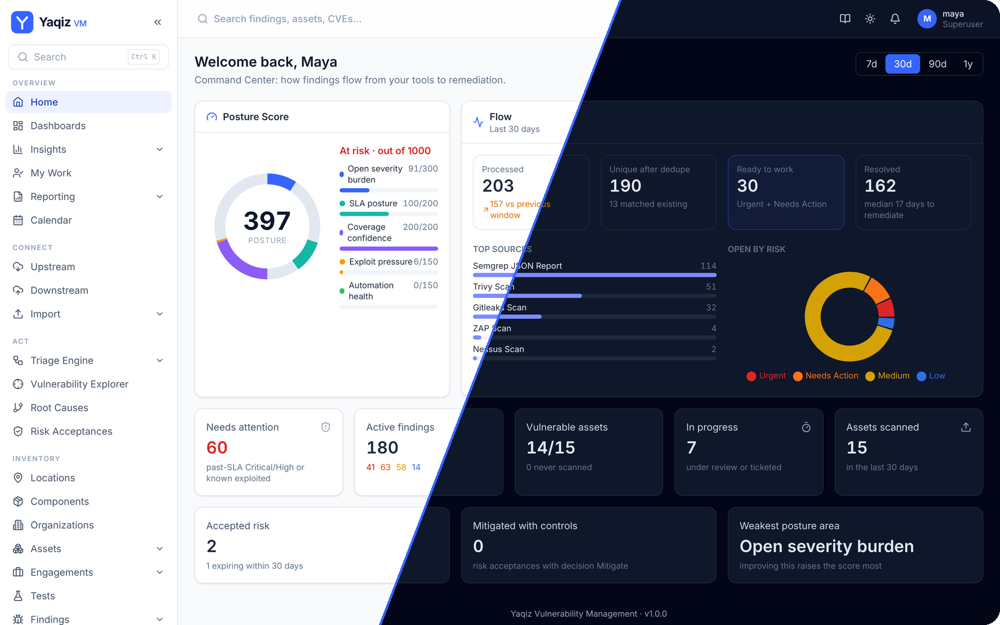
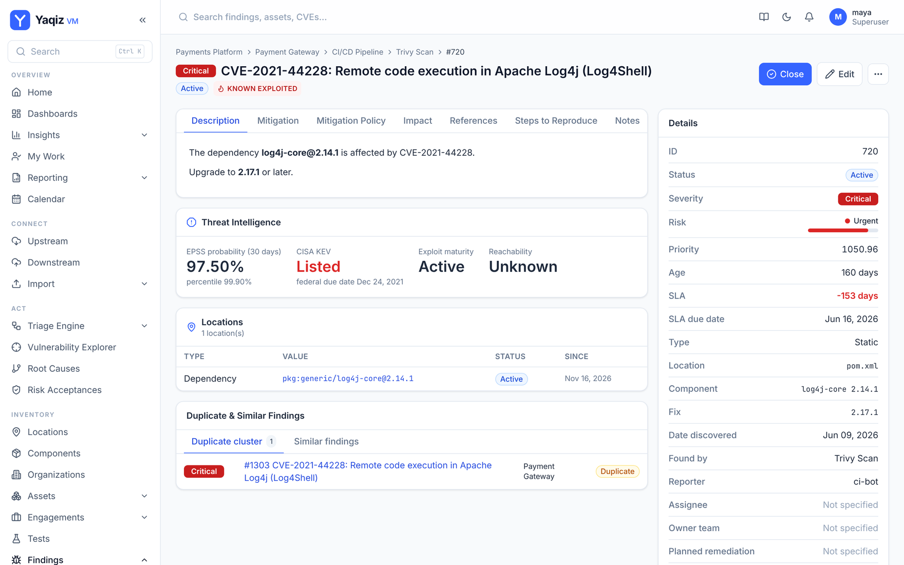
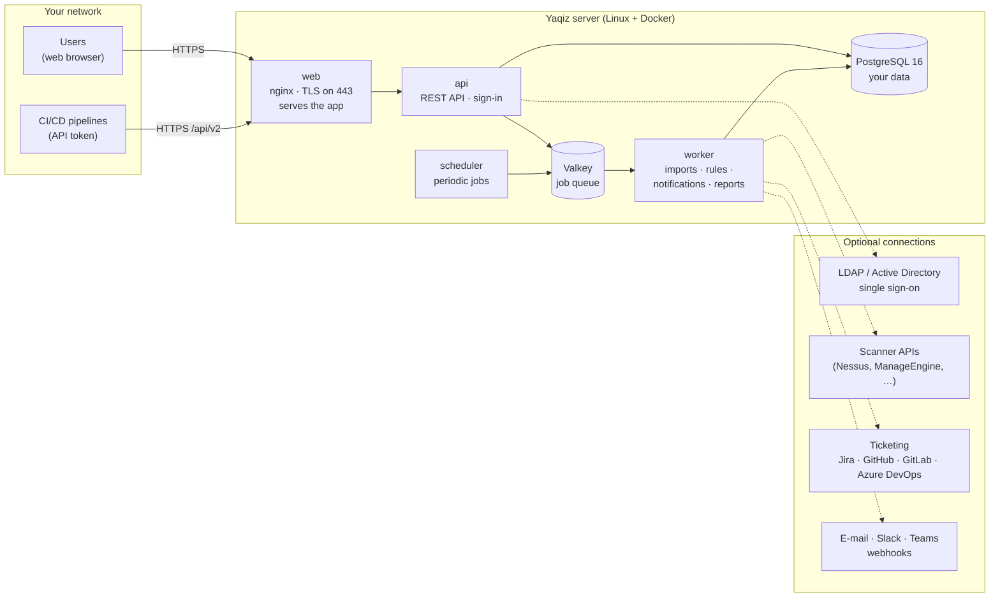

<h1 align="center">Yaqiz — Vulnerability Management Platform</h1>

<p align="center">
  <strong>يقظ · "vigilant"</strong><br/>
  Bring every scanner into one place, remove the duplicate noise, prioritize by real-world risk and drive
  remediation to closure — entirely inside your own network.
</p>

<p align="center">
  <a href="https://github.com/0peng/yaqiz-releases/releases/latest"></a>
  
  
  
</p>

<p align="center">
  
</p>

<p align="center">
  <a href="https://github.com/0peng/yaqiz-releases/releases/latest"><strong>⬇ Download the latest release</strong></a> ·
  <a href="#what-yaqiz-does"><strong>What it does</strong></a> ·
  <a href="#architecture"><strong>Architecture</strong></a> ·
  <a href="#install-step-by-step"><strong>Install</strong></a> ·
  <a href="#upgrade"><strong>Upgrade</strong></a>
</p>

---

## What Yaqiz does

Security teams run many scanners, and each one reports the same problems in its own format. Yaqiz collects all of
those findings, recognizes the duplicates, ranks what is left by how likely it is to be exploited and how much the
affected system matters, and follows every issue until it is fixed — with SLAs, tickets, automation and reports for
engineers and executives alike.

Everything runs on **your** server. No data leaves your network, and the server does not need internet access at
all: one download contains the whole platform.

| | |
|---|---|
| 🔌 **Collect** | 46 scanner and tool formats (Tenable Nessus, Qualys, OpenVAS, Trivy, Grype, Snyk, Semgrep, SonarQube, ZAP, Burp, Nuclei, Checkov, Prowler, AWS Security Hub, CycloneDX, SARIF, …), a no-code parser for any CSV / JSON / XML, scheduled connectors (Tenable Nessus, ManageEngine Vulnerability Manager Plus, GitHub, SonarQube, Dependency-Track, Snyk, Semgrep) and a REST API for CI/CD pipelines |
| 🧹 **Deduplicate** | The same issue reported twice, by one tool or several, becomes one finding; re-imports close what was fixed and reopen what came back |
| 🎯 **Prioritize** | A 0–100 risk score and risk bands from severity, **EPSS** exploit probability, the **CISA Known Exploited Vulnerabilities** list, internet exposure and business criticality — so the urgent work rises to the top |
| ⏱ **Track** | SLAs by severity or risk, due dates, breach alerts, risk acceptances with expiry and approval, full history of every change |
| ⚙️ **Automate** | A visual rule engine: when a finding or import matches your conditions, change it, notify Slack / Teams / e-mail, or open a ticket in Jira, GitHub, GitLab or Azure DevOps |
| 📊 **Report** | Command Center, drag-and-drop dashboards, executive and program insights, a CVE explorer and scheduled reports (HTML, Excel, CSV, JSON) |
| 🗂 **Organize** | Organizations and assets with owners, criticality and exposure; import and reorganize your asset inventory from Excel or CSV with review and undo |
| 🔐 **Control access** | Roles per organization and asset for users and groups, two-step verification, LDAP / Active Directory and single sign-on (Entra ID, Okta, Keycloak, ADFS, Google), audit log |

<p align="center">
  
  <br/><sub><b>One finding, everything you need to decide:</b> exploit probability, CISA KEV status, risk and SLA, the affected
  component, and the duplicates from other scanners merged into it. Screenshots show the built-in demo data.</sub>
</p>

---

## Architecture

Yaqiz runs as six containers on a single Linux server with Docker. Only the web container is reachable from your
network; the database and the job queue stay on the server's internal Docker network. Every outbound connection is
optional and goes only where you configure it.



| Component | Role |
|---|---|
| **web** | Serves the application, terminates TLS (HTTPS on 443, redirect from 80) and adds browser security headers |
| **api** | REST API, sign-in (local accounts with MFA, LDAP, single sign-on) and permissions; applies database updates automatically on upgrade |
| **worker** | Background work: imports, connector syncs, automation rules, notifications, tickets and reports |
| **scheduler** | Starts periodic jobs: scheduled connectors and rules, SLA checks, reports, threat-intelligence updates |
| **PostgreSQL 16** | All application data, in a Docker volume on the server |
| **Valkey** | Job queue and shared cache |

**Security by design:** TLS with HSTS and a strict Content Security Policy · two-step verification, account lockout
and single sign-on · every query filtered by the user's roles · secrets never shown again after saving and masked in
the audit log · outbound requests checked against internal and cloud-metadata addresses · containers run unprivileged,
and the database and queue are never published · random secrets generated at install time in a root-only file.

---

## Install, step by step

### What you need

| Item | Requirement |
|---|---|
| Server | Linux **x86_64**: Ubuntu 22.04 / 24.04, RHEL / Rocky 9 or Debian 12 (a VM is fine) |
| Size | 4 vCPU, 8 GB RAM, 50 GB disk (more disk for several hundred thousand findings) |
| Software | **Docker Engine 24+** with the **Compose** plugin |
| Network | A DNS name for the server (e.g. `vm.example.com`); inbound TCP **443** and **80**. Internet access is **not** required |
| Certificate | Your TLS certificate (full chain) and private key, or a self-signed one for a trial |
| Time | Server clock synchronized (NTP) |
| License | The license file (`.lic`) from your vendor |
| Access | `root` or `sudo` on the server |

Check Docker on the server:

```bash
docker version && docker compose version
```

### 1. Download and verify

On any computer with internet access, download both files of the [latest release](https://github.com/0peng/yaqiz-releases/releases/latest):
`yaqiz-<version>-onprem.tar.gz` and `yaqiz-<version>-onprem.tar.gz.sha256`. Verify the download (on macOS use
`shasum -a 256 -c`):

```bash
sha256sum -c yaqiz-1.1.0-onprem.tar.gz.sha256
```

It must print `OK`. Copy the package and your license file to the server (for air-gapped servers, use your approved
transfer method).

### 2. Extract into the installation folder

Keep this folder: upgrades are done in the same place.

```bash
sudo mkdir -p /opt/yaqiz && sudo tar xzf yaqiz-1.1.0-onprem.tar.gz --strip-components=1 -C /opt/yaqiz
```

### 3. Add your TLS certificate

```bash
sudo cp fullchain.pem /opt/yaqiz/deploy/certs/tls.crt && sudo cp private.key /opt/yaqiz/deploy/certs/tls.key && sudo chmod 600 /opt/yaqiz/deploy/certs/tls.key
```

For a trial without a certificate, skip this step and use `--tls self-signed` below. If Yaqiz must trust an internal
CA (LDAPS, internal Jira or GitLab, a TLS-inspecting proxy), copy those CA certificates to
`/opt/yaqiz/deploy/ca/*.crt`.

### 4. Install with your license

```bash
cd /opt/yaqiz && sudo ./deploy/install.sh --host vm.example.com --tls provided --offline yaqiz-1.1.0-images.tar.gz --license your-company.lic
```

The installer checks the license file first, generates random secrets, loads the container images, starts the
platform, waits until it is healthy, installs the license and prints the address and the administrator password.
A first installation takes a few minutes.

| Option | Meaning |
|---|---|
| `--host NAME` | The DNS name users open in the browser |
| `--tls provided` / `self-signed` | Use your certificate from step 3, or generate a self-signed one |
| `--https-port N` / `--http-port N` | Different ports (default 443 / 80) |
| `--offline FILE` | Load the container images from the package (no internet needed) |
| `--license FILE` | Install your license as part of the installation |

### 5. Sign in and secure the platform

1. Open `https://vm.example.com` and sign in as **admin** with the printed password (also `YQ_ADMIN_PASSWORD` in
   `/opt/yaqiz/.env`).
2. **Profile → Change password**, then **Profile → Two-step verification**.
3. **Settings → License** shows who the installation is licensed to, the expiry date and the usage.
4. Connect **LDAP / Active Directory** or **single sign-on**, configure e-mail, and create users, groups and roles.
5. Schedule nightly backups (see [Operations](#operations)).
6. Bring in your data: upload scanner reports, connect your scanners under **Upstream**, or send results from CI/CD
   with an API token.

The complete guide — sizing, TLS, LDAP and single sign-on settings, private CAs, external PostgreSQL, backups and
troubleshooting — is **`docs/on-prem-installation.md`** inside the package.

---

## Upgrade

Download and verify the new version as in step 1, then extract it **over your installation folder** and upgrade.
Your settings, certificates, data and backups are kept, and the upgrade takes a backup first.

```bash
sudo tar xzf yaqiz-1.2.0-onprem.tar.gz --strip-components=1 -C /opt/yaqiz
```

```bash
cd /opt/yaqiz && sudo ./deploy/upgrade.sh --offline yaqiz-1.2.0-images.tar.gz
```

Each release page lists the exact commands for that version. Afterwards you can delete the previous
`yaqiz-<old version>-images.tar.gz` to free disk space.

---

## Operations

Run these in `/opt/yaqiz`:

| Task | Command |
|---|---|
| Status, health and recent errors | `sudo ./deploy/status.sh` |
| Backup (database, files, settings, certificates) | `sudo ./deploy/backup.sh --keep 14` — schedule it nightly and copy `backups/` off the server |
| Restore a backup | `sudo ./deploy/restore.sh backups/<timestamp>` |
| License status / install a renewal | `sudo ./deploy/license.sh` / `sudo ./deploy/license.sh renewal.lic` (or **Settings → License**) |
| Support bundle for your vendor (passwords and secrets removed) | `sudo ./deploy/support-bundle.sh` |
| Logs | `sudo docker compose logs -f api worker` |

**Licensing.** Licenses are checked on your server, offline. Administrators are reminded 30 days before expiry; after
expiry and a grace period Yaqiz becomes read-only — nothing is ever deleted, everything stays visible and exportable,
and installing the renewed license restores full access immediately.

---

## About this repository

This repository only publishes Yaqiz release packages. Download them from
[Releases](https://github.com/0peng/yaqiz-releases/releases). The **Source code (zip / tar.gz)** files that GitHub adds
to every release contain only this README and its images, not the platform.

For licenses, renewals and support, contact your vendor.
