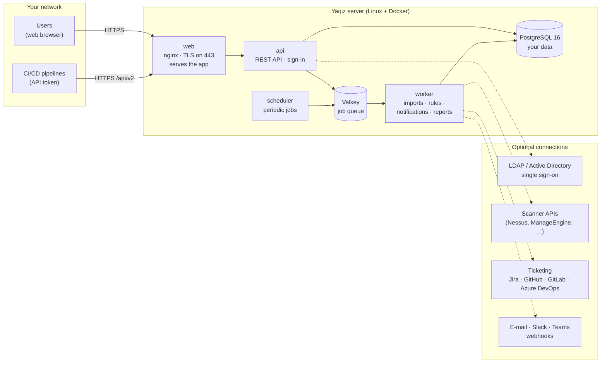

<h1 align="center">Yaqiz — Vulnerability Management Platform</h1>

<p align="center">
  <strong>يقظ · "vigilant"</strong><br/>
  Bring every scanner into one place, remove the duplicate noise, prioritize by real-world risk and drive
  remediation to closure — entirely inside your own network.
</p>

<p align="center">
  <a href="https://github.com/0peng/yaqiz-releases/releases/latest"></a>
  
  
  
</p>

<p align="center">
  
</p>

<p align="center">
  <a href="https://github.com/0peng/yaqiz-releases/releases/latest"><strong>⬇ Download the latest release</strong></a> ·
  <a href="#whats-new-in-115"><strong>What's new</strong></a> ·
  <a href="#what-yaqiz-does"><strong>What it does</strong></a> ·
  <a href="#architecture"><strong>Architecture</strong></a> ·
  <a href="#install-step-by-step"><strong>Install</strong></a> ·
  <a href="#upgrades-renewals-and-support"><strong>Upgrade</strong></a>
</p>

---

## What's new in 1.1.5

A security release that also sets up, checks and watches everything that depends on your environment, so nothing
fails silently.

- **Security fixes** from an independent assessment of 1.1.4: server-side requests can no longer be steered to
  internal addresses by DNS tricks; single sign-on accounts are bound to the identity provider's subject identifier,
  so another identity with the same user name cannot reach them; and failed sign-ins lock only the address they come
  from, so nobody can lock users or administrators out.
- **Stored credentials are encrypted** (issue-tracker tokens, webhook secrets, connector credentials, Slack/Teams
  URLs, two-step verification secrets) with a dedicated data key that is kept out of backups, so a copy of the
  database alone no longer reveals them. Every build now also runs static security analysis.
- **Settings → System Status** shows whether the installation is configured and healthy (background jobs, database,
  disk, backups, email, certificate, license, vulnerability feeds, sign-in) and says how to fix anything that needs
  attention. Administrators see a banner while something does.
- **Email set up during installation**, with a test email that must arrive: `--smtp-host … --smtp-test you@company.com`.
  Send a test email from System Status at any time. A rule's email step is no longer shown as "sent" when no mail
  server is configured.
- **Nightly backups are scheduled by the installer**, and System Status warns when they stop.
- **Your own PostgreSQL server** is supported end to end (`--db-host`), including backups and restores.
- **Import findings from Excel and Word**: the scan type *Generic Findings Import* reads `.xlsx` and `.docx` files
  (for example manual penetration test reports) as well as CSV and JSON. Excel, Word and CSV templates can be
  downloaded from the import page.

This builds on **1.1.4** (OWASP Top 10 red-team hardening) and **1.1.3**, which removed all demo data and demo
accounts from release packages and hardened the containers, HTTPS, integrations and input handling.

> [!IMPORTANT]
> **Upgrading from an earlier version?**
>
> - Upgrading from **1.1.2 or earlier**: installations made with the former `--demo` option had demo accounts
>   (alice, bob, carol, ci-bot) that shared one published password; the upgrade switches their passwords off, and
>   the `--demo` option and `YQ_SEED_DEMO` no longer exist. Very old HTTPS clients without modern ciphers can no
>   longer connect (every current browser is supported).
> - **Keep a copy of `YQ_DATA_KEYS`** from `/opt/yaqiz/.env` in your password vault after upgrading to 1.1.5. The
>   upgrade adds this key, which encrypts stored credentials. Backups do not contain it, and restoring on another
>   server needs it.
> - **Single sign-on with an email domain allow-list**: the identity provider must now send `email_verified`.
>   Microsoft Entra ID does not: add it as an optional claim, or set `YQ_OIDC_REQUIRE_EMAIL_VERIFIED=false` (see the
>   1.1.5 release notes).
> - After upgrading to 1.1.5, open **Settings → System Status**. If it reports no backup schedule, run
>   `sudo ./deploy/schedule-backups.sh` (an upgrade does not change how backups are scheduled).
> - An external database configured with a `docker-compose.override.yml`: move its settings to `.env` or re-run
>   `install.sh --db-host …` so that backups dump that server (see the 1.1.5 release notes).
> - Upgrading from **1.1.3 or earlier**: a scan import larger than 8 MB returns a background job that finishes
>   shortly after, rather than a synchronous response.
> - **The full list** is in the [1.1.5 release notes](https://github.com/0peng/yaqiz-releases/releases/tag/v1.1.5).
>   Coming from an older version, also read the [1.1.4](https://github.com/0peng/yaqiz-releases/releases/tag/v1.1.4)
>   and [1.1.3](https://github.com/0peng/yaqiz-releases/releases/tag/v1.1.3) release notes.
>
> To upgrade, follow [Upgrades](#upgrades-renewals-and-support). Your data and license are kept.

---

## What Yaqiz does

Security teams run many scanners, and each one reports the same problems in its own format. Yaqiz collects all of
those findings, recognizes the duplicates, ranks what is left by how likely it is to be exploited and how much the
affected system matters, and follows every issue until it is fixed — with SLAs, tickets, automation and reports for
engineers and executives alike.

Everything runs on **your** server. No data leaves your network, and the server does not need internet access at
all: one download contains the whole platform.

| | |
|---|---|
| 🔌 **Collect** | 46 scanner and tool formats (Tenable Nessus, Qualys, OpenVAS, Trivy, Grype, Snyk, Semgrep, SonarQube, ZAP, Burp, Nuclei, Checkov, Prowler, AWS Security Hub, CycloneDX, SARIF, …), a no-code parser for any CSV / JSON / XML, scheduled connectors (Tenable Nessus, ManageEngine Vulnerability Manager Plus, GitHub, SonarQube, Dependency-Track, Snyk, Semgrep) and a REST API for CI/CD pipelines |
| 🧹 **Deduplicate** | The same issue reported twice, by one tool or several, becomes one finding; re-imports close what was fixed and reopen what came back |
| 🎯 **Prioritize** | A 0–100 risk score and risk bands from severity, **EPSS** exploit probability, the **CISA Known Exploited Vulnerabilities** list, internet exposure and business criticality — so the urgent work rises to the top |
| ⏱ **Track** | SLAs by severity or risk, due dates, breach alerts, risk acceptances with expiry and approval, full history of every change |
| ⚙️ **Automate** | A visual rule engine: when a finding or import matches your conditions, change it, notify Slack / Teams / e-mail, or open a ticket in Jira, GitHub, GitLab or Azure DevOps |
| 📊 **Report** | Command Center, drag-and-drop dashboards, executive and program insights, a CVE explorer and scheduled reports (HTML, Excel, CSV, JSON) |
| 🗂 **Organize** | Organizations and assets with owners, criticality and exposure; import and reorganize your asset inventory from Excel or CSV with review and undo |
| 🔐 **Control access** | Roles per organization and asset for users and groups, two-step verification, LDAP / Active Directory and single sign-on (Entra ID, Okta, Keycloak, ADFS, Google), audit log |

<p align="center">
  
  <br/><sub><b>One finding, everything you need to decide:</b> exploit probability, CISA KEV status, risk and SLA, the affected
  component, and the duplicates from other scanners merged into it. Screenshots show sample data.</sub>
</p>

---

## Architecture

Yaqiz runs as six containers on a single Linux server with Docker. Only the web container is reachable from your
network; the database and the job queue stay on the server's internal Docker network. Every outbound connection is
optional and goes only where you configure it.



| Component | Role |
|---|---|
| **web** | Serves the application, terminates TLS (HTTPS on 443, redirect from 80) and adds browser security headers |
| **api** | REST API, sign-in (local accounts with MFA, LDAP, single sign-on) and permissions; applies database updates automatically on upgrade |
| **worker** | Background work: imports, connector syncs, automation rules, notifications, tickets and reports |
| **scheduler** | Starts periodic jobs: scheduled connectors and rules, SLA checks, reports, threat-intelligence updates |
| **PostgreSQL 16** | All application data, in a Docker volume on the server |
| **Valkey** | Job queue and shared cache |

**Security by design:** TLS with HSTS and a strict Content Security Policy · two-step verification, account lockout
and single sign-on · sign-in protected against cross-site request forgery · every query filtered by the user's roles · secrets never shown again after saving and masked in
the audit log · outbound requests checked against internal and cloud-metadata addresses · containers run unprivileged,
and the database and queue are never published · random secrets generated at install time in a root-only file.

---

## Install, step by step

Yaqiz is installed on **your own Linux server or VM, inside your network**. The whole installation takes about
15 minutes.

### What you receive from your vendor

| | |
|---|---|
| 🔗 **This page** | Where you download the installation package: the newest version is always under [Releases → Latest](https://github.com/0peng/yaqiz-releases/releases/latest) |
| 🔑 **Your license file** | `your-company.lic`, sent to you separately. It names your organization, the expiry date and your limits |

### What you need

| Item | Requirement |
|---|---|
| Server | Linux **x86_64**: Ubuntu 22.04 / 24.04, RHEL / Rocky 9 or Debian 12 (a VM is fine) |
| Size | 4 vCPU, 8 GB RAM, 50 GB disk (more disk for several hundred thousand findings) |
| Software | **Docker Engine 24+** with the **Compose** plugin |
| Network | A DNS name for the server (e.g. `vm.example.com`); inbound TCP **443** and **80**. Internet access is **not** required |
| Certificate | Your TLS certificate (full chain) and private key, or a self-signed one for a trial |
| Time | Server clock synchronized (NTP) |
| Access | `root` or `sudo` on the server |

To prepare the server with your IT team, use the pre-installation checklist in the package:
`docs/pre-installation-checklist.md`. It lists everything to have ready before the installation day.

### 1. Prepare the server

Install Docker with the Compose plugin. On Ubuntu or Debian with internet access:

```bash
curl -fsSL https://get.docker.com | sudo sh
```

On RHEL / Rocky follow the [Docker installation guide](https://docs.docker.com/engine/install/); on an air-gapped
server, install Docker from your internal package mirror. Then check it:

```bash
docker version && docker compose version
```

### 2. Download the release

Run all the following commands in the same terminal. Set the version you are installing (the newest one is shown on
the [Releases page](https://github.com/0peng/yaqiz-releases/releases/latest)):

```bash
VERSION=1.1.5
```

**Server with internet access** — download both files directly on the server:

```bash
curl -LO https://github.com/0peng/yaqiz-releases/releases/download/v$VERSION/yaqiz-$VERSION-onprem.tar.gz
```

```bash
curl -LO https://github.com/0peng/yaqiz-releases/releases/download/v$VERSION/yaqiz-$VERSION-onprem.tar.gz.sha256
```

**Air-gapped server** — download both files from the [Releases page](https://github.com/0peng/yaqiz-releases/releases/latest)
on a computer with internet access, then copy them to the server with your approved transfer method (USB drive, file
share, SCP).

Copy your license file to the server as well, for example to your home folder.

### 3. Verify and extract

```bash
sha256sum -c yaqiz-$VERSION-onprem.tar.gz.sha256
```

It must print `OK` (on macOS: `shasum -a 256 -c …`). Extract into the installation folder — keep this folder, upgrades
are done in the same place:

```bash
sudo mkdir -p /opt/yaqiz && sudo tar xzf yaqiz-$VERSION-onprem.tar.gz --strip-components=1 -C /opt/yaqiz
```

### 4. Add your TLS certificate

```bash
sudo cp fullchain.pem /opt/yaqiz/deploy/certs/tls.crt && sudo cp private.key /opt/yaqiz/deploy/certs/tls.key && sudo chmod 600 /opt/yaqiz/deploy/certs/tls.key
```

For a trial without a certificate, skip this step and use `--tls self-signed` below. If Yaqiz must trust an internal
CA (LDAPS, internal Jira or GitLab, a TLS-inspecting proxy), copy those CA certificates to
`/opt/yaqiz/deploy/ca/*.crt`.

### 5. Install with your license

```bash
cd /opt/yaqiz && sudo ./deploy/install.sh --host vm.example.com --tls provided --offline yaqiz-$VERSION-images.tar.gz --license ~/your-company.lic \
  --admin-email secops@example.com --smtp-host mail.example.com --smtp-user yaqiz --smtp-from yaqiz@example.com --smtp-test secops@example.com
```

The installer checks every option first, generates random secrets, loads the container images, starts the platform,
waits until it is healthy, installs the license, schedules the nightly backup, sends the test email and finally prints
the address, the administrator password and the **system status**: what is configured and what still needs attention.
It asks for the mail server's password (it is never typed on the command line). A first installation takes a few
minutes.

| Option | Meaning |
|---|---|
| `--host NAME` | The DNS name users open in the browser |
| `--tls provided` / `self-signed` | Use your certificate from step 4, or generate a self-signed one |
| `--https-port N` / `--http-port N` | Different ports (default 443 / 80) |
| `--offline FILE` | Load the container images from the package (no internet needed) |
| `--license FILE` | Install your license as part of the installation |
| `--admin-email ADDRESS` | Email address of the initial administrator |
| `--smtp-host NAME` with `--smtp-from`, `--smtp-user`, `--smtp-port`, `--smtp-security` | Your mail server, for notifications and the triage rules' emails |
| `--smtp-test ADDRESS` | Send a test email; the installation fails if your mail server refuses it |
| `--db-host NAME` with `--db-name`, `--db-user`, `--db-sslmode` | Your own PostgreSQL 13–16 server instead of the bundled database |
| `--time-zone NAME`, `--backup-time HH:MM` | Time zone (default: the server's) and the time of the nightly backup (02:30) |

### 6. Sign in and start using Yaqiz

1. Open `https://vm.example.com` and sign in as **admin** with the printed password (also `YQ_ADMIN_PASSWORD` in
   `/opt/yaqiz/.env`).
2. **Profile → Change password**, then **Profile → Two-step verification**.
3. **Settings → License** shows who the installation is licensed to, the expiry date and the usage.
4. **Settings → System Status**: fix anything it lists, and send a test email.
5. Connect **LDAP / Active Directory** or **single sign-on**, and create users, groups and roles.
6. Connect your scanners (Tenable Nessus, ManageEngine and others) under **Upstream**, upload scanner reports, or send
   results from CI/CD with an API token.
7. Copy the nightly backups in `/opt/yaqiz/backups` off the server.

The complete guide — sizing, TLS, LDAP and single sign-on settings, private CAs, external PostgreSQL, backups and
troubleshooting — is **`docs/on-prem-installation.md`** inside the package.

---

## Upgrades, renewals and support

**A new version.** Set the new version, download and verify it as in steps 2 and 3, then extract it **over your
installation folder** and upgrade. Your settings, certificates, data and backups are kept, and the upgrade takes a
backup first. Read the release notes on the release page first: they list the changes you may notice.

```bash
VERSION=1.1.5
```

```bash
sudo tar xzf yaqiz-$VERSION-onprem.tar.gz --strip-components=1 -C /opt/yaqiz
```

```bash
cd /opt/yaqiz && sudo ./deploy/upgrade.sh --offline yaqiz-$VERSION-images.tar.gz
```

Each release page also lists the exact commands for that version. Afterwards you can delete the previous
`yaqiz-<old version>-images.tar.gz` to free disk space.

**A renewed license or more users and assets.** Your vendor sends you a new license file. Install it under
**Settings → License**, or on the server — it takes effect immediately, without a restart:

```bash
cd /opt/yaqiz && sudo ./deploy/license.sh ~/renewal.lic
```

**Support.** Create a support bundle (versions, status and logs; passwords and secrets are removed) and send the file
it prints to your vendor:

```bash
cd /opt/yaqiz && sudo ./deploy/support-bundle.sh
```

---

## Operations

Run these in `/opt/yaqiz`:

| Task | Command |
|---|---|
| Status, configuration check and recent errors | `sudo ./deploy/status.sh` (the same as **Settings → System Status**) |
| Backup (database, files, settings, certificates) | Nightly by default; now: `sudo ./deploy/backup.sh --keep 14`. Copy `backups/` off the server |
| Change or stop the nightly backup | `sudo ./deploy/schedule-backups.sh --time 01:00 --keep 30` / `--remove` |
| Restore a backup | `sudo ./deploy/restore.sh backups/<timestamp>` (on another server, copy `YQ_DATA_KEYS` into its `.env` first) |
| License status / install a renewal | `sudo ./deploy/license.sh` / `sudo ./deploy/license.sh renewal.lic` (or **Settings → License**) |
| Support bundle for your vendor (passwords and secrets removed) | `sudo ./deploy/support-bundle.sh` |
| Logs | `sudo docker compose logs -f api worker` |

**Maintenance windows.** **Settings → System → Read-only mode** pauses all changes by users other than superusers.
Everyone can still sign in, view and export, and a banner explains why changes are paused.

**Licensing.** Licenses are checked on your server, offline. Administrators are reminded 30 days before expiry; after
expiry and a grace period Yaqiz becomes read-only — nothing is ever deleted, everything stays visible and exportable,
and installing the renewed license restores full access immediately.

---

## About this repository

This repository only publishes Yaqiz release packages. Download them from
[Releases](https://github.com/0peng/yaqiz-releases/releases). The **Source code (zip / tar.gz)** files that GitHub adds
to every release contain only this README and its images, not the platform.

For licenses, renewals and support, contact your vendor.
