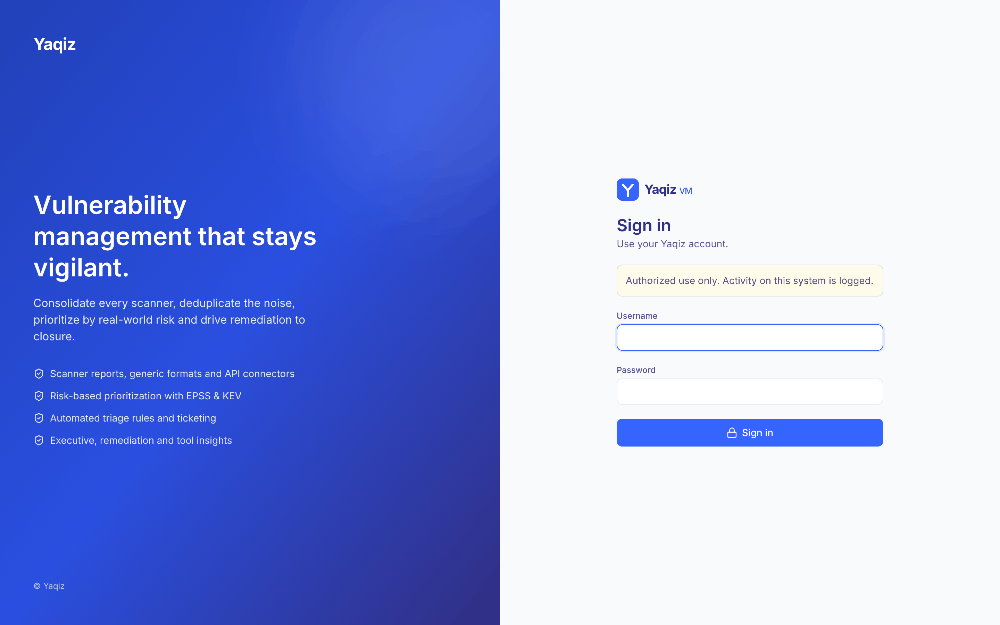
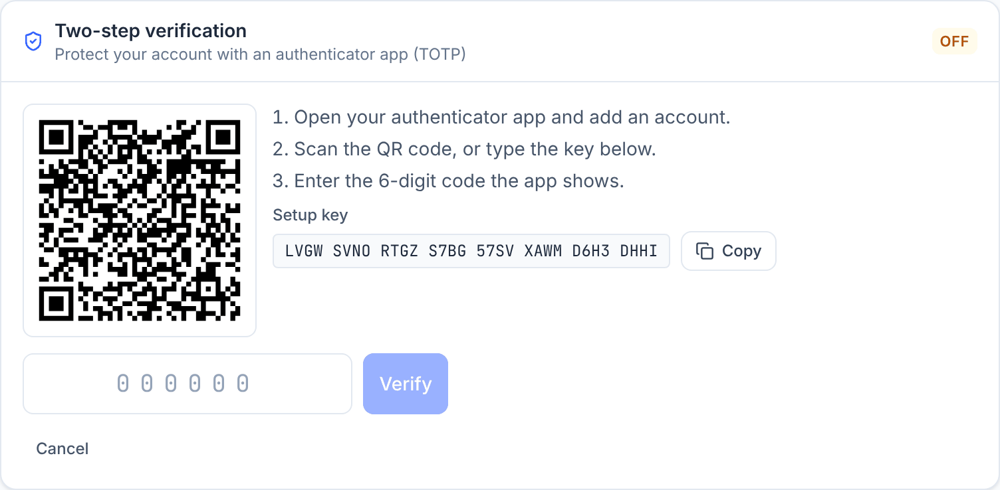
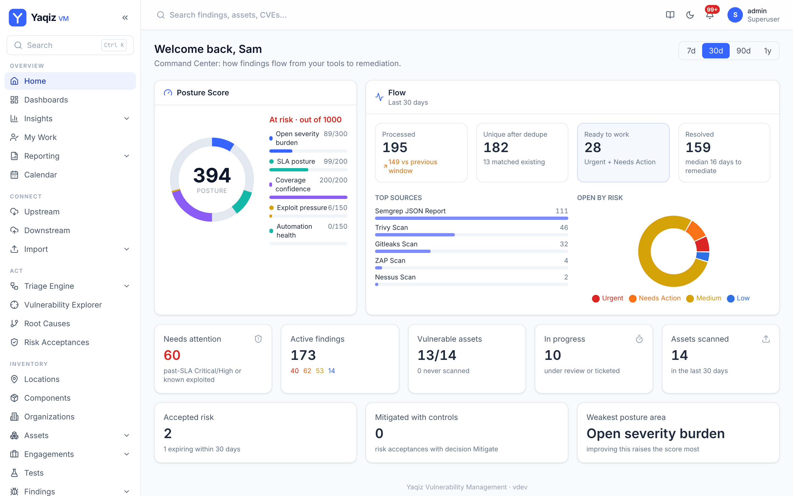
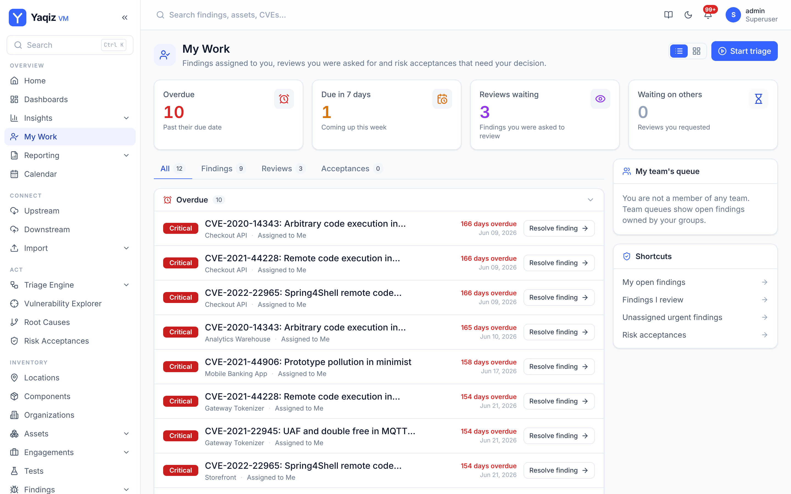

# 1. First steps

This chapter shows you how to sign in to Yaqiz, protect your account with two-step verification and find your way
around the interface. It ends with the two pages you will open most often, Home and My Work, and explains why two
people can see different menus and different data.

In this chapter:

* [Sign in](#sign-in)
* [Change your password](#change-your-password)
* [Two-step verification](#two-step-verification)
* [Your profile](#your-profile)
* [The layout](#the-layout)
* [Home: the Command Center](#home-the-command-center)
* [My Work](#my-work)
* [What you can see: permissions and feature flags](#what-you-can-see-permissions-and-feature-flags)

## Sign in

Yaqiz runs on a server inside your network. Your administrator gives you its address, for example
`https://vm.example.com`. The sign-in page tells you which kind of account to use:

* **Use your Yaqiz account.** You have a local account: use the username and password your administrator gave you.
* **Use your directory (Active Directory / LDAP) account.** Use your usual directory username and password.
* A **Sign in with …** button, followed by the name of your identity provider, means single sign-on is set up. Click
  it and sign in at your identity provider. Under the button the form is marked **or** when password sign-in is also
  allowed, or **administrators** when the password form is kept for administrators only.

1. Open the Yaqiz address in your browser. If you open a link to a page while signed out, Yaqiz takes you to the
   sign-in page first and back to that page afterwards.
2. Click **Sign in with …**, or enter your **Username** and **Password** and click **Sign in**.
3. If two-step verification is on for your account, enter the code from your authenticator app (see
   [Two-step verification](#two-step-verification)).

An amber box above the form is a message from your administrator, such as an acceptable-use notice. The first time
you sign in with a directory or single sign-on account, Yaqiz creates your account automatically. Until someone gives
you a role on an organization or asset, most pages are empty (see
[What you can see](#what-you-can-see-permissions-and-feature-flags)).

If sign-in fails, the message tells you why:

* **Invalid username or password.** Check the spelling and Caps Lock. Directory users use their directory password.
* **Too many failed sign-in attempts …** or **This account is temporarily locked …** Wait a few minutes, sign in from
  a browser you used before, or ask your administrator to unlock the account.
* **Password sign-in is disabled. Use your organization's single sign-on.** Use the **Sign in with …** button.
* **Single sign-on did not complete …** Your identity provider account may not be allowed to use Yaqiz; contact your
  administrator.
* **Service users cannot log in interactively.** Service accounts are for scripts and CI/CD only.

To sign out, click your initials in the top-right corner and choose **Sign out**. Your session also ends on its own
after a time your administrator sets; you then sign in again.

## Change your password

Yaqiz does not force a password change at the first sign-in. If your administrator gave you an initial password,
change it right away. This applies to local accounts only: directory and single sign-on users change their password
in the directory or identity provider. There is no self-service "forgot password" link; ask your administrator to set
a new password if you lose yours.

1. Click your initials in the top-right corner and choose **Profile**.
2. In the **Change password** card, fill in **Current password**, **New password** and **Confirm new password**.
3. Click **Change password**. You stay signed in.

The new password must have at least 9 characters (your administrator may require more), must differ from the
current one, and is refused when it is too common, entirely numeric or too similar to your user name or email.

## Two-step verification

Two-step verification adds a 6-digit code from an authenticator app on your phone (any app that supports TOTP codes)
to every sign-in. It is available to local and directory accounts; with single sign-on, your identity provider
handles it. Your administrator can make it mandatory for everyone.

**Turn it on yourself**

1. Open **Profile** and find the **Two-step verification** card (its badge shows **Off**).
2. Click **Set up**. A QR code and a **Setup key** appear.
3. In your authenticator app, add an account and scan the QR code (or type the setup key).
4. Enter the 6-digit code the app shows and click **Verify**.
5. Yaqiz shows 10 recovery codes. Click **Copy codes** or **Download** (`yaqiz-recovery-codes.txt`) and store them
   somewhere safe, then click **Done**. The codes are not shown again.

**When your administrator requires it**, the first sign-in after your password shows **Set up two-step
verification** with the same QR code. Enter the code, click **Verify and continue**, save the recovery codes and click
**I saved my codes, continue**.

**Signing in with a code.** After your password, enter the code and click **Verify**. Lost your phone? Click **Use a
recovery code** and type one of your saved codes (format `1a2b3c-4d5e6f`); each code works once. After five wrong
codes, or if you wait more than five minutes, you start again with your password.

**Managing it later.** The card shows how many recovery codes are left. Click **New recovery codes** to replace them,
or **Turn off** (not offered when your administrator requires two-step verification); both ask for a current code
from your app. If you lost both your phone and your recovery codes, ask your administrator to reset your two-step
verification.

## Your profile

Open **Profile** from the menu under your initials. Besides the password and two-step verification cards it holds:

* **Personal information**: **First name**, **Last name**, **Email** (used for email notifications), **Title**,
  **Phone number** and **Time zone**. Click **Save** after a change.
* **API token**: a personal token for scripts and CI/CD pipelines, with an example `curl` command for importing a scan.
  Click **Reveal** to show it, **Copy** to copy it, **Rotate** to replace it. Treat it like a password: it has all of
  your permissions. The menu entry **API token** jumps straight to this card.
* **Account**: your username, how you sign in, your **Global role**, your **Groups**, and your last login.
* **Your permissions**: the permissions you hold everywhere. If it says you have none, your access comes from
  memberships on organizations and assets (chapter 2).

## The layout

**Sidebar.** The menu on the left is grouped into sections. Click an entry with an arrow to expand it. Use the **«**
button next to the logo to collapse the sidebar to icons and **»** to expand it again; Yaqiz remembers your choice.

* **Overview**: **Home**, **Dashboards**, **Insights** (Executive, Priority, Program, Remediation, Tool), **My Work**,
  **Reporting** (Generated, Templates, Schedules) and **Calendar**.
* **Connect**: **Upstream** (scanner API connectors), **Downstream** (ticketing and other integrations) and **Import**
  (Add Findings, Universal Parser, Import History).
* **Act**: **Triage Engine** (automation rules), **Vulnerability Explorer**, **Root Causes** and **Risk Acceptances**.
* **Inventory**: **Locations**, **Components**, **Organizations**, **Assets**, **Engagements**, **Tests** and
  **Findings** (Open, Mitigated, Risk Accepted, All, Groups, Templates).
* **Settings**: configuration pages, shown only to administrators (see
  [What you can see](#what-you-can-see-permissions-and-feature-flags)).

**Top bar.** From left to right:

* **Search findings, assets, CVEs…** opens the search box (also **Ctrl K**, or **⌘ K** on a Mac, and the **Search**
  field at the top of the sidebar). Type at least two characters to find findings (by title, CVE or component),
  assets, organizations, engagements, tests, vulnerabilities and menu pages. Use the arrow keys and Enter to open a
  result, or choose **Search findings for "…"** to see a filtered findings list. Results only include what you may
  see.
* The book icon opens the **API documentation** in a new tab.
* The moon or sun icon switches between light and dark theme. Until you choose, Yaqiz follows your operating system
  setting; your choice is remembered in this browser.
* The bell shows your **Alerts**, with a red badge for unread ones. Click an alert to open the related page; click
  **Mark all read** to clear the badge.
* Your initials, username and role open the menu with **Profile**, **API token** and **Sign out**.

**Choosing your notifications.** **Settings › Notifications › Personal** (page **My notifications**) lets you tick,
per event (for example **SLA breached** or **Review requested**), whether it reaches you as an **In-app alert** in
the bell and by **Email**; click **Save**. Email needs an address in your profile and mail enabled by your
administrator. If your sidebar has no Settings section, press **Ctrl K**, type `Personal` and open **Notifications ›
Personal**.

**Banners.** Colored bars above the top bar carry messages from your administrator (some have a **Dismiss** link). A
red bar saying Yaqiz is in read-only mode means you can view and export, but not change anything for now.

**Lists.** Most pages are tables: click a row to open it, click a column header to sort, use **Add filter** and the
search field to narrow the list, and **Columns** to choose visible columns (remembered in this browser). The footer
shows the Yaqiz version, which is useful when you contact support.

## Home: the Command Center

**Overview › Home** greets you and summarizes how findings flow from your tools to remediation. Every number counts
only the organizations and assets you may see, and every tile is a link to the matching list.

1. Pick the time window at the top right: **7d**, **30d**, **90d** or **1y** (remembered in this browser).
2. Read the **Posture Score** (out of 1000: **Strong** from 800, **Needs attention** from 600, otherwise **At
   risk**) and its parts: **Open severity burden**, **SLA posture**, **Coverage confidence**, **Exploit pressure**
   and **Automation health**. The tile **Weakest posture area** names the part that would raise the score most.
3. Follow the **Flow** card: **Processed** findings in the window, **Unique after dedupe**, **Ready to work** (open
   findings rated Urgent or Needs Action) and **Resolved**, plus **Top sources** and **Open by risk**.
4. Use the tiles below to jump to work: **Needs attention** (past-SLA Critical/High or known exploited findings),
   **Active findings**, **Vulnerable assets**, **In progress**, **Assets scanned**, **Accepted risk** and
   **Mitigated with controls**.

While you can see no assets and no findings, Home shows a **Get started** card with **Add findings** (if you may
import scans), **Set up a connector** (if you manage connectors) and **Add an organization**. Chapters 2 and 3 cover
these steps.

## My Work

**Overview › My Work** is your personal to-do list. It collects:

* findings assigned to you that are open or under review (**Assigned to Me**),
* findings whose review you were asked for (**Review Requested**),
* active risk acceptances you own or approve that expire within 30 days (**Acceptance Expiring**),
* pending risk acceptances you may approve (**Approval Requested**).

1. Check the counters: **Overdue** (due today or earlier), **Due in 7 days**, **Reviews waiting** and **Waiting on
   others** (reviews you requested). Click a counter to jump to its items.
2. Narrow the list with the tabs **All**, **Findings**, **Reviews** and **Acceptances**. Items are grouped into
   **Overdue**, **Due in 7 Days**, **Later** and **No Due Date**; the due date is the finding's SLA date or the
   acceptance's expiration date. Switch between list and grid with the two icons at the top right.
3. Click the button on an item (**Resolve finding**, **Complete review**, **Review acceptance** or **Approve
   acceptance**) to open it, or **Start triage** to open all your open assigned findings in the findings list.
4. On the right, **My team's queue** counts open findings owned by your groups (**Open team queue**), and
   **Shortcuts** link to **My open findings**, **Findings I review**, **Unassigned urgent findings** and
   **Risk acceptances**.

When nothing is waiting, the page says **You're all caught up**.

## What you can see: permissions and feature flags

Two colleagues can see different menus and different data. Three things decide what you see:

* **Your access to data.** You see only the organizations and assets where you hold a role, either through a
  membership (on an organization or asset, for you or one of your groups) or through a global role that applies
  everywhere. Everything below them (engagements, tests, findings) follows, and so do search results, Home numbers
  and reports. Chapter 2 explains memberships and roles. Superusers see everything.
* **Your permissions.** Some menu entries need a configuration permission: **Connect › Upstream** needs
  `config.connectors` and **Act › Triage Engine** needs `config.rules`. The **Settings** section appears only for
  superusers and users with at least one configuration permission; some of its pages then show "You can view this
  configuration, but changing it requires … permission". If you may configure assets (`asset.configure`) but hold no
  configuration permission, the section shows just **Risk & Matching › Dedupe Pools**. On other pages, buttons you may
  not use are either hidden (for example **New organization**) or refused with a message when you click them.
* **Feature flags.** Administrators turn optional modules on or off for everyone under **Settings › Feature Flags**.
  **Locations** (flag Locations), **Root Causes** (flag Root Cause Correlation), **Upstream** (flag Upstream
  Connectors) and **Triage Engine** (flag Triage Engine) disappear from the menu when their flag is off.

If a page or button described in this guide is missing, check **Profile › Your permissions** and ask your
administrator. Installing Yaqiz and setting up directory sign-in, single sign-on, email and backups are covered in the
installation guide (`docs/on-prem-installation.md` in the release package).

Next: [2. Inventory](02-inventory.md)
