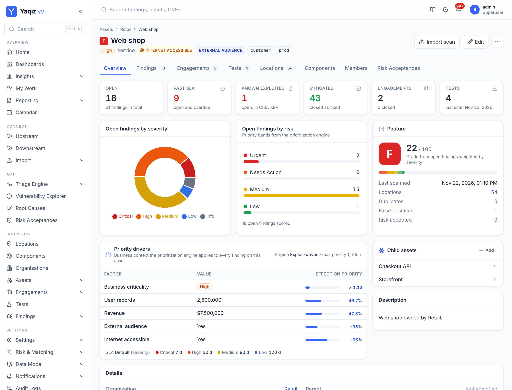
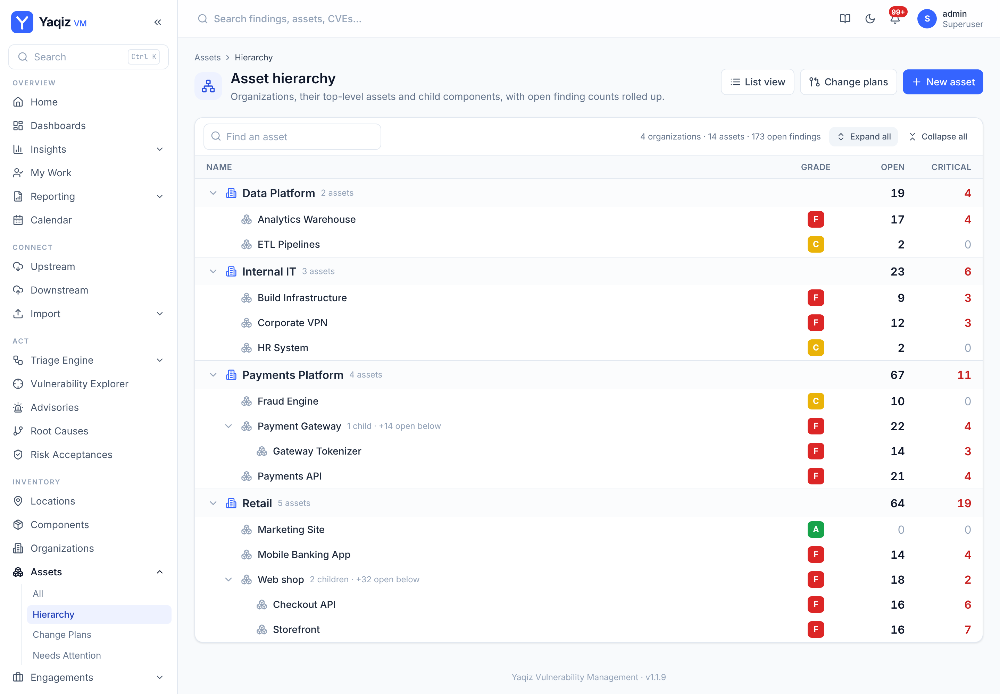
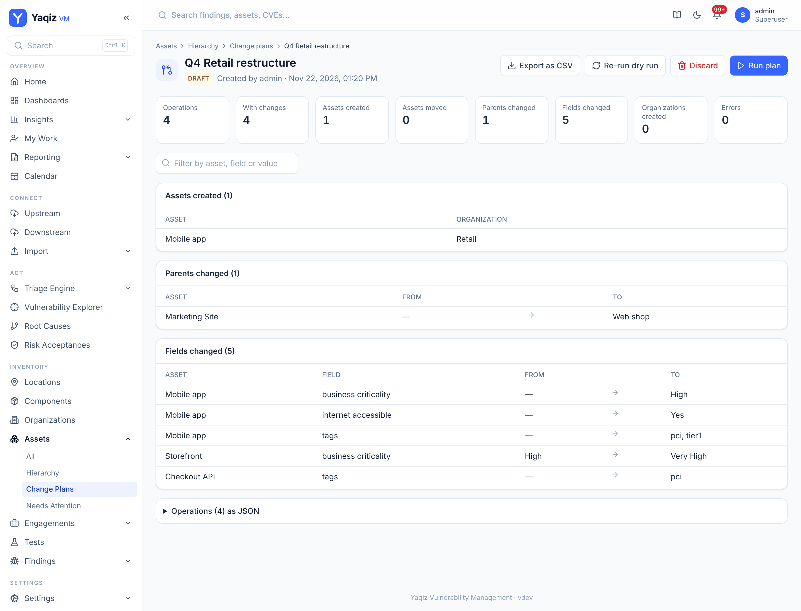
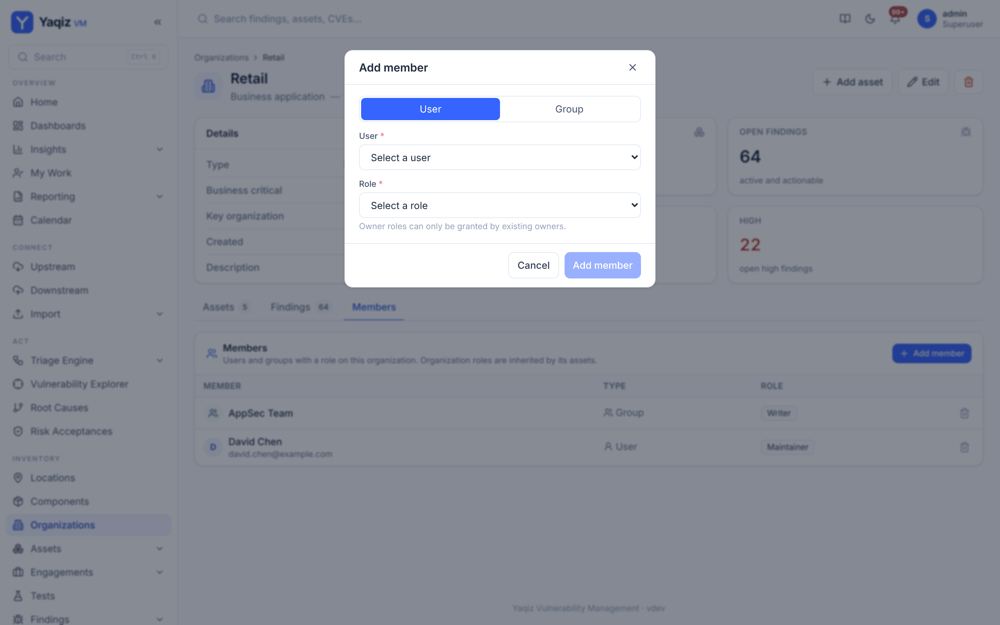

# 2. Inventory

Every finding in Yaqiz belongs to an asset, and every asset to an organization. This chapter explains that model with
a running example, then shows how to create and maintain organizations and assets, reorganize them in bulk with
change plans, and how memberships and roles decide who sees which part of the inventory.

In this chapter:

* [The data model](#the-data-model)
* [Organizations](#organizations)
* [Assets](#assets)
* [Business context and Needs Attention](#business-context-and-needs-attention)
* [The asset hierarchy](#the-asset-hierarchy)
* [Change plans: bulk changes from a spreadsheet](#change-plans-bulk-changes-from-a-spreadsheet)
* [Engagements](#engagements)
* [Tests](#tests)
* [Locations and Components](#locations-and-components)
* [Members and roles: who can see what](#members-and-roles-who-can-see-what)

## The data model

Yaqiz stores your security data in five levels. Take the retail business unit of a company that runs an online shop
and has it tested by an external pentest team every quarter:

```
Retail                        organization  a business unit, team, portfolio or compliance scope
└─ Web shop                   asset         something you scan and fix: application, service, host…
   └─ Q4 penetration test     engagement    a time-boxed activity: a pentest, a review, a CI/CD pipeline
      └─ ZAP Scan             test          one scan import; a reimport of the next report updates it
         └─ 37 findings       findings      the individual issues the report contained
```

* Each **asset** belongs to exactly one organization and can have a **parent asset** in the same organization, for
  example **Checkout API** under **Web shop**. Its business context (criticality, exposure, revenue) drives how its
  findings are prioritized.
* An **engagement** belongs to one asset (its name is unique there) and has dates, a status and a type.
* A **test** belongs to one engagement; a **finding** belongs to a test, and through it to the asset.

You need not build this tree before importing: the import page can create a missing organization, asset and
engagement on the fly (chapter 3). Roles granted on an organization or asset apply to everything below it.

## Organizations

**Inventory › Organizations** lists the organizations you can see with their asset count and open, Critical and High
findings. Filter with **Type**, **Critical** and **Key**, or search by name.

To create an organization you need the global permission `organization.add` (global **Maintainer** or **Owner**);
otherwise the button is hidden.

1. Click **New organization**, enter a **Name** (`Retail`) and choose a **Type**: **Team**, **Business application**,
   **Compliance scope**, **Portfolio** or **Custom**.
2. Optionally switch on **Business critical** or **Key organization**, and add a **Description** and **Tags** (type a
   tag and press Enter).
3. Click **Create organization**. Yaqiz opens the new organization.

The organization page shows its **Details**, finding tiles and the tabs **Assets**, **Findings** and **Members**.
**Add asset** creates an asset in it, **Edit** changes it, and the trash icon deletes it together with all of its
assets, engagements, tests and findings.

## Assets

**Inventory › Assets › All** lists your assets with organization, parent, criticality, grade (**A** to **F**, from
open findings weighted by severity), finding counts, asset manager and last scan date. **Add filter** offers, among
others, **Organization**, **Business criticality**, **Internet accessible**, **Not scanned in last N days** and
**Missing priority data**. **CSV (page)** downloads the rows on the current page.

To create an asset you need `asset.add` in its organization, through a role on that organization or a global role:

1. Click **New asset** (or **Add asset** on an organization page).
2. Under **General**, enter a **Name** (`Web shop`), choose the **Organization** (`Retail`) and, optionally, a
   **Parent asset** of the same organization, an **Asset type** (free text such as `application` or `host`),
   **Tags** and a **Description**.
3. Under **Business context**, set **Business criticality** (**Very High** to **None**), **User records**, **Annual
   revenue (USD)**, **Internet accessible**, **External audience** and any **Regulations** (for example PCI DSS).
4. Under **Classification**, choose **Platform**, **Lifecycle** and **Origin**. Administrators maintain these lists
   under **Settings › Data Model › Asset Attributes**.
5. Under **People**, pick the **Technical contact**, **Team manager** and **Asset manager**.
6. Under **Risk & SLA**, choose the **SLA configuration** and **Prioritization engine** (empty means the default;
   choosing others needs `asset.configure`), and set **Allow simple risk acceptance**, **Allow full risk acceptance**
   and **Disable SLA breach notifications**.
7. Click **Create asset**.



The asset page has the tabs **Overview**, **Findings**, **Engagements**, **Tests**, **Locations**, **Components**,
**Members** and **Risk Acceptances**. The **Overview** shows tiles (**Open**, **Past SLA**, **Known exploited**,
**Mitigated**, **Engagements**, **Tests**), the grade under **Posture**, the **Priority drivers** (how each business
field changes the priority of the asset's findings), **Child assets** and all **Details**. At the top, **Import scan**
imports a report straight into this asset and **Edit** opens the form. The **…** menu offers **New engagement**,
**New risk acceptance**, **Add child asset**, **Copy asset ID** and **Delete asset**. Deleting an asset deletes its
engagements, tests and findings; its child assets are kept and become top-level.

To change many assets at once, tick them in the list, click **Bulk edit…**, set **Business criticality**, **Internet
accessible**, **External audience** or **Add tags**, and click **Apply** (up to 1,000 assets; assets you may not edit
are skipped). To move an asset to another organization, change its **Organization** in the edit form; its child assets
move along, so you need `asset.add` in the target organization and `asset.edit` on every child.

## Business context and Needs Attention

The prioritization engine weighs every finding by the business context of its asset. When **Business criticality**,
**User records** or **Revenue** is not set, the asset page warns "Prioritization is using incomplete business
context" and its findings are scored as if that field had no weight.

**Inventory › Assets › Needs Attention** lists every asset you can see that misses one of these three fields:

1. Click a row, or its **Fill in** button.
2. In the **Business context** dialog, fill in the fields marked **missing**, and check **Internet accessible** and
   **External audience**.
3. Click **Save**. Yaqiz rescores the asset's findings; the asset leaves the list once all three fields are set.

(The **Needs attention** tile on Home is different: it counts urgent findings.)

## The asset hierarchy

**Inventory › Assets › Hierarchy** shows a tree: each organization, its top-level assets and their child assets, with
**Grade**, **Open** and **Critical** per row. An organization row adds up all of its assets, and a parent row shows
how many open findings its children have (for example **2 children · +14 open below**). Type in **Find an asset** to
filter the tree, and use **Expand all** and **Collapse all**.



A parent and its child always belong to the same organization. Set a parent in the asset form (**Parent asset**,
which needs `asset.edit` on the parent) or with a change plan.

## Change plans: bulk changes from a spreadsheet

**Inventory › Assets › Change Plans** creates, moves, updates and deletes many assets at once from a CSV or Excel file.
Nothing is written when you upload: Yaqiz first shows every effect for review, and an applied plan can be undone. You
can create plans if you may edit, configure or add assets somewhere, or create organizations; every row is still
checked against your permissions on its own asset. The list shows the plans you created or applied (superusers and
global Owners see all of them).

1. Click **Download current state** to get one row per asset you may export (needs `asset.export`), or **Empty
   template** to start from scratch.
2. Edit the file in Excel. Keep only the rows you change. The columns are `asset_id`, `asset_name`, `organization`,
   `parent_id`, `parent_name`, `asset_type`, `business_criticality`, `user_records`, `revenue`, `external_audience`,
   `internet_accessible`, `prioritization_engine`, `sla_configuration`, `lifecycle`, `technical_contact`,
   `team_manager`, `asset_manager`, `tags_add`, `tags_remove` and `delete`. Each row needs `asset_id` or `asset_name`;
   other columns are optional.
   * An empty cell changes nothing; `null` clears a value (`null` in `parent_id` or `parent_name` makes the asset
     top-level).
   * Contacts are usernames, engines and SLA configurations are names, tags are comma-separated, yes/no columns take
     `true` or `false`.
   * Changing `organization` moves the asset and its children. A row without `asset_id` whose `asset_name` does not
     exist yet, with an `organization`, becomes a new asset (when **Create assets that don't exist yet** is on).
   * `yes` in `delete` deletes the row's asset with its engagements, tests and findings (the row's other cells are
     ignored; its child assets become top-level). Leave it empty, or write `no`, to keep the asset. Deleting needs
     the Owner role on the asset.
3. Click **Import CSV / Excel**, choose the **File** (CSV or `.xlsx`, first sheet, up to 10 MB and 10,000 rows) and,
   optionally, a **Plan name**. Leave **Create assets that don't exist yet** on; switch on **Create organizations that
   don't exist yet** only if unknown organization names should become new organizations. Click **Create plan for
   review**.
4. Review the plan. The tiles count **Operations**, **With changes**, **Assets created**, **Assets moved**,
   **Parents changed**, **Fields changed**, **Organizations created**, **Assets deleted** (when the plan deletes)
   and **Errors**; the cards below list each change. **Assets deleted** shows, for each asset, how many engagements,
   tests and findings go with it and which child assets become top-level; a red banner repeats the totals. Watch **Parent links removed** (a parent and child must stay in one organization) and **Recalculation**
   (findings that will be rescored). **Export as CSV** downloads the review.
5. If there are **Errors**, fix the file and import it again: a plan with errors cannot run. Otherwise click **Run
   plan** and confirm (**Run plan and delete** when the plan deletes assets). The status changes to **Applying** and
   then **Applied**. Deleted assets cannot be restored, not even by Undo.

For example, this file moves the existing asset 42 under **Web shop** and creates a new asset in **Retail**:

```csv
asset_id,asset_name,organization,parent_name,business_criticality,internet_accessible,tags_add
42,,,Web shop,,,
,Mobile app,Retail,,high,true,"pci,tier1"
```



* **Stale** means the hierarchy changed after your review (for example, findings were imported into an asset the
  plan deletes), so the plan did not run. Click **Re-run dry run** to
  review the current state in a new plan. **Discard** abandons a draft; **Review again** rebuilds a **Failed** plan.
* **Undo** on an applied plan creates a draft that reverses every change and deletes the assets the plan created,
  with everything recorded under them since; review it and run it. Organizations the plan created are kept, and assets
  deleted in the meantime are left out.
* To delete assets without a spreadsheet, tick them on **Inventory › Assets › All** and click **Delete…**: a change
  plan opens for review.

## Engagements

An engagement groups the tests run against one asset during one activity. **Inventory › Engagements › Active** shows
engagements whose status is not **Completed** or **Cancelled**; **Inventory › Engagements › All** shows every one. On
the page, the buttons **Active**, **Overdue** (active, past the target end) and **All** switch between these views,
and **Calendar** shows engagements on a calendar.

1. Click **New engagement** (or use **New engagement** on an asset's **Engagements** tab or **…** menu).
2. Choose the **Asset** (`Web shop`) and enter a **Name** (`Q4 penetration test`).
3. Choose the **Type**: **Interactive** for manual work such as a pentest, **CI/CD** for a pipeline.
4. Set **Status**, **Target start** and **Target end** (default: today and two weeks later), and optionally **Lead**,
   **Version**, **Description**, the **Build & source** fields (**Branch / tag**, **Build ID**, **Commit hash**,
   **Source code repository URL**) and **Tags**.
5. Leave **Deduplicate only within this engagement** off unless findings must not be matched against the rest of the
   asset, and click **Create engagement**.

The engagement page shows tiles, **Details** and the tabs **Tests** and **Findings**. **Import scan** imports a report
into this engagement. **Close** sets the status to **Completed** without changing its findings; **Reopen** sets it to
**In Progress**. The **…** menu offers **Open in test list** and **Delete engagement** (with its tests and findings).

## Tests

A test is the result of one scan import. **Inventory › Tests** (also opened by **Connect › Import › Import History**)
lists every test with its test type, category, asset, engagement, environment and finding counts. Filter by **Test
type**, **Category**, **Organization**, **Asset** or **Engagement**; **Import scan** opens the import page.

The test page shows **Total findings**, **Open**, **Duplicates** and **Imports**, the **Details**, the **Matching
policy** used for deduplication, and the tabs **Findings** and **Import history** (what each import created, closed
and reactivated). **Reimport** loads a newer report into the same test; the **…** menu offers **Import a new scan into
engagement** and **Delete test**. Chapter 3 explains imports and reimports.

## Locations and Components

**Inventory › Locations** (if the **Locations** flag is enabled under **Settings › Feature Flags**, as it is by
default) lists where findings live: URLs, hosts, IP addresses, domains, dependencies, source code, container images,
cloud resources and certificates. Several assets can share a location. Narrow the list with the type tabs; open a
location to see the **Assets** that reference it and its findings. Each asset also has a **Locations** tab.

**Inventory › Components** lists the third-party packages that software composition (SCA) and container scans
reported, across all assets you can see, with **Active** and **Total** findings, **Assets** and **Max priority** per
name and version. Type in **Filter by name or version**, switch on **Only with active findings**, and click a
component to open its findings. Each asset also has a **Components** tab.

## Members and roles: who can see what

Yaqiz keeps teams apart. You see an organization, asset, engagement, test or finding only when one of these gives you
a role on it:

* a **global role** on your user or one of your groups: applies everywhere;
* a membership on the **organization**, for you or one of your groups: applies to all of its assets, also new ones;
* a membership on the **asset**, for you or one of your groups: applies to that asset only (its organization becomes
  visible, read-only).

What you may do depends on the role. The built-in roles are:

* **Reader**: view everything in scope.
* **API_Importer**: view, plus import and reimport scans (for CI/CD service users).
* **Writer**: view, import, triage and edit findings, engagements and tests.
* **Maintainer**: Writer, plus edit assets, delete objects and manage members.
* **Owner**: full control, including deleting assets and managing owners.

As global roles, Maintainer and Owner can also create organizations. Administrators can define more roles under
**Settings › Roles**. To give a colleague or a team access:

1. Open the organization (or asset) and click the **Members** tab.
2. Click **Add member**, choose **User** or **Group**, select who, and pick a **Role**.
3. Click **Add member**. Remove a member with the trash icon in its row.



Managing members needs `member.manage` there (Maintainer or Owner). You can only grant or remove a role whose
permissions you hold there, and only owners can grant the Owner role. Your global permissions are listed under
**Profile › Your permissions**; administrators manage groups and global roles under **Settings › Groups** and
**Settings › Users**.

Next: [3. Bringing in findings](03-bringing-in-findings.md)
