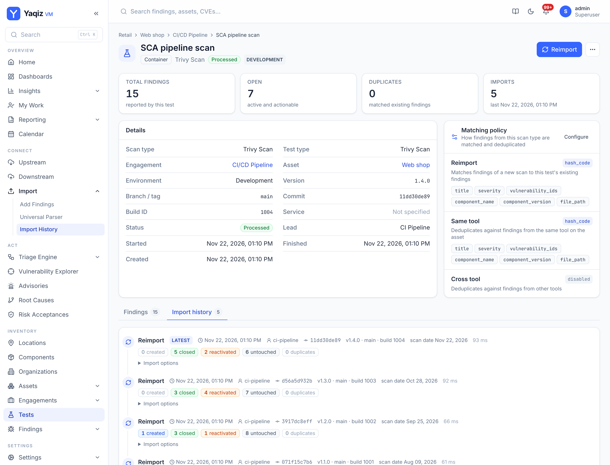

# 3. Bringing in findings

Yaqiz collects findings from scanner reports you upload, from spreadsheets and Word reports, from tools it pulls
from on a schedule, and from your CI/CD pipelines. A report that covers many servers goes in with one upload, and each
server's findings land on its own asset. Every import is deduplicated against what is already there and prioritized
as it arrives, and a re-import of the same scan closes what was fixed and adds what is new.

In this chapter:

* [Before you start](#before-you-start)
* [Import a scan report](#import-a-scan-report)
* [One upload for many assets](#one-upload-for-many-assets)
* [Supported scanners](#supported-scanners)
* [Generic Findings Import (CSV, Excel, Word, JSON)](#generic-findings-import-csv-excel-word-json)
* [Universal Parser](#universal-parser)
* [Re-import a scan](#re-import-a-scan)
* [Import History](#import-history)
* [Upstream connectors](#upstream-connectors)
* [Set up the CISO Assistant connector](#set-up-the-ciso-assistant-connector)
* [Report from URL](#report-from-url)
* [The DefectDojo connector (removed)](#the-defectdojo-connector-removed)
* [Send results from CI/CD](#send-results-from-cicd)
* [Add a single finding by hand](#add-a-single-finding-by-hand)

## Before you start

Findings live in a hierarchy: **Organization › Asset › Engagement › Test › Finding**, and each import creates or
updates one *test* ([chapter 2](02-inventory.md#the-data-model)). You need the permission "Import and reimport scan
reports" on the asset (the roles Writer, Maintainer, Owner and API_Importer have it), plus the matching "add"
permissions to create a missing organization, asset or engagement during an import. Ask your administrator if an
import is refused ([who can see what](02-inventory.md#members-and-roles-who-can-see-what)).

## Import a scan report

1. Go to **Connect › Import › Add Findings**. You can also click **Import scan** on an asset or engagement page, which
   fills in the destination for you.
2. Under **1. Scan report**, open **Scan type** and type part of the tool name or file extension. The list is grouped
   by category and shows the file types each format expects; a box below the picker describes the chosen format.
3. Drop the report onto the upload box, or click **Choose a file**. If the extension does not match the scan type,
   a warning says the file "may not parse".
4. Under **2. Destination**, keep **Import** selected ("Create a new test with these findings"), then either:
   - **Choose engagement** and pick an existing **Engagement**, or
   - **By name**: type the **Organization**, **Asset** and **Engagement**. Leave **Create the organization, asset and
     engagement if they do not exist** checked to create what is missing; otherwise the import fails when one of them
     does not exist. An engagement created this way has the type CI/CD and the status In Progress.
5. Optionally enter a **Test title** (it defaults to the scan type).
6. Under **3. Options**, adjust what you need (see the table below), then click **Import scan**.

For a report that covers many servers, choose **Many assets** under **2. Destination** instead; see
[One upload for many assets](#one-upload-for-many-assets).


| Option | What it does |
|---|---|
| **Scan date** | Discovery date of the new findings. Defaults to the date in the report, or today. |
| **Minimum severity** | Findings below this severity are skipped. |
| **Active**, **Verified** | **Not specified** keeps what the report says (by default new findings are active and unverified); **Yes** or **No** overrides it. |
| **Tags** | Tags for the test. Tick **Also tag findings** or **Also tag locations / endpoints** to copy them. |
| **Close old findings** | Closes findings from earlier imports of the same tool in this engagement that are not in this report. **Across the whole asset** looks in every engagement of the asset. |
| **Build, grouping and environment** | Click to expand: **Group findings by** (creates [finding groups](04-working-with-findings.md#finding-groups)), **Environment** (default Development), **Service** (when several applications share one asset; matching and closing then stay within that service), **Version**, **Branch / tag**, **Commit hash**, **Build ID**. |

**The result.** An **Import complete** card shows how many findings were **Created**, **Closed**, **Reactivated** and
**Untouched**, by severity, how many were duplicates of existing findings, and any warnings. Use **View test**,
**Created findings** or **Closed findings** to jump to them.

**Large files.** Turn on **Run in background** to queue the import; reports larger than 8 MB always run in the
background. The page then shows **Import queued**. Destination and permissions are checked first, so a refusal shows
right away; when the import ends you get an in-app alert ("Background import finished" or "Background import failed"
with the reason). Upload size limits are set on the server; see the installation guide
(`docs/on-prem-installation.md` in the release package).

## One upload for many assets

A vulnerability report often covers many servers, for example a Qualys, Nessus or OpenVAS export of a whole network.
With **Many assets** you upload it once, and Yaqiz puts each server's findings on that server's own asset, so every
asset owner sees exactly their findings. Nothing is split by hand.

1. Go to **Connect › Import › Add Findings** and choose the **Scan type** and the file, as for any import.
2. Under **2. Destination**, choose **Many assets** ("Each host's findings go to its own asset, matched by IP address
   or host name").
3. Enter the **Engagement** that the findings go to on each asset. It is created on each asset that does not have it
   yet. Optionally enter a **Test title**.
4. Optionally add organizations under **Only these organizations**: only their assets are matched. Leave it empty to
   match assets in every organization you can import into.
5. Under **Hosts that match no asset**, keep **Leave them out (listed in the preview)**, or choose **Create an asset
   for each one in organization** and pick the organization.
6. Under **3. Options**, set what you need, as for any import. **Close old findings** works asset by asset (see
   **Monthly uploads** below). **Across the whole asset**, **Group findings by** and **Service** are not offered here,
   so the section to expand is called **Build and environment**.
7. Click **Check matches**. The check imports nothing: a **Preview** shows which asset each host's findings would go
   to.
8. Review the preview, then click **Import to N assets**, for example **Import to 4 assets**.

Changing the file or an option clears the preview, so what you import is always what you checked.

**Which reports.** Any scan type works whose findings name the host they were found on: an IP address, a host name or
a URL. Typical are Qualys (XML or CSV), Tenable Nessus and OpenVAS exports, and a
[Generic Findings Import](#generic-findings-import-csv-excel-word-json) spreadsheet with a **Host** column. Yaqiz reads
the report host by host. One issue seen on several servers becomes one finding per server, with only that server's
details and locations; the same issue on several ports of one server stays one finding. A spreadsheet row that names
several hosts becomes one finding on each. Findings without a host are listed as **(no host in the report)** and are
not imported.

**How each host is matched.** The candidates are the assets you may import into (in the chosen organizations), so the
preview never names an asset you cannot see. For each host, Yaqiz tries the strongest evidence first: its IP address,
then its full host name, then an IP address written in an asset's description, then its short host name. Case does
not matter. The **Matched by** column of the preview shows which evidence decided:

| Matched by | The host goes to the asset… |
|---|---|
| **IP address** | whose name is the host's IP address, or contains it (for example in brackets after a name) |
| **Existing location** | that already has the host among its locations from earlier imports, by IP address, host name or short host name |
| **Host name** | whose name is the host's full host name, for example `storefront.retail.example` |
| **IP address in description** | whose **Description** contains the host's IP address (asset inventories imported from a CMDB keep it there) |
| **Short host name** | whose name has the same first part as the host name, up to the first dot: the asset **Storefront** for the host `storefront.retail.example` |
| **New asset** | that the import creates, because the host matched no asset and you chose **Create an asset for each one** |

Evidence that fits several assets, for example two assets with the same short name, decides nothing, and Yaqiz tries
the next kind. When the evidence of a host still points at more than one asset, the host is listed under **More than
one possible asset** and none of its findings is imported. So that your servers are found, name each server's asset
after its host name or IP address, or write the IP address in its **Description**
([chapter 2](02-inventory.md#assets)).

**The preview.** The first line sums up what will happen, for example "7 findings will go to 4 assets · 1 finding on 1
host matches no asset". The table lists each asset with its **Organization**, **Hosts**, **Findings** (with the count
per severity below), **Matched by** and **Engagement**: **New** when the asset does not have the engagement yet,
**Exists** when it does. A **New asset** badge marks the assets the import will create. Below the table, the preview
lists what is left out:

* **No matching asset**: the hosts that match no asset, with their findings. To import them, choose **Create an asset
  for each one** and check again.
* **More than one possible asset**: the hosts that match several assets, with the **Possible assets**. Choosing only
  some organizations can make the match unique.
* **Not allowed**: assets you may not import into, with the **Reason**, for example "You are not allowed to create
  engagements in this asset."


**Download CSV** saves the preview with every row; the page shows at most 500 rows per list. With more than 10
assets, **Filter assets or hosts** narrows the table. **Change options** takes you back to the form.

**The import.** **Import to N assets** imports each asset's findings exactly like an upload to that asset: with the
same permissions, deduplication, SLAs, scoring, triage rules ([chapter 5](05-automation.md)), automatic issue-tracker
pushes and notifications. Each asset gets a new test in the engagement. The **Import complete** card shows **Assets
imported**, **Created**, **Closed** and **Duplicates**, and for each asset its counts and **View test**; **Download
CSV** saves this result. If an asset fails, the card is titled **Import finished with errors** and shows the error on
that asset's row; the other assets are imported all the same.

**Monthly uploads.** Import each new report into the same engagement with **Close old findings** on (it is off by
default here). On each asset, Yaqiz then closes the findings of earlier imports of this tool in this engagement that the
new report no longer lists. A server missing from the report keeps its findings: a vulnerability report lists only
hosts with findings, so a missing server does not prove that its findings were fixed.

**New assets for unmatched hosts.** With **Create an asset for each one in organization**, each host that matches no
asset gets a new asset in that organization, named after its host name, or its IP address when it has none. You need
the permission to add assets in that organization. The new assets have only a name: give a team a role on them with
**Assign owner…** ([chapter 2](02-inventory.md#assign-an-owner-to-many-assets)) and fill in their business context
(until then they are listed under **Inventory › Assets › Needs Attention**, see
[chapter 2](02-inventory.md#business-context-and-needs-attention)).

**Limits.**

* One upload imports into at most 2,000 assets. For a larger report, choose only some organizations, or split the
  report.
* A report larger than 8 MB is too large to check first. Yaqiz says so and offers **Import without checking**, which
  imports it in the background.
* These imports run in the background: reports larger than 8 MB, imports into more than 300 assets, and imports with
  **Run in background** turned on. The page then shows **Import queued**, and a notification ("Import finished: … on N
  assets") gives the new and closed findings and the number of findings that were not imported.

**From a script.** `POST /api/v2/import-scan/split/` takes the usual import fields
([Send results from CI/CD](#send-results-from-cicd)) plus `engagement_name`, `organizations` (organization IDs, comma
separated), `unmatched` (`skip` or `create`), `unmatched_organization` and `dry_run`. With `dry_run=true` it only checks
the matches. The **Automate from CI/CD** card on **Add Findings** shows the command for the options you chose.

## Supported scanners

Yaqiz reads 98 report formats out of the box. For the full list, open the **Scan type** picker on **Add Findings**:
the search box shows how many scan types exist, and each entry lists its file types and alternative names ("Also:
…"). Every scan type name is also listed under **Settings › Data Model › Test Types**.

| Category | Tools |
|---|---|
| Infrastructure | Tenable Nessus, Tenable.io and Tenable.sc, Qualys VM/VMDR (XML or CSV), Rapid7 InsightVM / Nexpose, Microsoft Defender for Endpoint, CrowdStrike Falcon Spotlight, Greenbone/OpenVAS, ManageEngine Vulnerability Manager Plus / Endpoint Central, Wazuh, OpenSCAP, Lynis, Nmap, kube-bench |
| TLS | testssl.sh, SSLyze, SSL Labs |
| DAST and APIs | Burp Suite, OWASP ZAP, Acunetix, Invicti / Netsparker / Acunetix 360, HCL AppScan, Fortify WebInspect, Rapid7 AppSpider, Qualys WAS, Nuclei, Nikto, Wapiti, WPScan, StackHawk |
| SAST | SARIF (any tool), Checkmarx, Checkmarx One, Fortify SCA (`.fpr`, `.fvdl`), Veracode, Semgrep, SonarQube/SonarCloud, GitHub code scanning (CodeQL), SpotBugs / Find Security Bugs, Bandit, Brakeman, gosec, ESLint, Horusec, njsscan, Bearer, Cppcheck, Kiuwan |
| SCA | Snyk, Black Duck, JFrog Xray, Sonatype Nexus IQ, Mend, OWASP Dependency-Check, Dependency-Track, CycloneDX (BOM or VEX), npm audit, yarn audit, pip-audit, Safety, bundler-audit, cargo-audit, govulncheck, Composer audit, OSV-Scanner, Retire.js, GitHub Dependabot |
| Container | Trivy, Grype, Anchore Engine/Enterprise, Aqua, Prisma Cloud Compute / Twistlock, Harbor, Sysdig, Clair, Docker Scout |
| IaC | Checkov, KICS, tfsec, Terrascan, Kubescape, kubeaudit, Hadolint |
| Cloud | AWS Security Hub (ASFF), Amazon Inspector, Microsoft Defender for Cloud, Google Cloud Security Command Center, Prowler, ScoutSuite, Wiz |
| Secrets | Gitleaks, TruffleHog, detect-secrets, GitGuardian ggshield, Talisman (secrets are stored masked) |
| Mobile | MobSF and mobsfscan |
| Pentests and bug bounty | CISO Assistant, HackerOne, Bugcrowd |
| Other | Generic Findings Import |

Fortify `.fpr` and Black Duck report `.zip` files are uploaded as they are. Most formats accept several names (for
example "Nessus Scan" for "Tenable Scan"). For a format that is not listed, use the Generic Findings Import or a
Universal Parser.

New in Yaqiz 1.1.9:

* **CISO Assistant** reads the findings and vulnerabilities of CISO Assistant, the JSON that its API returns for
  `/api/findings/` or `/api/vulnerabilities/`. Only open items are imported. The CISO Assistant connector pulls the same
  data on a schedule ([Set up the CISO Assistant connector](#set-up-the-ciso-assistant-connector)).
* **Qualys Scan** also reads Qualys CSV exports joined with the CMDB: an **Asset** column with the host's IP address or
  name instead of the IP and DNS columns, a **Parent** column with the server's host name, and an **Application**
  column, which is shown with each host in the finding's description.

## Generic Findings Import (CSV, Excel, Word, JSON)

Use **Generic Findings Import** for findings that do not come from a supported scanner, such as penetration test
reports, audit results or your own lists.

1. On **Add Findings**, choose the scan type **Generic Findings Import**.
2. In the description box, click **Excel**, **Word** or **CSV** next to **Templates:** to download an empty template
   (headers and instructions only, so an untouched template imports nothing).
3. Fill in one finding per row (or per table in Word), then import the file as described above.

**Columns.** **Title** and **Severity** (Critical, High, Medium, Low or Info) are required; other cells may stay
empty, and rows without a title are skipped. Optional columns: **Description**, **Mitigation**, **Impact**,
**References**, **CVE** (comma separated), **CweId**, **CVSSV3** (vector), **Url** (URLs or hosts, comma separated;
each becomes a location), **ComponentName**, **ComponentVersion**, **FilePath**, **Line**, **Date** (YYYY-MM-DD),
**UniqueIdFromTool**, **Tags**, and also **Active**, **Verified**, **FalsePositive**, **Mitigated** (true, yes, y, 1
or x), **VulnerabilityIds**, **VulnIdFromTool** and **Service**. Names are not case sensitive and spaces and
punctuation are ignored ("Component Name" works). When a standard column is missing, these wordings are accepted:

| Standard column | Also accepted |
|---|---|
| Title | Name, Finding, Finding Title, Vulnerability, Issue |
| Severity | Risk, Risk Level, Risk Rating, Rating |
| Mitigation | Recommendation(s), Remediation, Solution, Fix |
| Description | Details, Observation, Summary |
| Url | Affected host(s), Affected URL(s), Affected systems, Location, Endpoint, Host |
| CVE, CweId, References, CVSSV3 | CVEs; CWE; Reference; CVSS or CVSS Vector |

**Excel.** Yaqiz uses the first sheet with a Title and a Severity column; the header row may follow a few title or
note rows. The Excel template has a **Findings** sheet (with a Severity drop-down) and an **Instructions** sheet.

**Word.** Use either one table with Title and Severity columns and one finding per row, or one two-column table per
finding with the labels (Title, Severity, Description, Recommendation, Affected hosts, …) in the first column and the
values in the second. The Word template contains both layouts.

**Old Office formats.** Excel 97-2003 (.xls) and Word 97-2003 (.doc) files are refused. Open the file, choose **File
› Save As**, save it as Excel Workbook (.xlsx) or Word Document (.docx), and upload that file.

**JSON.** Use an object with a `findings` list; each finding needs `title` and `severity`:

```json
{"findings": [{"title": "Outdated TLS configuration", "severity": "Medium", "description": "TLS 1.0 is enabled.",
  "endpoints": ["https://portal.example.com"], "unique_id_from_tool": "PT-2026-007"}]}
```

**Re-importing a corrected report.** By default a re-import recognizes a Generic Findings Import finding by its
Title, CWE, Line, File path and Description. If you change those between versions, the finding counts as new and the
old one is closed. The **Matching policy** card on the test page shows the rule in use; an administrator can change it
under **Settings › Risk & Matching › Matching Configuration** ([chapter 7](07-administration.md#risk--matching)), for
example to match on UniqueIdFromTool.

## Universal Parser

A Universal Parser teaches Yaqiz any other CSV, JSON or XML format without code: you map the fields of a sample
report once, and the parser becomes a scan type named "Universal Parser - <label>". Use it for an in-house or niche
tool whose output you import regularly and cannot change; if you can shape the file yourself, the Generic Findings
Import is simpler. Creating and editing parsers needs the permission "Manage universal parsers".

1. Go to **Connect › Import › Universal Parser** and click **New parser**.
2. **Sample report**: enter a **Label**, upload a real report (at most 5 MB), check the **File type** and, for JSON
   or XML, the **Items path** or **Item element** that holds the findings. Click **Detect fields**.
3. **Field mapping**: choose the source for each finding field; **Title**, **Severity** and **Description** are
   required. Under **Severity values**, map the tool's values ("Automatic" recognizes words such as critical, high,
   moderate or 1-5) and set a **Default severity**.
4. **Preview & save**: check the parsed findings, then click **Create parser** and **Import a report with it**.

On the parser list, **Active** shows or hides a parser on the Import page. Renaming a parser renames its scan type
(update your CI jobs); parsers in use cannot be deleted, so deactivate them instead.

## Re-import a scan

Re-import a newer report into the existing test to keep one up-to-date picture instead of a new test per scan.

1. Open the test (for example from **Import History**) and click **Reimport**. Or, on **Add Findings**, choose
   **Reimport** under **2. Destination** and pick the **Test**. The scan type is taken from the test.
2. Choose the file and options. **Close old findings** is on by default; **Do not reactivate** keeps mitigated
   findings closed even if the report lists them again.
3. Click **Reimport scan**.

Yaqiz matches each finding in the report against the findings of the test, using the scan type's reimport rule
(shown on the test page under **Matching policy**):

| Finding in the new report… | Result |
|---|---|
| matches an open finding | Stays open (**Untouched**). Fix version, file path, line and component version are refreshed; new locations are added and locations no longer reported are marked mitigated. |
| matches a Mitigated finding | Reopened (**Reactivated**) with the note "Re-activated by … re-upload". With **Do not reactivate**, it stays closed and gets a note instead. |
| matches a False Positive, Out Of Scope, Risk Accepted or Duplicate finding | Left as it is (**Untouched**): your triage decisions survive re-imports. |
| has no match | Created as a new finding, then checked for duplicates on the asset. |
| *(an open finding of the test is missing from the report)* | Closed as Mitigated with the note "Mitigated by … re-upload", when **Close old findings** is on. |

If a report lists no findings and Yaqiz cannot recognize it as a valid empty report of that format, nothing is closed
and the result shows a warning.

## Import History

**Connect › Import › Import History** opens the **Tests** page (also **Inventory › Tests**): every scan import and
manual test with its scan type, asset, engagement, status and finding counts, newest first. Filter it by **Test
type**, **Category**, **Organization**, **Asset**, **Engagement**, tags or creation date; click a row to open a test.

On the test page, the **Import history** tab shows every import and re-import: who ran it, when, the file name, build
details and the counts of **created**, **closed**, **reactivated**, **untouched** and **duplicates**. Each count links
to exactly those findings, and **Import options** shows the options used. A warning appears when a re-import closed
every open finding and matched none, which usually means the wrong report was uploaded. The page header also offers
**Reimport**, **Import a new scan into engagement** and **Delete test**.



## Upstream connectors

Upstream connectors pull findings from your tools on a schedule. A connector signs in to the tool's API (**Report from
URL** downloads report files instead), lists its targets (scans, sites, hosts, projects …) as *records*, and pulls
their open findings; findings the tool no longer reports are closed. **Connect › Upstream** is shown only when the
**Upstream Connectors** feature flag is on (it is by default, under **Settings › Feature Flags**) and you have the
permission "Manage upstream and downstream connectors".

The page lists your **Configured connectors** first, each with its **State** (**Healthy**, **Warning** when some
records failed, **Error**, **Never run** or **Disabled**), its mapped records, its last discovery and sync and its
**Schedule**. Below, **Available connectors** offers 26 connector types in six groups; type in **Search connectors**
to find one. Each card describes what the connector pulls and lists the fields of its form.


| Group | Connector | What it pulls (one record per …) |
|---|---|---|
| Vulnerability management | ManageEngine Vulnerability Manager Plus | Open vulnerabilities of managed computers, also from Endpoint Central build 11.3.2430.01 or later (computer, or the whole server) |
| | Qualys VMDR | Open vulnerabilities of hosts, with Qualys KnowledgeBase details (host, or the whole subscription) |
| | Rapid7 InsightVM / Nexpose | Open vulnerabilities of each site of the Security Console, as an XML Export 2.0 report (site) |
| | Tenable Nessus | Latest results of each scan, from Nessus Professional / Manager or Tenable Vulnerability Management (scan) |
| | Tenable Security Center | Latest completed result of each scan, as a `.nessus` file (scan) |
| Web application scanning (DAST) | Acunetix | Open vulnerabilities of each target: Acunetix Premium, Acunetix 360 on premises or Acunetix Online (target) |
| | Burp Suite DAST | Issues of the latest completed scan of each site, without false positives; formerly Burp Suite Enterprise Edition (site) |
| | Invicti Enterprise | Open issues of each website (website) |
| | Nuclei (ProjectDiscovery Cloud) | Open Nuclei results of each scan in ProjectDiscovery Cloud Platform, also of runs uploaded with `nuclei -dashboard` (scan) |
| | Qualys Web Application Scanning | Open vulnerabilities of each web application (web application) |
| | ZAP | Alerts of each site known to a running ZAP, without false positives (site) |
| Code and dependencies (SAST / SCA) | Checkmarx One | Open SAST, SCA and IaC (KICS) results of each project's latest completed scan (project) |
| | Dependency-Track | The project's open findings, under the same scan type as the tool's report files (project) |
| | Fortify Software Security Center | Open issues of each application version, without suppressed and "Not an Issue" ones (application version) |
| | GitHub Advanced Security | Open code scanning and Dependabot alerts of an organization's repositories, imported as two tests (repository) |
| | GitLab vulnerabilities | Detected and confirmed vulnerabilities of the GitLab Ultimate vulnerability report, from GitLab's cloud service or a self-managed GitLab (project) |
| | Semgrep | The project's open findings, under the same scan type as the tool's report files (project) |
| | Snyk | The project's open findings, under the same scan type as the tool's report files (project) |
| | SonarQube | Open vulnerabilities of each SonarQube or SonarCloud project (project) |
| Cloud and containers | Harbor | Vulnerability reports of the newest image, or a chosen tag, of each repository (repository) |
| | Wiz | Open vulnerability findings, open issues, or both (Wiz project, or the whole tenant) |
| Endpoint security | CrowdStrike Falcon Spotlight | Open vulnerabilities of Falcon hosts (host, or all hosts) |
| | Microsoft Defender for Endpoint | Open software vulnerabilities of devices, from Defender Vulnerability Management (device, or the whole tenant) |
| Platforms and report feeds | CISO Assistant | Open findings and vulnerabilities (CISO Assistant asset); see [Set up the CISO Assistant connector](#set-up-the-ciso-assistant-connector) |
| | Generic JSON Feed | Findings in the generic JSON format from any HTTP endpoint (one URL per record) |
| | Report from URL | Report files from a web server, in any format that Yaqiz imports (URL); see [Report from URL](#report-from-url) |

**Add a connector**

1. On **Connect › Upstream**, find the tool under **Available connectors** and click **Add configuration**.
2. Enter a unique **Name**. Synced findings land in the engagement "Connector - <name>" of each mapped asset.
3. Fill in the connection fields; many have a hint that says where to find the value in the tool. **Tenable
   Nessus**: **Server URL** (`https://<host>:8834`, or `https://cloud.tenable.com`), **API access key** and **API
   secret key** (in Nessus under Settings › My Account › API Keys), optionally **Only scans in folder** and **Only scans
   whose name contains**. **ManageEngine**: **Server URL**, an **API auth token** or a technician username and
   **Password** with the **Sign-in type**, and under **Records** one record per computer (each becomes an asset) or one
   for the whole server. Secrets are never shown again.
4. Set the **Sync schedule** (Manual only, Every hour, Every 6 hours, Every 12 hours, Daily or Weekly; Daily by
   default) and the **Minimum severity** (lower severities are skipped). Optionally choose a **Default organization**:
   with **Automatically map newly discovered records to assets** on (it is by default), each new record is then mapped
   to the asset of the same name in that organization, or to a new asset created there. Click **Add connector**.

**Discover, map and sync**

1. On the connector page, click **Discover** to list the records the tool exposes.
2. In the **Records** table, click **Map to asset** (an existing asset), **Create asset** (an asset named after the
   record, in the organization you choose) or **Ignore** for each record. **Remap** points a mapped record at another
   asset; the findings it already imported stay where they are. Filter the table with **All**, **New**, **Mapped**,
   **Ignored** and **Missing** (no longer found upstream), or type in **Filter records**.
3. Click **Sync** at the top to import every mapped record now, or **Sync** in a record's row for that record only.

The **Status** card shows the state and the schedule (for example **Healthy** and **Daily**), how many **Records**
there are and how many are **Mapped**, the connection settings, the default organization and when the connector last
discovered and synced. The **Operations log** keeps the last 50 discover and sync runs; click a run to see its counts
and log.


**What a sync does**

* Each sync imports a mapped record's findings into the engagement "Connector - <name>" of its asset. The record's
  first sync creates its test and closes nothing. Every later sync re-imports into that test: findings the tool no
  longer reports are closed, and returning ones reopen (see [Re-import a scan](#re-import-a-scan)).
* Several records of one connector can be mapped to the same asset, for example the http and https addresses of one
  site. Each record has a test of its own, so their syncs never close each other's findings. The first record keeps
  the test named after the connector; the others get tests named "<connector name> - <record name>", and when two of
  them have the same name, the later one also gets its record number: "(record <number>)".
* Where the tool exports its own report (Rapid7, Tenable Security Center, Nessus, Harbor, Nuclei, ZAP, Invicti …), the
  connector imports that report with the same parser as a file import, so a sync and an upload give the same findings.
* A record that the tool no longer lists gets the state **Missing upstream** and is not synced; its findings stay as
  they are. The CISO Assistant and ManageEngine connectors keep their records instead, so the next sync closes the
  findings of a CISO Assistant asset that was deleted, or of a computer whose vulnerabilities are all fixed.
* Enabled connectors with a schedule are checked every 30 minutes and run discovery and sync when due. Failing records
  raise a "Connector … had N failing records" alert, and the connector's state turns to **Warning**.
* Keep **Verify TLS certificate** on; your administrator can make an internal CA trusted (see the installation guide).
  Cloud connectors (Qualys, Wiz, Microsoft Defender, CrowdStrike, Checkmarx One, ProjectDiscovery, GitLab's cloud
  service) need the Yaqiz server to reach the vendor's API over HTTPS.

## Set up the CISO Assistant connector

CISO Assistant is an open-source GRC platform (community or enterprise edition). Its connector pulls the open findings
(from pentests, audits, red-team exercises and other findings assessments: identified, confirmed, assigned or in
progress) and the open vulnerabilities (potential or exploitable) of each CISO Assistant asset.

1. In CISO Assistant, create a personal access token (your profile › Personal access tokens). The token sees what its
   user sees; create a new one when it expires.
2. On **Connect › Upstream**, find **CISO Assistant** under **Platforms and report feeds** and click **Add
   configuration**.
3. Enter a **Name**, the **Server URL** (the address of CISO Assistant's web interface; Yaqiz reads its API at
   `<server>/api`) and the **Personal access token**.
4. Optionally fill in:
   * **Only domain**: a CISO Assistant domain, by name or ID. Its sub-domains are included. Leave it empty for every
     domain the token can see.
   * **Pull**: **Findings and vulnerabilities** (the default), **Findings only** or **Vulnerabilities only**.
   * **Verify TLS certificate**: keep **Yes (recommended)**.
5. Set the schedule and the other settings as for any connector, then click **Add connector**.
6. Click **Discover**. Each CISO Assistant asset becomes a record, and the record **(no asset in CISO Assistant)**
   collects the findings and vulnerabilities that are linked to no asset. For each record, click **Map to asset** (an
   existing Yaqiz asset) or **Create asset**, then click **Sync**.

**Only domain.** The connector then reads only the findings and vulnerabilities of that domain and its sub-domains. An
item of the domain that is on an asset of another domain is kept: that asset is listed as a record too. A name that
several domains share is refused, and the message lists their IDs: enter the ID of the one you mean.

**Records.** A record is one CISO Assistant asset with the open findings and vulnerabilities on it. A finding is on
one asset; a vulnerability can be on several assets and then becomes a finding on each of their records.

**Matching across syncs.** Each item is matched by its CISO Assistant ID, so work done in CISO Assistant (status,
priority, dates, wording, controls) never creates a second Yaqiz finding, and Yaqiz keeps its own triage: notes,
assignee, risk acceptance, false positive. Title, severity, description, CVEs, CWE and the recommendation are taken
when an item is first imported, with a link back to it; the live status, dates and controls stay in CISO Assistant. An
undefined severity becomes Info, and the findings carry the tag `ciso-assistant`.

**Closing.** Items closed in CISO Assistant (mitigated, resolved, fixed, dismissed …) are closed in Yaqiz at the next
sync. So are the items of an asset that is deleted in CISO Assistant or leaves the domain: its record stays, and the
next sync finds nothing open for it.

**Upload instead.** The same JSON can be uploaded by hand: on **Add Findings**, choose the scan type **CISO Assistant**
and upload the answer of `/api/findings/` or `/api/vulnerabilities/`.

## Report from URL

**Report from URL** pulls report files instead of calling an API. Use it for tools without an API connector, for
example self-hosted Nuclei, Trivy or OpenVAS reports that a script publishes on an internal web server. Each sync
downloads the files again and imports them with the parser of the chosen format, which can be any of the 98 formats
Yaqiz imports.

1. On **Connect › Upstream**, find **Report from URL** under **Platforms and report feeds** and click **Add
   configuration**.
2. Enter a **Name** and the **Web server URL**: the server that publishes the report files.
3. In **Report URLs**, enter each report file: a path on the web server, for example `/nuclei/latest.jsonl`, or a full
   `https://` address. Separate several with spaces. Each one becomes a record, named after its file name.
4. Choose the **Report format**: the tool that wrote the files, the same choice as the scan type of a file import.
5. Only if the web server requires a sign-in, enter the **Authorization header name**, for example `Authorization` or
   `X-API-Key`, and the **Header value**, for example `Bearer <token>`. The header is sent to the web server only,
   never to a full address on another server. Do not put a user name or password into a URL: it is refused.
6. Set the schedule and the other settings, click **Add connector**, then **Discover**, map each record to an asset and
   click **Sync**.

Every sync after the first imports the file again into the record's test, so findings that are no longer in the file
are closed, as a re-upload would close them. A file that the parser reads but that lists no findings closes all of the
record's findings, so make sure each address always serves the complete, current report. A file that the parser
cannot read, for example a sign-in page instead of the report, is not imported: the sync reports the error and closes
nothing. Files larger than the upload limit are not imported either; the sync reports the error.

## The DefectDojo connector (removed)

Yaqiz 1.1.8 had a connector that pulled findings from another DefectDojo server. Yaqiz 1.1.9 no longer offers it:

* The upgrade to 1.1.9 switches existing DefectDojo connectors off. The findings they imported stay in Yaqiz with
  their history.
* **Connect › Upstream** still lists these connectors under their names, with the type
  **DefectDojo (removed in 1.1.9)**, the state **Disabled** and the reason: "The DefectDojo connector was removed in
  Yaqiz 1.1.9. The findings it imported stay in Yaqiz; delete this connector when you no longer need it."
* Such a connector cannot be switched on again. **Discover**, **Sync**, **Edit** and mapping its records are not
  available; **Ignore** still works.
* Delete it when you no longer need it. Deleting removes the connector with its records and history; the assets and
  findings it imported are kept.
* The DefectDojo-compatible import API is unchanged. Scripts and pipelines that send reports to `/api/v2/import-scan/`
  and `/api/v2/reimport-scan/` with DefectDojo's field names keep working; for example, `product_name` and
  `product_type_name` are accepted in place of `asset_name` and `organization_name`
  ([Send results from CI/CD](#send-results-from-cicd)).

## Send results from CI/CD

Pipelines import through the REST API with the same options as the Add Findings page.

1. **Get a token.** For a pipeline, ask your administrator for a service user with the API_Importer role: the
   administrator clicks **Generate API token** on that user's page and gives you the token (it is shown once). For
   your own scripts, choose **API token** in the user menu at the top right and use **Reveal** and the copy button. A
   token carries all of its user's permissions, so treat it like a password; **Rotate** (or generating a new service
   user token) replaces it and stops the old one at once.
2. **Store it** in your CI system as a secret, for example `YAQIZ_API_TOKEN`.
3. **Build the command.** On **Add Findings**, choose the scan type, destination and options; the **Automate from
   CI/CD** card shows the matching `curl` command to copy into your pipeline.

`POST /api/v2/import-scan/` creates a new test on every call. `POST /api/v2/reimport-scan/` updates a test: pass its
`test` id, or names as below. With names, Yaqiz re-imports into the newest test of that scan type in the engagement
(with that `test_title`, if given) or creates it on the first run. Send the token as `Authorization: Token …`:

```bash
curl --fail -X POST "https://vm.example.com/api/v2/reimport-scan/" \
  -H "Authorization: Token $YAQIZ_API_TOKEN" \
  -F "file=@trivy-report.json" \
  -F "scan_type=Trivy Scan" \
  -F "organization_name=Retail" \
  -F "asset_name=Web shop" \
  -F "engagement_name=CI/CD Pipeline" \
  -F "auto_create_context=true" \
  -F "commit_hash=$COMMIT_SHA"
```

Other fields mirror the page: `engagement`, `test_title`, `scan_date`, `minimum_severity`, `active`, `verified`,
`tags`, `close_old_findings`, `do_not_reactivate`, `group_by`, `service`, `version`, `branch_tag`, `build_id`,
`environment`, `background_import`. Success returns HTTP 201 with the test id and the created, closed, reactivated and
untouched counts; 202 means it was queued (reports over 8 MB, `background_import=true`, or the field left out while
**Background imports from the API** is on in the system settings). Refusals return 400 (a field problem), 403 (not
allowed) or 404 (target not found). The book icon in the top bar opens the full API reference.

For a report that covers many servers, `POST /api/v2/import-scan/split/` puts each server's findings on its own asset
([One upload for many assets](#one-upload-for-many-assets)). It returns 200 for a check (`dry_run=true`), 201 after
the import and 202 when the import was queued.

## Add a single finding by hand

For a finding from a manual review, open any list under **Inventory › Findings** and click **New Finding** (you need
permission to add findings). Choose the **Test** it belongs to, fill in **Title**, **Severity** and **Description
(markdown)**, optionally the classification, location and **Assignee**, and click **Create finding**. Reusable
write-ups are kept as [finding templates](04-working-with-findings.md#finding-templates).

Next: [4. Working with findings](04-working-with-findings.md)
