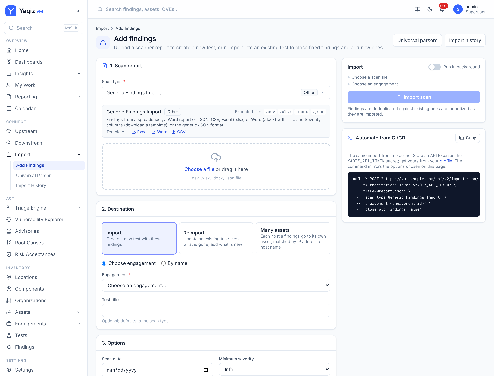
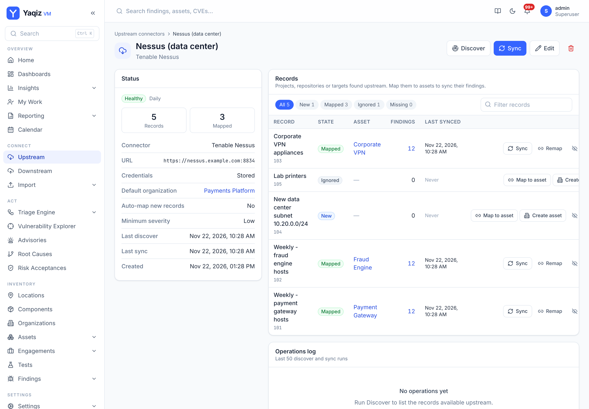

# 3. Bringing in findings

Yaqiz collects findings from scanner reports you upload, from spreadsheets and Word reports, from tools it pulls
from on a schedule, and from your CI/CD pipelines. Every import is deduplicated against what is already there and
prioritized as it arrives, and a re-import of the same scan closes what was fixed and adds what is new.

In this chapter:

* [Before you start](#before-you-start)
* [Import a scan report](#import-a-scan-report)
* [Supported scanners](#supported-scanners)
* [Generic Findings Import (CSV, Excel, Word, JSON)](#generic-findings-import-csv-excel-word-json)
* [Universal Parser](#universal-parser)
* [Re-import a scan](#re-import-a-scan)
* [Import History](#import-history)
* [Upstream connectors](#upstream-connectors)
* [Send results from CI/CD](#send-results-from-cicd)
* [Add a single finding by hand](#add-a-single-finding-by-hand)

## Before you start

Findings live in a hierarchy: **Organization › Asset › Engagement › Test › Finding**, and each import creates or
updates one *test* ([chapter 2](02-inventory.md#the-data-model)). You need the permission "Import and reimport scan
reports" on the asset (the roles Writer, Maintainer, Owner and API_Importer have it), plus the matching "add"
permissions to create a missing organization, asset or engagement during an import. Ask your administrator if an
import is refused ([who can see what](02-inventory.md#members-and-roles-who-can-see-what)).

## Import a scan report

1. Go to **Connect › Import › Add Findings**. You can also click **Import scan** on an asset or engagement page, which
   fills in the destination for you.
2. Under **1. Scan report**, open **Scan type** and type part of the tool name or file extension. The list is grouped
   by category and shows the file types each format expects; a box below the picker describes the chosen format.
3. Drop the report onto the upload box, or click **Choose a file**. If the extension does not match the scan type,
   a warning says the file "may not parse".
4. Under **2. Destination**, keep **Import** selected ("Create a new test with these findings"), then either:
   - **Choose engagement** and pick an existing **Engagement**, or
   - **By name**: type the **Organization**, **Asset** and **Engagement**. Leave **Create the organization, asset and
     engagement if they do not exist** checked to create what is missing; otherwise the import fails when one of them
     does not exist. An engagement created this way has the type CI/CD and the status In Progress.
5. Optionally enter a **Test title** (it defaults to the scan type).
6. Under **3. Options**, adjust what you need (see the table below), then click **Import scan**.



| Option | What it does |
|---|---|
| **Scan date** | Discovery date of the new findings. Defaults to the date in the report, or today. |
| **Minimum severity** | Findings below this severity are skipped. |
| **Active**, **Verified** | **Not specified** keeps what the report says (by default new findings are active and unverified); **Yes** or **No** overrides it. |
| **Tags** | Tags for the test. Tick **Also tag findings** or **Also tag locations / endpoints** to copy them. |
| **Close old findings** | Closes findings from earlier imports of the same tool in this engagement that are not in this report. **Across the whole asset** looks in every engagement of the asset. |
| **Build, grouping and environment** | Click to expand: **Group findings by** (creates [finding groups](04-working-with-findings.md#finding-groups)), **Environment** (default Development), **Service** (when several applications share one asset; matching and closing then stay within that service), **Version**, **Branch / tag**, **Commit hash**, **Build ID**. |

**The result.** An **Import complete** card shows how many findings were **Created**, **Closed**, **Reactivated** and
**Untouched**, by severity, how many were duplicates of existing findings, and any warnings. Use **View test**,
**Created findings** or **Closed findings** to jump to them.

**Large files.** Turn on **Run in background** to queue the import; reports larger than 8 MB always run in the
background. The page then shows **Import queued**. Destination and permissions are checked first, so a refusal shows
right away; when the import ends you get an in-app alert ("Background import finished" or "Background import failed"
with the reason). Upload size limits are set on the server; see the installation guide
(`docs/on-prem-installation.md` in the release package).

## Supported scanners

Yaqiz reads 97 report formats out of the box. For the full list, open the **Scan type** picker on **Add Findings**:
the search box shows how many scan types exist, and each entry lists its file types and alternative names ("Also:
…"). Every scan type name is also listed under **Settings › Data Model › Test Types**.

| Category | Tools |
|---|---|
| Infrastructure | Tenable Nessus, Tenable.io and Tenable.sc, Qualys VM/VMDR (XML or CSV), Rapid7 InsightVM / Nexpose, Microsoft Defender for Endpoint, CrowdStrike Falcon Spotlight, Greenbone/OpenVAS, ManageEngine Vulnerability Manager Plus / Endpoint Central, Wazuh, OpenSCAP, Lynis, Nmap, kube-bench |
| TLS | testssl.sh, SSLyze, SSL Labs |
| DAST and APIs | Burp Suite, OWASP ZAP, Acunetix, Invicti / Netsparker / Acunetix 360, HCL AppScan, Fortify WebInspect, Rapid7 AppSpider, Qualys WAS, Nuclei, Nikto, Wapiti, WPScan, StackHawk |
| SAST | SARIF (any tool), Checkmarx, Checkmarx One, Fortify SCA (`.fpr`, `.fvdl`), Veracode, Semgrep, SonarQube/SonarCloud, GitHub code scanning (CodeQL), SpotBugs / Find Security Bugs, Bandit, Brakeman, gosec, ESLint, Horusec, njsscan, Bearer, Cppcheck, Kiuwan |
| SCA | Snyk, Black Duck, JFrog Xray, Sonatype Nexus IQ, Mend, OWASP Dependency-Check, Dependency-Track, CycloneDX (BOM or VEX), npm audit, yarn audit, pip-audit, Safety, bundler-audit, cargo-audit, govulncheck, Composer audit, OSV-Scanner, Retire.js, GitHub Dependabot |
| Container | Trivy, Grype, Anchore Engine/Enterprise, Aqua, Prisma Cloud Compute / Twistlock, Harbor, Sysdig, Clair, Docker Scout |
| IaC | Checkov, KICS, tfsec, Terrascan, Kubescape, kubeaudit, Hadolint |
| Cloud | AWS Security Hub (ASFF), Amazon Inspector, Microsoft Defender for Cloud, Google Cloud Security Command Center, Prowler, ScoutSuite, Wiz |
| Secrets | Gitleaks, TruffleHog, detect-secrets, GitGuardian ggshield, Talisman (secrets are stored masked) |
| Mobile | MobSF and mobsfscan |
| Bug bounty | HackerOne, Bugcrowd |
| Other | Generic Findings Import |

Fortify `.fpr` and Black Duck report `.zip` files are uploaded as they are. Most formats accept several names (for example "Nessus Scan" for "Tenable Scan"). For a format that is not listed,
use the Generic Findings Import or a Universal Parser.

## Generic Findings Import (CSV, Excel, Word, JSON)

Use **Generic Findings Import** for findings that do not come from a supported scanner, such as penetration test
reports, audit results or your own lists.

1. On **Add Findings**, choose the scan type **Generic Findings Import**.
2. In the description box, click **Excel**, **Word** or **CSV** next to **Templates:** to download an empty template
   (headers and instructions only, so an untouched template imports nothing).
3. Fill in one finding per row (or per table in Word), then import the file as described above.

**Columns.** **Title** and **Severity** (Critical, High, Medium, Low or Info) are required; other cells may stay
empty, and rows without a title are skipped. Optional columns: **Description**, **Mitigation**, **Impact**,
**References**, **CVE** (comma separated), **CweId**, **CVSSV3** (vector), **Url** (URLs or hosts, comma separated;
each becomes a location), **ComponentName**, **ComponentVersion**, **FilePath**, **Line**, **Date** (YYYY-MM-DD),
**UniqueIdFromTool**, **Tags**, and also **Active**, **Verified**, **FalsePositive**, **Mitigated** (true, yes, y, 1
or x), **VulnerabilityIds**, **VulnIdFromTool** and **Service**. Names are not case sensitive and spaces and
punctuation are ignored ("Component Name" works). When a standard column is missing, these wordings are accepted:

| Standard column | Also accepted |
|---|---|
| Title | Name, Finding, Finding Title, Vulnerability, Issue |
| Severity | Risk, Risk Level, Risk Rating, Rating |
| Mitigation | Recommendation(s), Remediation, Solution, Fix |
| Description | Details, Observation, Summary |
| Url | Affected host(s), Affected URL(s), Affected systems, Location, Endpoint, Host |
| CVE, CweId, References, CVSSV3 | CVEs; CWE; Reference; CVSS or CVSS Vector |

**Excel.** Yaqiz uses the first sheet with a Title and a Severity column; the header row may follow a few title or
note rows. The Excel template has a **Findings** sheet (with a Severity drop-down) and an **Instructions** sheet.

**Word.** Use either one table with Title and Severity columns and one finding per row, or one two-column table per
finding with the labels (Title, Severity, Description, Recommendation, Affected hosts, …) in the first column and the
values in the second. The Word template contains both layouts.

**Old Office formats.** Excel 97-2003 (.xls) and Word 97-2003 (.doc) files are refused. Open the file, choose **File
› Save As**, save it as Excel Workbook (.xlsx) or Word Document (.docx), and upload that file.

**JSON.** Use an object with a `findings` list; each finding needs `title` and `severity`:

```json
{"findings": [{"title": "Outdated TLS configuration", "severity": "Medium", "description": "TLS 1.0 is enabled.",
  "endpoints": ["https://portal.example.com"], "unique_id_from_tool": "PT-2026-007"}]}
```

**Re-importing a corrected report.** By default a re-import recognizes a Generic Findings Import finding by its
Title, CWE, Line, File path and Description. If you change those between versions, the finding counts as new and the
old one is closed. The **Matching policy** card on the test page shows the rule in use; an administrator can change it
under **Settings › Risk & Matching › Matching Configuration** ([chapter 7](07-administration.md#risk--matching)), for
example to match on UniqueIdFromTool.

## Universal Parser

A Universal Parser teaches Yaqiz any other CSV, JSON or XML format without code: you map the fields of a sample
report once, and the parser becomes a scan type named "Universal Parser - <label>". Use it for an in-house or niche
tool whose output you import regularly and cannot change; if you can shape the file yourself, the Generic Findings
Import is simpler. Creating and editing parsers needs the permission "Manage universal parsers".

1. Go to **Connect › Import › Universal Parser** and click **New parser**.
2. **Sample report**: enter a **Label**, upload a real report (at most 5 MB), check the **File type** and, for JSON
   or XML, the **Items path** or **Item element** that holds the findings. Click **Detect fields**.
3. **Field mapping**: choose the source for each finding field; **Title**, **Severity** and **Description** are
   required. Under **Severity values**, map the tool's values ("Automatic" recognizes words such as critical, high,
   moderate or 1-5) and set a **Default severity**.
4. **Preview & save**: check the parsed findings, then click **Create parser** and **Import a report with it**.

On the parser list, **Active** shows or hides a parser on the Import page. Renaming a parser renames its scan type
(update your CI jobs); parsers in use cannot be deleted, so deactivate them instead.

## Re-import a scan

Re-import a newer report into the existing test to keep one up-to-date picture instead of a new test per scan.

1. Open the test (for example from **Import History**) and click **Reimport**. Or, on **Add Findings**, choose
   **Reimport** under **2. Destination** and pick the **Test**. The scan type is taken from the test.
2. Choose the file and options. **Close old findings** is on by default; **Do not reactivate** keeps mitigated
   findings closed even if the report lists them again.
3. Click **Reimport scan**.

Yaqiz matches each finding in the report against the findings of the test, using the scan type's reimport rule
(shown on the test page under **Matching policy**):

| Finding in the new report… | Result |
|---|---|
| matches an open finding | Stays open (**Untouched**). Fix version, file path, line and component version are refreshed; new locations are added and locations no longer reported are marked mitigated. |
| matches a Mitigated finding | Reopened (**Reactivated**) with the note "Re-activated by … re-upload". With **Do not reactivate**, it stays closed and gets a note instead. |
| matches a False Positive, Out Of Scope, Risk Accepted or Duplicate finding | Left as it is (**Untouched**): your triage decisions survive re-imports. |
| has no match | Created as a new finding, then checked for duplicates on the asset. |
| *(an open finding of the test is missing from the report)* | Closed as Mitigated with the note "Mitigated by … re-upload", when **Close old findings** is on. |

If a report lists no findings and Yaqiz cannot recognize it as a valid empty report of that format, nothing is closed
and the result shows a warning.

## Import History

**Connect › Import › Import History** opens the **Tests** page (also **Inventory › Tests**): every scan import and
manual test with its scan type, asset, engagement, status and finding counts, newest first. Filter it by **Test
type**, **Category**, **Organization**, **Asset**, **Engagement**, tags or creation date; click a row to open a test.

On the test page, the **Import history** tab shows every import and re-import: who ran it, when, the file name, build
details and the counts of **created**, **closed**, **reactivated**, **untouched** and **duplicates**. Each count links
to exactly those findings, and **Import options** shows the options used. A warning appears when a re-import closed
every open finding and matched none, which usually means the wrong report was uploaded. The page header also offers
**Reimport**, **Import a new scan into engagement** and **Delete test**.


## Upstream connectors

Upstream connectors pull findings straight from a tool's API on a schedule. **Connect › Upstream** is shown only when
the **Upstream Connectors** feature flag is on (it is by default, under **Settings › Feature Flags**) and you have the
permission "Manage upstream and downstream connectors".

| Connector | What it pulls (one record per…) |
|---|---|
| Tenable Nessus | Latest results of each scan, from Nessus Professional / Manager or Tenable Vulnerability Management (scan) |
| ManageEngine Vulnerability Manager Plus | Open vulnerabilities of managed computers, also from Endpoint Central build 11.3.2430.01 or later (computer, or the whole server) |
| GitHub Advanced Security | Open code scanning and Dependabot alerts of an organization's repositories, imported as two tests (repository) |
| SonarQube | Issues and security hotspots of each project (project) |
| Dependency-Track, Snyk, Semgrep | The project's open findings, under the same scan types as the tools' report files (project) |
| Generic JSON Feed | Any HTTP endpoint returning the generic JSON format (feed) |

**Add a connector**

1. On **Connect › Upstream**, find the tool under **Available connectors** and click **Add configuration**.
2. Enter a unique **Name**. Synced findings land in the engagement "Connector - <name>" of each mapped asset.
3. Fill in the connection fields. **Tenable Nessus**: **Server URL** (`https://<host>:8834`, or
   `https://cloud.tenable.com`), **API access key** and **API secret key** (in Nessus under Settings › My Account › API
   Keys), optionally **Only scans in folder** and **Only scans whose name contains**. **ManageEngine**: **Server URL**,
   an **API auth token** or a technician username and **Password** with the **Sign-in type**, and under **Records**
   one record per computer (each becomes an asset) or one for the whole server. Secrets are never shown again.
4. Set the **Sync schedule** (Manual only, Every hour, Every 6 hours, Every 12 hours, Daily or Weekly) and the
   **Minimum severity**. Optionally choose a **Default organization** and turn on **Automatically map newly discovered
   records to assets**, so new records become assets there by themselves. Click **Add connector**.

**Discover, map and sync**

1. On the connector page, click **Discover** to list the records the tool exposes.
2. In the **Records** table, click **Map to asset**, **Create asset** or **Ignore** for each record. Filter the table
   by **New**, **Mapped**, **Ignored** or **Missing** (no longer found upstream).
3. Click **Sync** to import every mapped record now (or **Sync** on one row). Each sync is a re-import with **Close old
   findings** on, so fixed issues close and returning ones reopen (see [Re-import a scan](#re-import-a-scan)).

Enabled connectors with a schedule are checked every 30 minutes and run discovery and sync when due. The **Status**
card shows the last runs and the last error; the **Operations log** keeps the last 50 runs. Failing records raise a
"Connector … had N failing records" alert. Keep **Verify TLS certificate** on; your administrator can make an
internal CA trusted (see the installation guide).



## Send results from CI/CD

Pipelines import through the REST API with the same options as the Add Findings page.

1. **Get a token.** For a pipeline, ask your administrator for a service user with the API_Importer role: the
   administrator clicks **Generate API token** on that user's page and gives you the token (it is shown once). For
   your own scripts, choose **API token** in the user menu at the top right and use **Reveal** and the copy button. A
   token carries all of its user's permissions, so treat it like a password; **Rotate** (or generating a new service
   user token) replaces it and stops the old one at once.
2. **Store it** in your CI system as a secret, for example `YAQIZ_API_TOKEN`.
3. **Build the command.** On **Add Findings**, choose the scan type, destination and options; the **Automate from
   CI/CD** card shows the matching `curl` command to copy into your pipeline.

`POST /api/v2/import-scan/` creates a new test on every call. `POST /api/v2/reimport-scan/` updates a test: pass its
`test` id, or names as below. With names, Yaqiz re-imports into the newest test of that scan type in the engagement
(with that `test_title`, if given) or creates it on the first run. Send the token as `Authorization: Token …`:

```bash
curl --fail -X POST "https://vm.example.com/api/v2/reimport-scan/" \
  -H "Authorization: Token $YAQIZ_API_TOKEN" \
  -F "file=@trivy-report.json" \
  -F "scan_type=Trivy Scan" \
  -F "organization_name=Retail" \
  -F "asset_name=Web shop" \
  -F "engagement_name=CI/CD Pipeline" \
  -F "auto_create_context=true" \
  -F "commit_hash=$COMMIT_SHA"
```

Other fields mirror the page: `engagement`, `test_title`, `scan_date`, `minimum_severity`, `active`, `verified`,
`tags`, `close_old_findings`, `do_not_reactivate`, `group_by`, `service`, `version`, `branch_tag`, `build_id`,
`environment`, `background_import`. Success returns HTTP 201 with the test id and the created, closed, reactivated and
untouched counts; 202 means it was queued (reports over 8 MB, `background_import=true`, or the field left out while
**Background imports from the API** is on in the system settings). Refusals return 400 (a field problem), 403 (not
allowed) or 404 (target not found). The book icon in the top bar opens the full API reference.

## Add a single finding by hand

For a finding from a manual review, open any list under **Inventory › Findings** and click **New Finding** (you need
permission to add findings). Choose the **Test** it belongs to, fill in **Title**, **Severity** and **Description
(markdown)**, optionally the classification, location and **Assignee**, and click **Create finding**. Reusable
write-ups are kept as [finding templates](04-working-with-findings.md#finding-templates).

Next: [4. Working with findings](04-working-with-findings.md)
