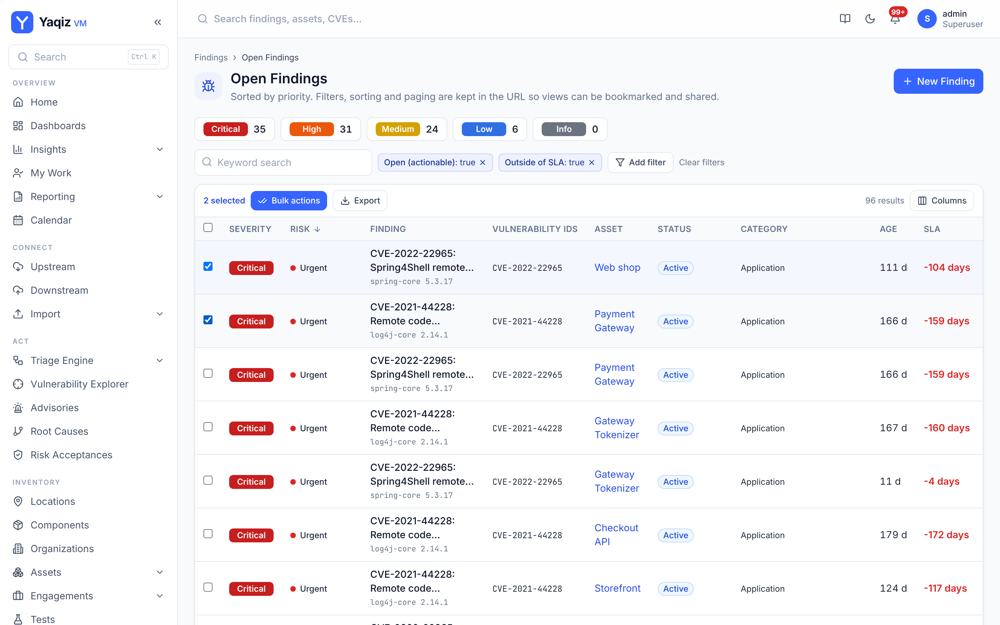
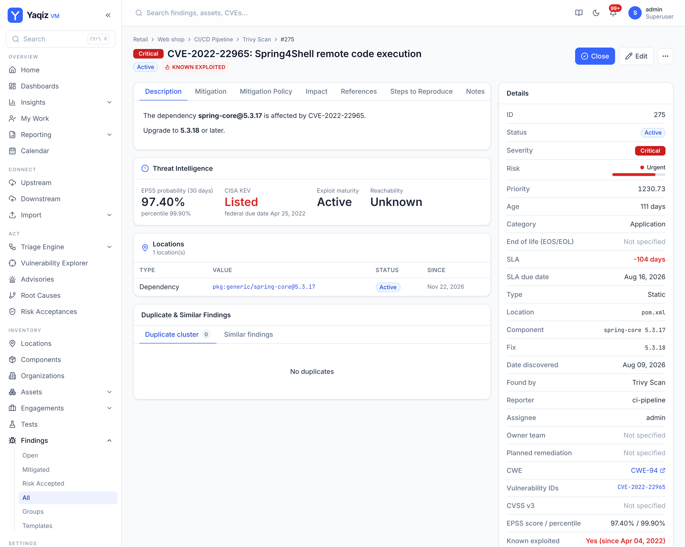
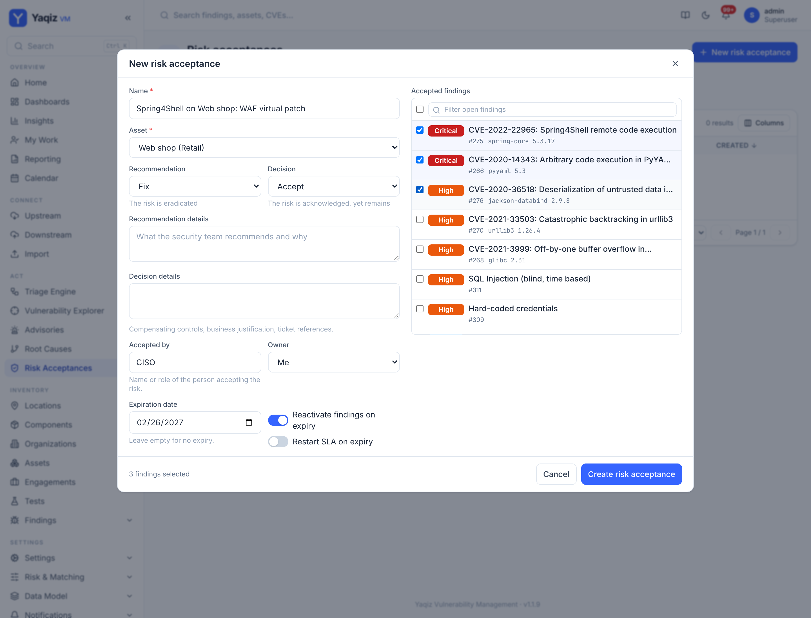
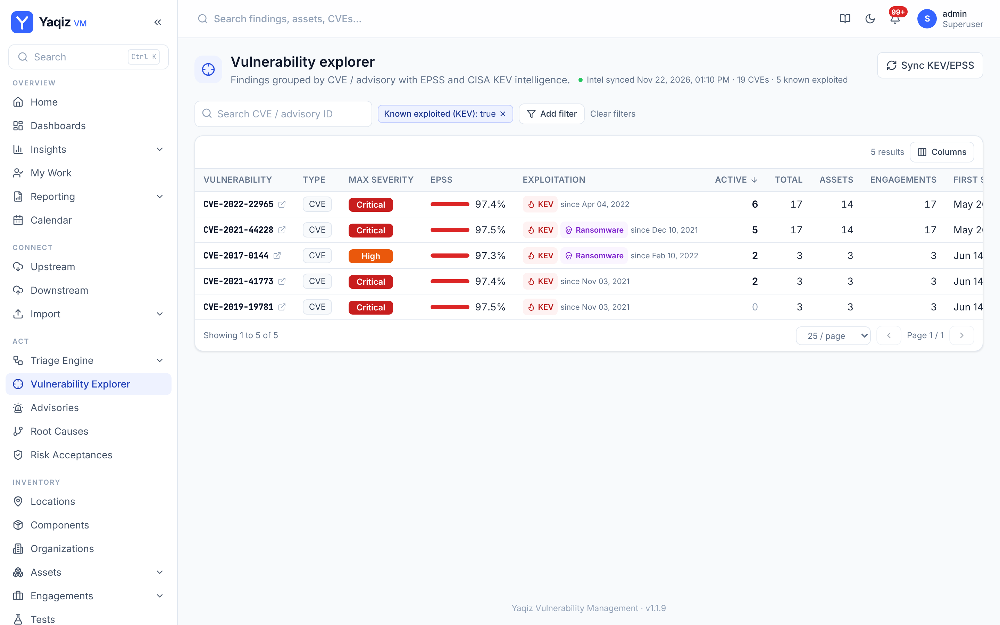
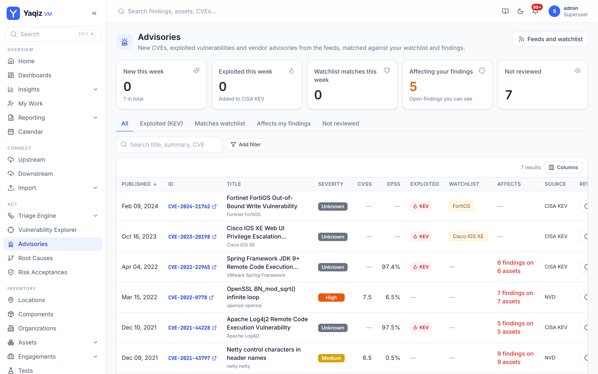

# 4. Working with findings

This chapter shows how to find the findings that matter, read what Yaqiz knows about each one, and move them to a
decision: fixed, false positive, out of scope or accepted risk. It also covers the views that group findings by
vulnerability and by root cause, so you can fix one thing and close many findings, and the **Advisories** page, which
tells you about new CVEs and exploited vulnerabilities and which of your findings they affect.

In this chapter:

* [Find the findings you need](#find-the-findings-you-need)
* [Read a finding](#read-a-finding)
* [Severity, risk, priority and SLA](#severity-risk-priority-and-sla)
* [Categories and end-of-life software](#categories-and-end-of-life-software)
* [Change a finding's status](#change-a-findings-status)
* [Assign findings and request reviews](#assign-findings-and-request-reviews)
* [Bulk actions](#bulk-actions)
* [Risk acceptances](#risk-acceptances)
* [Finding groups](#finding-groups)
* [Finding templates](#finding-templates)
* [Vulnerability Explorer](#vulnerability-explorer)
* [Advisories](#advisories)
* [Root Causes](#root-causes)

## Find the findings you need

**Inventory › Findings** offers four lists: **Open**, **Mitigated**, **Risk Accepted** and **All**. *Open* means
actionable: active and not mitigated, false positive, out of scope, risk accepted or a duplicate. The findings tables
on asset, engagement and test pages work the same way.

1. Lists are sorted by priority, highest first. Click a column heading to sort by it instead.
2. Click a severity button above the table (each shows its count) to show only that severity; click again to clear.
3. Type in **Keyword search**, or click **Add filter** and pick a filter. Filters are grouped (Triage, SLA, Dates,
   Details, Source, Exploitability, Asset context, People, Context). Active filters appear as chips: click one to
   change it, click its × to remove it, or click **Clear filters**.
4. Use **Columns** to show or hide columns. Your choice is remembered in your browser.
5. Click **Export** and choose **Export as CSV**, **Export as XLSX** or **Export as JSON** to download every finding
   that matches the current filters.

Useful filters: **Outside of SLA**, **SLA days remaining ≤**, **Known exploited (KEV)**, **EPSS score ≥ (0-1)**,
**Risk**, **Fix available**, **Asset internet accessible**, **Assignee (id or 'me')** and **Duplicate**.

To filter by what a finding is about, how old it is and who owns it:

* **Category** (group Triage): one or more categories, such as **Windows OS** or **Web (servers, CMS, web apps)**.
* **End of life (EOS/EOL)** (group Triage): **Yes** for only the findings about software past its end of life or end
  of support, **No** for all others. Both are explained in
  [Categories and end-of-life software](#categories-and-end-of-life-software).
* **Age at least (days)** and **Age at most (days)** (group Dates): the days since a finding was discovered. Together
  they give a range, for example 31 and 60 for the findings that are one to two months old.
* **Owned by user ID (or me)** and **Owned by group ID** (group Context): the findings a person or a group owns. A
  person or group owns a finding when it is assigned to them, or when they are members of its asset (on the asset or
  on its organization); a person also owns what their groups own. Enter `me` for your own findings, or the ID of a
  user or group. You rarely need to type them: a number on an Insights page filtered by **Owner** or **Group** opens
  the findings list with this filter set ([chapter 6](06-dashboards-and-reports.md#insights)).

There is no separate "saved view": filters, sorting and paging are kept in the page address, so bookmark the page or
send the link to a colleague (who sees only what their own permissions allow). **Overview › My Work** has ready-made
shortcuts such as "My open findings" and "Unassigned urgent findings".

The default columns are **Severity**, **Risk**, **Finding** (title plus component or file), **Vulnerability IDs**,
**Asset**, **Status**, **Category** (with an **EOL** mark on end-of-life findings), **Age**, **SLA**, **EPSS**,
**Found By** and **Tags**. You can add **Priority**, **Organization**, **KEV**, **CWE**, **Assignee**, **Engagement**,
**Unique ID From Tool**, **Discovered** and **Created**. The **Category** column came with Yaqiz 1.1.8: if you opened
the findings list in this browser before the upgrade, the browser keeps your earlier columns, so tick **Category**
under **Columns** to show it.

## Read a finding

Click a finding's title to open it. The breadcrumb shows where it lives (**Organization › Asset › Engagement › Test**),
and the header shows its severity, status and badges such as **Verified** and **Known exploited**. A banner tells you
when the finding is a duplicate (with a link to the original) or under review.

- **Tabs**: **Description**, **Mitigation**, **Mitigation Policy** (your organization's standard guidance),
  **Impact**, **References**, **Steps to Reproduce** (with the severity justification), **Notes**, **Files**,
  **History**, and **Request / Response** when the scanner recorded HTTP traffic.
- **Details** card: **Status**, **Severity**, **Risk** (with a bar), **Priority**, **Age**, **Category** (marked
  **set by hand** when someone chose it), **End of life (EOS/EOL)**, **SLA** and **SLA due date**, **Location** (file
  and line), **Component**, **Fix**, **Date discovered**, **Found by**, **Assignee**, **Owner team**, **Planned
  remediation**, **CWE**, **Vulnerability IDs**, **CVSS v3**, **EPSS score / percentile**, **Known exploited**,
  **Service**, **Finding group**, and after closing **Mitigated** and **Within SLA**.
- **Threat Intelligence**: the EPSS probability of exploitation in the next 30 days and its percentile, whether the
  CVE is listed in CISA KEV (with the federal due date), exploit maturity and reachability.
- **Locations**: every affected URL, host, file or component with its status (for example Active or Mitigated).
- **Duplicate & Similar Findings**: **Duplicate cluster** lists the original and all its duplicates; **Similar
  findings** lists findings with the same title, a shared vulnerability ID, or the same CWE and file path.
- **Notes**: type a note and click **Add note**. Mention a colleague with @username to notify them; tick **Private**
  to keep the note to yourself. Notes you enter when closing a finding appear here too.
- **Files**: attach evidence (up to 50 MB; common document, image, report and archive types) and click **Upload**.
- **History**: **Status changes** (from, to, when, who, and the source, such as import, reimport or bulk), **Field
  changes** and **Imports**.

## Severity, risk, priority and SLA

**Severity** (Critical, High, Medium, Low, Info) is what the scanner reported; you can change it with **Edit**.
**Priority** and **Risk** are what Yaqiz sorts by. At a high level:

- **Priority** is a number that starts from the severity and grows with exploit evidence (EPSS score, a CISA KEV
  listing, exploit maturity), exposure (number of active locations, whether the asset is internet accessible or has
  an external audience), reachability, an open review, and the asset's business context (criticality and its share
  of the organization's user records and revenue). The weights come from the prioritization engine assigned to the
  asset. Priority uses the severity, not the CVSS score; **CVSS v3** is shown for reference.
- **Risk** expresses the priority as a 0-100 risk score and puts it into one of four bands: **Urgent**, **Needs
  Action**, **Medium** or **Low**. An engine can raise actively exploited findings to at least a given band and cap
  unreachable ones.
- **Priority override** and **Risk override** (in **Edit**) replace the computed values for one finding.
- **EPSS and KEV** data is attached to findings with CVE identifiers when they are imported, if Yaqiz already knows
  the CVE, and otherwise by the daily enrichment run. When CISA adds a CVE to its KEV catalog, the findings that carry
  it are marked as known exploited within the hour, without waiting for the daily run, when the **CISA KEV** advisory
  feed ([Advisories](#advisories)) and the **CISA KEV lookup** of Finding Enrichment are both on
  ([chapter 7](07-administration.md#advisory-feeds)).

**SLA.** The SLA configuration of the asset (the default one unless your administrator chose another) sets how many
days a finding may stay open, by severity or by risk band. The clock normally starts on the discovery date; a
configuration can also cap the due date at the CISA KEV due date. Info findings have no SLA when the deadline depends
on severity. The **SLA** column counts the days left: amber within 7 days, "Due today", and a negative number in red
once the finding is overdue. Use the **Outside of SLA** filter to list overdue findings; if an administrator turned on
SLA breach notifications, you are also alerted. When a finding is closed, **Within SLA** records whether it was closed
in time. Configuring SLAs and prioritization engines is covered in [chapter 7](07-administration.md#risk--matching).

## Categories and end-of-life software

Every finding has a **category** that says what the vulnerability is about, and so which kind of team usually fixes
it: **Windows OS**, **Unix / Linux OS**, **Application**, **Web (servers, CMS, web apps)**, **Database**, **Network /
hardware**, **TLS & configuration** or **Other**. Yaqiz works it out for each finding from its title, its component,
the scanner's own category (for example the Qualys "Category"), the host's operating system and the kind of tool that
found it. Findings that existed before Yaqiz 1.1.8 were categorized during the upgrade.

Findings about software past its end of life or end of support are flagged as end of life (EOS/EOL). Yaqiz recognizes
them by their title, for example Qualys "EOL/Obsolete …", "Unsupported Version Detection" or "End of Life / End of
Support". The flag follows the title; it cannot be set by hand.

You find both in the **Category** column of the findings lists (with an **EOL** mark; click the heading to sort by
category), on the finding's **Details** card and in the filters **Category** and **End of life (EOS/EOL)**
([above](#find-the-findings-you-need)). The Insights pages filter by **Category** and **EOS / EOL**, and
**Overview › Insights › Executive** charts the open findings by category
([chapter 6](06-dashboards-and-reports.md#insights)).

**Change a category.** Where the automatic choice is wrong, choose the category by hand:

* One finding: click **Edit**, choose the **Category** and click **Save**.
* Many findings: tick them in a findings list, choose **Bulk actions › Edit severity / plan…**, pick the **Category**
  and click **Apply**.

A category chosen by hand is kept when later imports update the finding, and the **Details** card marks it **set by
hand**. To let Yaqiz work the category out again, choose **Automatic**. In the **Edit** dialog this option shows the
current automatic category, for example **Automatic (Application)**, or reads **Automatic (recalculated)** when the
category was chosen by hand.

## Change a finding's status

Status changes need the permission "Change finding status" (the Writer, Maintainer and Owner roles have it). Buttons
you may not use are not shown. Open the finding and use the header buttons or the **⋯** (More actions) menu:

| Action | Where | Result |
|---|---|---|
| **Close** | Header, open findings | **Mitigated**. A note is required. |
| **Reopen** | Header, closed findings | **Active**. A risk-accepted finding leaves its risk acceptance (you confirm first). |
| **Mark verified** / **Mark unverified** | ⋯ menu | Adds or removes the **Verified** badge. Duplicates and false positives cannot be verified. |
| **False positive** | ⋯ menu | **False Positive**. A note is required. |
| **Out of scope** | ⋯ menu | **Out Of Scope**. A note is required. |
| **Accept risk (simple)** / **Unaccept risk** | ⋯ menu | **Risk Accepted** without a formal record or expiry. Only open findings; the asset must allow simple risk acceptance. |
| **Add to risk acceptance…** | ⋯ menu | Opens a new formal risk acceptance for this finding ([below](#risk-acceptances)). |
| **Mark as duplicate of…** | ⋯ menu | **Duplicate** of the **Original finding ID** you enter. |
| **Reset duplicate status** / **Set as original** | ⋯ menu, duplicates | Makes the finding independent again, or makes it the original of its cluster. |

The ⋯ menu also offers **Request review**, **Push to issue tracker** (see
[chapter 5](05-automation.md#downstream-issue-trackers)), **Copy finding** and **Delete**. Use **Edit** to change the
finding's text, severity, CWE, CVSS v3 vector, component, **Category**, tags, **Planned remediation date** and
**Effort for fixing**.

A finding shows one status at a time: **Active**, **Inactive**, **Under Review**, **Mitigated**, **Risk Accepted**,
**Out Of Scope**, **False Positive** or **Duplicate**. Duplicates cannot be reopened; reset the duplicate status
first. Re-imports respect your decisions: they reopen Mitigated findings that reappear but never touch false
positives, out-of-scope, risk-accepted or duplicate findings ([Re-import a
scan](03-bringing-in-findings.md#re-import-a-scan)).

## Assign findings and request reviews

1. Open the finding, click **Edit**, choose the **Assignee** and click **Save**. To assign many findings at once,
   use **Bulk actions › Assign…**. Leave the field empty to unassign.
2. Only open findings can be assigned, and the assignee must be able to see the finding. Accepting the risk of a
   finding removes its assignee.
3. Assignees find their work under **Overview › My Work**, together with reviews they were asked for and risk
   acceptances waiting for their decision.

To get a second opinion, choose **⋯ › Request review**, pick the **Reviewers** (they must be able to see the finding),
write a **Note** and click **Request review**. The finding becomes **Under Review** and the reviewers get an alert. A
reviewer then chooses **⋯ › Clear review**, picks the **Resulting status** (**Keep active**, **Verified**, **False
positive**, **Out of scope** or **Mitigated**), adds a **Note** and clicks **Clear review**.

## Bulk actions

1. In any findings list, tick the findings (the box in the header row selects the whole page). The toolbar shows how
   many are selected; one bulk action handles at most 5,000 findings.
2. Click **Bulk actions** and choose:
   - **Change status…**: **Mitigated (close)**, **False positive**, **Out of scope**, **Verified**, **Unverified**,
     **Active (reopen)**, **Inactive** or **Under defect review**, with an optional **Note** kept when closing.
   - **Edit severity / plan…**: **Severity**, **Category** (one of the categories, or **Automatic**), **Planned
     remediation date**, **Planned remediation version**.
   - **Tags…**: **Add**, **Remove** or **Replace all** tags.
   - **Assign…**, **Request review…**, **Accept risk (simple)**, **Unaccept risk**, **Push to issue tracker** or
     **Delete…**.
3. Confirm the dialog (**Apply** for most actions). If some findings could not be changed, a dialog lists them with
   the reason, for example "closed findings cannot be assigned" or that you may not change that finding's asset.

Check boxes appear only if you may edit findings; status changes and **Delete…** need the matching permissions.

## Risk acceptances

A risk acceptance is a formal, documented decision about the risk of one or more findings of an asset, with an
owner and an expiry date. It replaces the quick **Accept risk (simple)** when you need a record. **Act › Risk
Acceptances** lists them with their **State**, **Decision**, number of findings, **Owner** and **Expires** date; filter
by **State**, **Expiring within N days**, **Asset** or **Owner**.

**Create one**

1. Click **New risk acceptance** (or, on a finding, **⋯ › Add to risk acceptance…**).
2. Enter a **Name** and choose the **Asset**. Full risk acceptance must be enabled for the asset (it is by default).
3. Choose the **Recommendation** and the **Decision**: **Accept**, **Avoid**, **Mitigate**, **Fix** or **Transfer**.
   Explain them under **Recommendation details** and **Decision details** (compensating controls, justification,
   ticket references).
4. Enter **Accepted by** (name or role, for example CISO) and an **Owner** (you, if left empty).
5. Check the **Expiration date** (proposed 90 days ahead; leave it empty for no expiry) and the toggles **Reactivate
   findings on expiry** and **Restart SLA on expiry**.
6. Under **Accepted findings**, tick the open findings of the asset this decision covers (at most 5,000), then click
   **Create risk acceptance**. The findings become **Risk Accepted**. A finding already in another risk acceptance is
   left out.

**Approval.** If the **Risk Acceptance Approvals** feature flag is on (it is off by default, under **Settings ›
Feature Flags**), a new risk acceptance starts as **Pending approval** and its findings are not accepted until an
approver clicks **Approve** (or **Reject**, with a reason). Approving needs the permission "Approve or reject risk
acceptances" (the Maintainer and Owner roles have it). By default you cannot approve your own request.

**Expiry.** An alert is sent some days before the expiration date (10 by default). On the date, the risk acceptance
becomes **Expired** and, if **Reactivate findings on expiry** is on, its findings are active again and their SLA
clock resumes (or starts again from that day, with **Restart SLA on expiry**). On the risk acceptance page you can
also **Expire now**, **Reinstate** an expired one with a **New expiration date**, **Edit** it, use **⋯ › Add
findings…**, remove a finding with its trash icon, or **Delete** it (its findings stop being risk accepted).

## Finding groups

A finding group bundles related findings of one test, for example every vulnerability fixed by upgrading one
component, so they can be triaged and ticketed together. Groups are created when a scan is imported with **Group
findings by** (**Component name**, **Component name + version**, **File path** or **Finding title**; see [Import a
scan report](03-bringing-in-findings.md#import-a-scan-report)), provided the **Finding groups** system setting is on
(it is by default). Duplicates are not grouped.

1. Open **Inventory › Findings › Groups** to see each group's **Max severity**, **Test**, **Asset**, **Findings** and
   **Active** counts.
2. Click a group to open the findings list filtered to it, then use filters and **Bulk actions** as usual.

A finding's group is shown as **Finding group** on its detail page.

## Finding templates

Finding templates are reusable write-ups for manual findings from penetration tests and reviews: title, severity,
CWE, CVSS v3 vector, description, mitigation, impact, references, vulnerability IDs and tags.

1. Open **Inventory › Findings › Templates** and use **Search templates** to find one.
2. Click a template to read it. Copy its text into the **New Finding** form
   ([chapter 3](03-bringing-in-findings.md#add-a-single-finding-by-hand)) when you record a finding.
3. To add or change templates, you need the permission "Manage finding and report templates": click **New
   template**, or use a template's menu to **Edit** or **Delete** it. Deleting a template does not affect findings.

## Vulnerability Explorer

**Act › Vulnerability Explorer** groups findings by CVE or advisory, with EPSS and CISA KEV intelligence. Use it to
answer "where are we exposed to this vulnerability?" and to spot the exploited ones first. The page header shows when
threat intelligence was last synced and how many CVEs are known exploited. It starts from your findings; to hear about
new vulnerabilities as they are published, use [Advisories](#advisories).

1. Search by **CVE / advisory ID**, or filter, for example by **Known exploited (KEV)**, **Used in ransomware**, **EPSS
   score ≥ (0-1)**, **Fix available**, **Asset criticality** or **Asset internet accessible**.
2. Read the row: **Max severity**, **EPSS** (bar and score), **Exploitation** (**KEV** and **Ransomware** badges with
   the date added), the number of **Active** and **Total** findings, **Assets** and **Engagements** affected, and when
   it was **First seen** and **Last seen**. Rows are sorted by active findings; click a heading to re-sort.
3. Click a row to list all its findings, or the **Active** count to list only the active ones.

Superusers also see **Sync KEV/EPSS**, which downloads the latest CISA KEV catalog and EPSS scores and applies them.

## Advisories

**Act › Advisories** tells you about vulnerabilities as they are published, before a scan finds them on your assets.
An advisory is one such notice: a new CVE, a vulnerability exploited in the wild (often the first sign of a zero-day)
or a vendor's security advisory. Yaqiz polls the advisory feeds every hour: by default **CISA KEV** (the catalog of
known exploited vulnerabilities), **NVD** (every new CVE) and the **GitHub Advisory Database**, plus the RSS feeds your
administrator turned on or added, for example a vendor's security advisories. An administrator chooses the feeds and
keeps the watchlist of the products and vendors you run under **Settings › Risk & Matching › Advisory Feeds**
([chapter 7](07-administration.md#advisory-feeds)); with the permission "Edit system settings",
**Feeds and watchlist** on this page takes you there.

Advisories are public information, so everyone sees the same list. What differs from one person to the next is which
of their findings an advisory affects.

1. Read the tiles: **New this week** (with the total below), **Exploited this week** (added to CISA KEV), **Watchlist
   matches this week**, **Affecting your findings** (the advisories with a CVE of an open finding you can see) and
   **Not reviewed**. Click a tile to open the matching tab.
2. Choose a tab:
   * **All**: every advisory, newest first.
   * **Exploited (KEV)**: vulnerabilities known to be exploited, that is the CISA KEV entries and the advisories of the
     other feeds for a CVE in the KEV catalog.
   * **Matches watchlist**: advisories that name a watchlist term, for example `FortiOS` or `Cisco IOS XE`, as a whole
     word in their title, summary or products. The **Watchlist** column shows the terms.
   * **Affects my findings**: advisories with a CVE that an open finding you can see carries.
   * **Not reviewed**: advisories that nobody has marked as reviewed yet.
3. Search with **Search title, summary, CVE**, or click **Add filter** for **Severity**, **Source type**, **Published
   from** and **Published to**. Click the **Published**, **CVSS** or **EPSS** heading to sort.
4. Read a row: the **ID** (a link to the advisory's web page), the **Title** with the products it names, **Severity**,
   **CVSS**, **EPSS**, **Exploited** (a **KEV** badge), **Watchlist**, **Affects**, the **Source** feed and
   **Reviewed**. CISA KEV entries have no severity or CVSS score of their own: their severity shows **Unknown**.

Click a row to open the advisory in a panel on the right: its summary, **Source**, **Published**, **First seen**,
**CVSS** with the vector, **EPSS**, **CWE** and **Known exploited**; for a CISA KEV entry also the **KEV date**, the
**Required action** and its **Due date**; then its **CVEs**, **Products** and **References**. **Open advisory** opens
its web page, like the link on the **ID**.

**From an advisory to your findings.** Yaqiz compares the CVEs of each advisory with the vulnerability IDs of the open
findings you may see. When some match, **Affects** shows how many, for example **6 findings on 6 assets**, and the
panel repeats it: "Affects 6 findings on 6 assets that you can see." Click the count, or **Open findings**, to list
these findings: the findings list opens with the filters **Vulnerability ID** and **Open (actionable)** set. From there
you assign, ticket, close or accept them as usual. Each CVE under **CVEs** opens the open findings with that CVE alone.
The counts include only the findings you may see, so a colleague in another team may see other numbers for the same
advisory.

**Review.** When you have checked an advisory, for example found that you do not run the product, click **Mark
reviewed** in its row or panel. It then shows **Reviewed** for everyone, with who reviewed it and when, and leaves the
**Not reviewed** tab; click **Reviewed** to take it back. Marking needs the permission "Edit system settings" or a
global role that may edit findings, such as Writer; others see **Reviewed** or **Not reviewed** only.

**Alerts.** To hear about new advisories without opening the page, subscribe to **New exploited vulnerability (CISA
KEV)**, **New advisory matching the watchlist** or **New advisory affecting your findings** under **Settings ›
Notifications › Personal** ([chapter 1](01-first-steps.md#the-layout)). An alert about your findings comes only when
you can see at least one affected finding, and counts only the findings you can see. A feed's first successful poll
fills the list without alerts.

If the page says **No advisories yet**, no feed has delivered any advisories so far. The feeds are polled every hour,
and the server must be able to reach them; ask your administrator to check them
([chapter 7](07-administration.md#advisory-feeds)).

## Root Causes

**Act › Root Causes** correlates open findings into the vulnerable component versions and CVEs behind them: fix one
root cause, close many findings. The menu entry appears only when the **Root Cause Correlation** feature flag is on
(it is by default, under **Settings › Feature Flags**).

1. Read the tiles: **Root causes**, **Findings covered**, **Fix available** (root causes with a known upgrade) and
   **Urgent**.
2. Narrow the table with **Search component or CVE** and the **All** / **Components** / **CVEs** switch. Each row shows
   the **Risk**, the **Fix** ("upgrade to …" when known), **Open findings**, **CVEs**, **Assets**, **Organizations** and
   **Max priority**.
3. Sort by **Open findings** or **Max priority** to plan the upgrades that remove the most risk, then click a row to
   open its findings and assign or ticket them.

Next: [5. Automation and integrations](05-automation.md)
