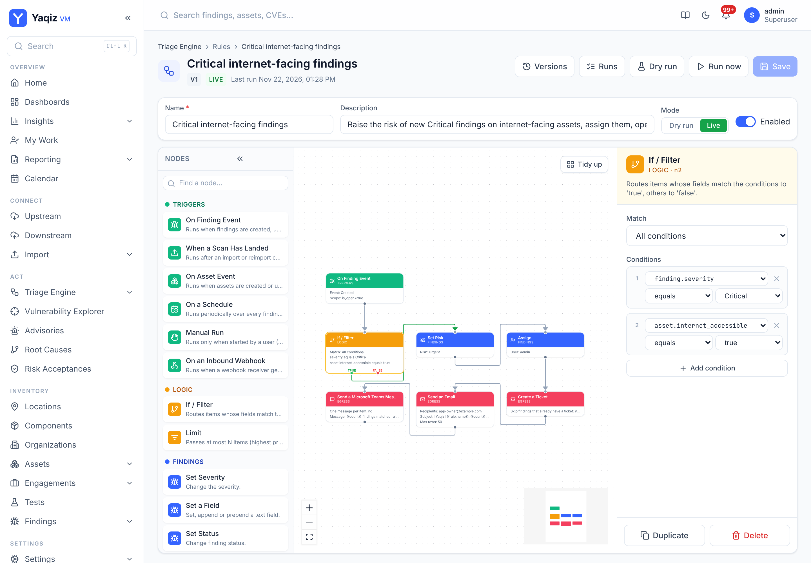
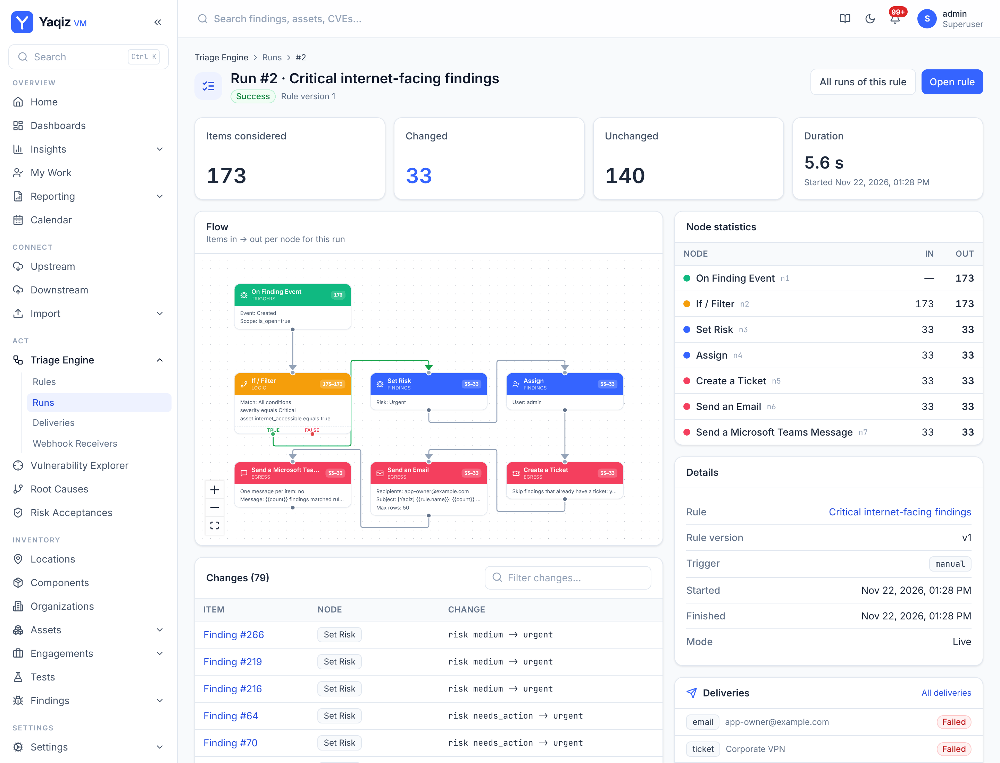
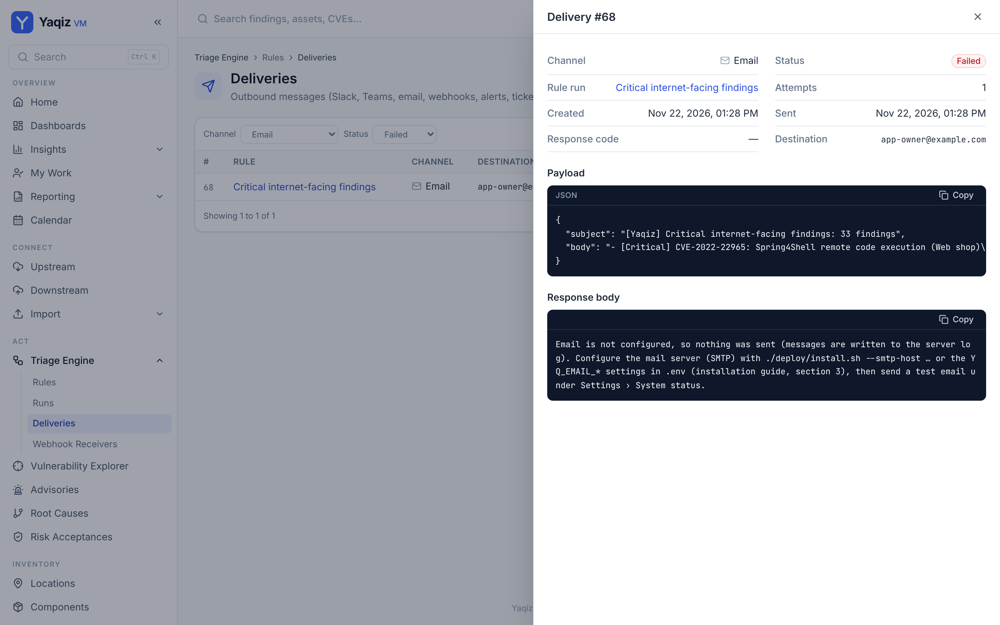
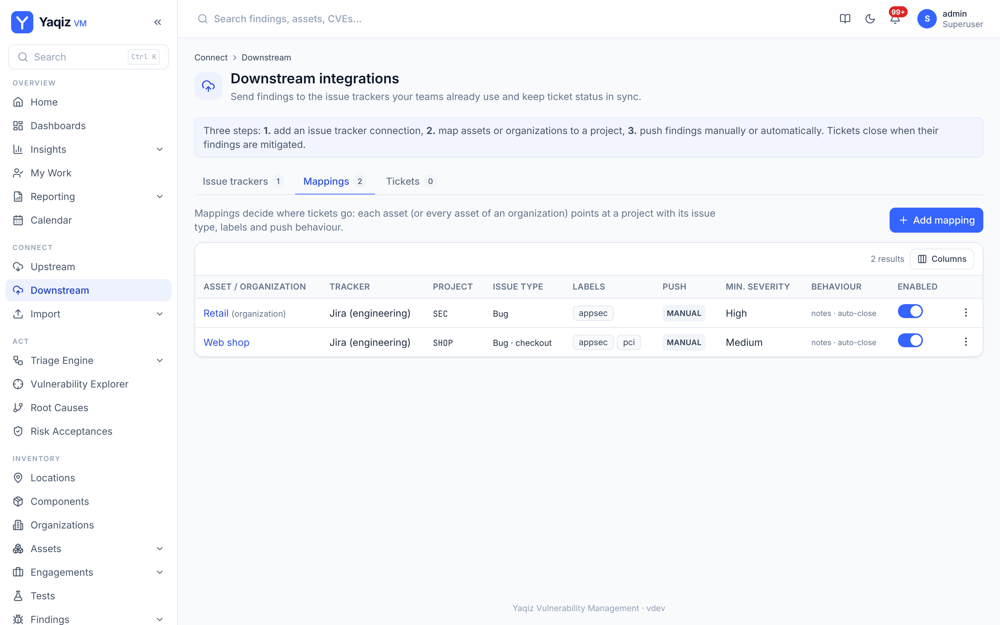

# 5. Automation and integrations

The Triage Engine runs rules that react to new findings, finished imports, asset changes, schedules and inbound
webhooks. A rule can change findings and assets, open tickets and send messages for you. This chapter shows how to
build, test and monitor a rule, how to check what it sent, and how to connect issue trackers and chat tools.

In this chapter:

* [Before you start](#before-you-start)
* [How a rule works](#how-a-rule-works)
* [Build your first rule](#build-your-first-rule)
* [Test with a dry run, then go live](#test-with-a-dry-run-then-go-live)
* [Versions, templates, export and import](#versions-templates-export-and-import)
* [Runs: what a rule did and why](#runs-what-a-rule-did-and-why)
* [Deliveries: what was sent](#deliveries-what-was-sent)
* [Webhook receivers](#webhook-receivers)
* [Downstream issue trackers](#downstream-issue-trackers)
* [Slack, Teams and notification webhooks](#slack-teams-and-notification-webhooks)

## Before you start

**Act › Triage Engine** appears in the menu only when both of these are true:

* The **Triage Engine** module is on under **Settings › Feature Flags**. It is on by default and marked Beta.
* You hold the **Manage triage rules** (`config.rules`) configuration permission. Only a superuser can grant it,
  through a global role (see [chapter 7](07-administration.md#users-groups-and-roles)).

A rule acts with the permissions of its **owner**, the user who created it. It only changes findings and assets that
its owner may edit. A rule that only sends messages needs view access. Other rule administrators can open your
rules, but only you or a superuser can change, run or delete them.

## How a rule works

A rule is a small flow chart. Items (findings or assets) enter at the **trigger** and travel along the connections.
On the way, **logic** nodes route them, **action** nodes change them and **egress** nodes send messages. Each rule has
exactly one trigger, and the connections may not form a loop. A change made by a rule does not start the same rule
again.

| Trigger (palette name) | Starts when | Settings |
|---|---|---|
| **On Finding Event** | An import or connector sync creates findings, or findings are updated, closed or reopened | **Event**, **Scope** |
| **When a Scan Has Landed** | An import or reimport finishes | **Scan types**, **Emit**, **Scope** |
| **On Asset Event** | Assets are created or updated | **Event**, **Asset scope** |
| **On a Schedule** | Every N minutes (15 to 525,600). Yaqiz checks for due rules every 15 minutes | **Every (minutes)**, **Entity**, scope |
| **Manual Run** | Someone clicks **Run now** | **Entity**, scope |
| **On an Inbound Webhook** | A [webhook receiver](#webhook-receivers) gets a payload | **Find findings by**, **Value path in payload** |

**Scope** uses the same filters as the findings list. Click **Add filter**, or switch to **Raw JSON**. The other
nodes are grouped in the palette:

* **Logic**: **If / Filter** sends items that match its **Conditions** to its `true` output and all other items to
  `false`. Set **Match** to **All conditions** or **Any condition**. **Limit** passes at most N items, highest
  priority first.
* **Findings**: Set Severity, Set a Field, Set Status, Add Tags, Remove Tags, Add a Note, Assign, Set Owner Team,
  Request Review, Accept Risk, Set Mitigation Policy, Change Priority, Set Risk, Set Planned Remediation Date.
* **Assets** (the asset of each item): Set an Asset Field, Add Asset Tags, Set SLA Configuration, Set Prioritization
  Engine.
* **Egress**: Create a Ticket, Send a Slack Message, Send a Microsoft Teams Message, Send an Email, Call a Webhook,
  Raise an In-App Alert.

A condition compares a field, such as `finding.severity`, `finding.known_exploited`, `finding.epss_score` or
`asset.internet_accessible`, with a value. Operators include **equals**, **is one of**, **is at least** and **is more
than N days ago**. Texts accept tokens such as `{{count}}` and `{{rule.name}}`. Notes, field values and messages sent
with **One message per item** also accept finding fields, for example `{{finding.title}}`.

## Build your first rule

This example handles a new Critical finding on an internet-facing asset. The rule raises the risk, assigns the
finding, opens a Jira issue, emails the asset owner and posts to a Microsoft Teams channel. First, make sure that:

* The asset, or its organization, is mapped to a Jira project under **Connect › Downstream** (see
  [Downstream issue trackers](#downstream-issue-trackers)).
* You have a Teams webhook URL for the channel, or an administrator has set one under
  **Settings › System Settings** (section **Notifications**).

1. Open **Act › Triage Engine › Rules** and click **New rule**. The editor opens with an **On Finding Event** trigger
   on the canvas. A new rule starts in **Dry run** mode.
2. In **Name**, enter `Critical internet-facing findings`. Explain the purpose in **Description**.
3. Select the trigger node. In the settings panel on the right, set **Event** to **Created**.
4. With the trigger still selected, click **If / Filter** in the **Nodes** palette on the left. The node is added below
   the trigger and connected to it. Keep **Match** on **All conditions** and click **Add condition** twice:
   * `finding.severity` **equals** `Critical`
   * `asset.internet_accessible` **equals** `true`
5. With **If / Filter** selected, click **Set Risk**. The new node is connected to the `true` output. Set **Risk** to
   **Urgent**. To move the findings further up sorted lists as well, add **Change Priority**, for example with
   **Operation** `add` and **Value** `20`.
6. Click **Assign** and choose the **User**. The user must be able to see the findings. Otherwise saving fails with
   "… cannot see the findings this rule acts on".
7. Click **Create a Ticket**. Keep **Skip findings that already have a ticket** on.
8. Click **Send an Email**. In **Recipients (comma separated)**, enter the owner's address, for example
   `app-owner@example.com`. Recipients are fixed addresses. The email is a digest that lists up to **Max rows**
   findings.
9. Click **Send a Microsoft Teams Message**. Paste the channel's webhook into **Webhook URL (empty = system
   setting)**, or leave it empty to use the system setting. Turn on **One message per item** to post one card per
   finding.
10. Click an empty part of the canvas. The **Rule overview** panel should show **0** warnings. Click **Save** or press
    Ctrl+S. The page header shows the version, for example **v1**.

Action nodes pass every item on, so you can chain them in one line. To connect nodes yourself, drag from a node's
bottom handle to another node's top handle. Press Delete to remove the selected node or connection. **Tidy up**
rearranges the graph, and **Duplicate** in the settings panel copies a node.



## Test with a dry run, then go live

A dry run evaluates the rule and records what *would* change. It saves nothing and sends nothing.

1. In the editor, click **Dry run**. Unsaved changes are saved first.
2. The **Dry run result** panel shows **Considered**, **Would change**, **Unchanged** and the recorded changes. Badges
   on the nodes show how many items went in and out of each node.
3. Click **View run details** for the full list (see [Runs](#runs-what-a-rule-did-and-why)).

> **Caution:** **Dry run** and **Run now** do not wait for the trigger event. They take **every** finding or asset in
> the trigger's scope, whatever the **Event** setting. Add a **Scope** filter, for example open findings only, before
> you run a ticketing or email rule by hand.

A rule in **Dry run** mode also runs when its trigger fires, but it only records the result. Leave the rule like this
for a few days and check its runs. When the results look right:

1. Set **Mode** to **Live** and click **Save**.
2. Leave the rule enabled. To pause a rule, turn its **On** switch off in the rules list, or switch it to
   **Disabled** in the editor.

**Run now** applies the rule at once to every item in scope and sends its messages. Yaqiz asks you to confirm with
**Run live**.

The rules list shows each rule's trigger, number of nodes, version, mode and last run. Filter it by **Enabled**,
**Mode** or **Trigger**. The row menu offers **Edit**, **Run now**, **Dry run**, **Run history**, **Export JSON** and
**Delete**.

## Versions, templates, export and import

* **Versions**: every save that changes the graph creates a new version. Renaming a rule or switching its mode does
  not. Click **Versions** in the editor to see who saved each version. **Restore** saves an old graph as a new
  version. Each run records the version that ran.
* **From template** (rules list) offers four starting points: *Escalate known-exploited findings*, *Auto-close
  informational findings*, *Daily SLA breach digest to Slack* and *Ticket critical findings on internet-facing
  assets*. A rule created from a template starts disabled and in dry-run mode.
* **Export JSON** downloads a `.yaqiz-rule.json` file. Webhook URLs and secrets are masked, so enter them again after
  an import. **Import** (rules list) takes the file or pasted JSON. An imported rule starts disabled.

## Runs: what a rule did and why

**Act › Triage Engine › Runs** lists every execution with its trigger, **Status**, mode, duration and the counts
**Considered**, **Changed** and **Unchanged**. Filter by **Rule**, **Status** or **Dry run**, or choose **Run history**
in a rule's menu. Click a run to open its details:

* **Flow**: the graph of the version that ran, with items in → out on each node.
* **Changes**: up to 200 recorded changes, each linked to its finding or asset. Click a node name to filter the list.
* **Node statistics**, **Details** and the **Deliveries** that the run produced.

| Status | Meaning |
|---|---|
| **Success** | The run finished. A **Finished with warnings** box lists skipped steps, for example users skipped for findings they cannot see, or nodes with invalid settings. |
| **Error** | The run stopped and shows the error. The owner gets a **Rule run failed** notification. |
| **Skipped** | The rule has no active owner. A superuser takes the rule over by opening and saving it. |
| **Running** | The run is still in progress. |

If a rule changed nothing, check these points in order:

1. Is the rule enabled and in **Live** mode?
2. Is **Considered** zero? Then the trigger's scope matched nothing, or the matching findings are outside the owner's
   permissions.
3. In **Node statistics**, which node's **Out** drops to zero? Usually it is an **If / Filter** whose conditions do
   not match.
4. Read the warnings box on the run.



## Deliveries: what was sent

**Act › Triage Engine › Deliveries** lists every message that your rules produced: Slack, Microsoft Teams, Email,
Webhook, In-app alert and Ticket. Superusers see the deliveries of all rules. Filter by **Channel** or **Status**,
and click a row to see its **Payload** and **Response body**. For URL destinations only the host is shown, because
webhook URLs contain credentials.

| Status | Meaning |
|---|---|
| **Sent** | The receiver accepted the message. For email, the response reads "SMTP 250 (accepted by the mail server)". |
| **Failed** | The message was not delivered. The **Response body** says why. |
| **Dry run** | Recorded by a dry run. Nothing was sent. |

Common reasons for **Failed**:

* **Email is not configured**: the response body starts with "Email is not configured, so nothing was sent". Since 1.1.5
  Yaqiz records such an email as not delivered instead of reporting it as sent. Ask an administrator to set up the mail
  server and send a test email under **Settings › System Status** (see
  [chapter 7](07-administration.md#system-status)). The **Send an Email** node shows the same warning under
  **Recipients**.
* **The mail server refused the message**: the response body quotes the server, for example a refused recipient.
* **Webhook, Slack or Teams**: the response shows the HTTP status, for example `HTTP 404`, or a connection error that
  names the host. Check the URL and the secret.
* **Ticket**: "No issue tracker mapping for this finding's asset or organization", or "Finding severity is below the
  mapping minimum". Fix the mapping under **Connect › Downstream**.

If no delivery appears at all, no item reached the node, or the node had nothing to send to. A Slack or Teams node
with an empty **Webhook URL** and no URL in **System Settings** sends nothing, and an email node without recipients
does the same.



## Webhook receivers

A webhook receiver gives another system, such as a SIEM or a CI pipeline, an endpoint that starts one of your rules.
The rule finds findings from values in the posted JSON.

1. Build a rule with the trigger **On an Inbound Webhook**. Set **Find findings by** (**Finding id**, **Unique ID
   from tool** or **Vulnerability id**) and **Value path in payload**, for example `finding_id` or `data.finding.id`.
   Save it and set **Mode** to **Live** when you are ready.
2. Open **Act › Triage Engine › Webhook Receivers** and click **New receiver**.
3. Enter a **Name** and choose the **Rule**. You can only attach rules that you own.
4. Optionally enter a **Shared secret**. Callers must then send it in the `X-Yaqiz-Secret` header.
5. Click **Create receiver**. The dialog shows the **Endpoint URL** and an example request. Copy the URL now: it
   contains a token and is not shown in full again.

```bash
curl -X POST "https://vm.example.com/api/v2/hooks/<token>/" \
  -H "Content-Type: application/json" \
  -H "X-Yaqiz-Secret: <shared secret>" \
  -d '{"items": [{"finding_id": 123}]}'
```

The payload can be one JSON object, a list of objects, or `{"items": [...]}` with up to 10,000 items. A disabled or
unknown receiver answers 404, and a wrong secret answers 403. A receiver without a rule accepts and counts payloads
but runs nothing. The **Received** and **Last received** columns show the traffic. To replace a leaked URL, choose
**Endpoint & curl example** in the row menu, then **Generate new URL**. The old URL stops working immediately.

## Downstream issue trackers

**Connect › Downstream** sends findings to the issue trackers that your engineers use. The page has three tabs:
**Issue trackers**, **Mappings** and **Tickets**. Everyone can view the page. Changing it needs the **Manage upstream
and downstream connectors** (`config.connectors`) permission.

1. On **Issue trackers**, click **Add tracker**. Choose the **Type**: Jira, GitHub Issues, GitLab Issues, Azure DevOps
   Boards, ServiceNow, Linear or Generic webhook.
2. Enter a **Name** and the **URL**, for example `https://jira.example.com`. For Jira, enter the account email in
   **Username** and the API token in **API token**. Secrets are write-only.
3. Optionally fill **Options (JSON)**. For Jira, `{"close_transition": "Done", "reopen_transition": "To Do"}` names
   the workflow transitions that Yaqiz uses. Click **Add tracker**, then **Test connection** on its card.
4. On **Mappings**, click **Add mapping**. Choose the **Issue tracker** and, under **Applies to**, either **One
   asset** or **Every asset of an organization**. An asset mapping takes precedence over its organization's mapping.
5. Enter the **Project** (for Jira, the project key such as `SEC`), the **Issue type**, an optional **Component** and
   **Labels**, and the **Minimum severity**. Lower severities are never pushed.
6. Choose the **Push mode** and the options below, then click **Add mapping**.

| Setting | What happens |
|---|---|
| **Push mode: Manual** | Tickets only from **Push to issue tracker** in a finding's action menu (or the bulk action of the same name), from an import with the push option, or from a rule's **Create a Ticket** node, as in the [example rule](#build-your-first-rule). |
| **Push mode: Automatically for new findings** | Also every new finding of an import or connector sync at or above the minimum severity. |
| **Push mode: Automatically for all matching findings** | Also every open finding already in scope: when you save the mapping, then every 30 minutes, at most 200 tickets per run. |
| **Push finding notes as comments** | Public notes on the finding are added to its ticket. Private notes are not. |
| **Close tickets when findings are mitigated** | Closing a finding, or marking it false positive or out of scope, closes its ticket; reopening the finding reopens it. This follows every change: the finding page, bulk actions, rules and re-imports. |
| **One ticket per finding group** | The findings of a [finding group](04-working-with-findings.md#finding-groups) share one ticket, which closes when every finding of the group is closed. |

A ticket contains the finding title, severity, risk, priority, asset, vulnerability IDs, CWE, location, description,
mitigation and a link back to Yaqiz. Jira issues also get the label `yaqiz`. The ServiceNow and Linear types send the
same JSON events as **Generic webhook** (`ticket.create`, `ticket.close`, `ticket.reopen`, `ticket.comment`) to the
URL that you enter.

**What syncs back.** Yaqiz stores the ticket key and link. They appear in the finding's **Tickets** card and on the
**Tickets** tab, with **Status**, **Last synced** and **Sync error**. Every 30 minutes Yaqiz reads each ticket's status
from the tracker and shows it under **Status**; this is information only, a ticket closed in the tracker does not close
the finding. Webhook-type trackers cannot be asked and keep the status Yaqiz last set. When the tracker refuses a
change, for example a Jira workflow without the transition named in the tracker's options (`close_transition`,
default "Done"), **Sync error** says why and the ticket stays as it was.



## Slack, Teams and notification webhooks

* **In rules**: **Send a Slack Message** and **Send a Microsoft Teams Message** post to the **Webhook URL** in the
  node. When that field is empty, they use **Slack incoming webhook URL** or **Teams webhook URL** from
  **Settings › System Settings** (section **Notifications**). **Call a Webhook** posts JSON to any URL, with an
  optional **Bearer secret**.
* **Platform events**, such as imports, SLA breaches and risk acceptances, are routed to Slack, Teams, email and
  notification webhooks under **Settings › Notifications › System**. JSON receivers for those events are set up
  under **Settings › Notifications › Webhooks**. See [chapter 7](07-administration.md#notifications).

Next: [6. Dashboards and reports](06-dashboards-and-reports.md)
