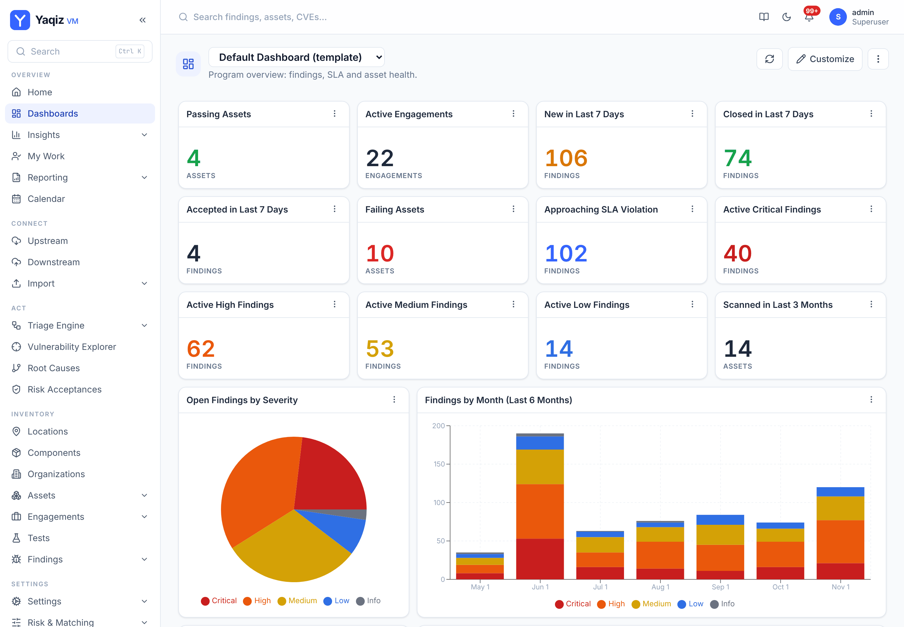
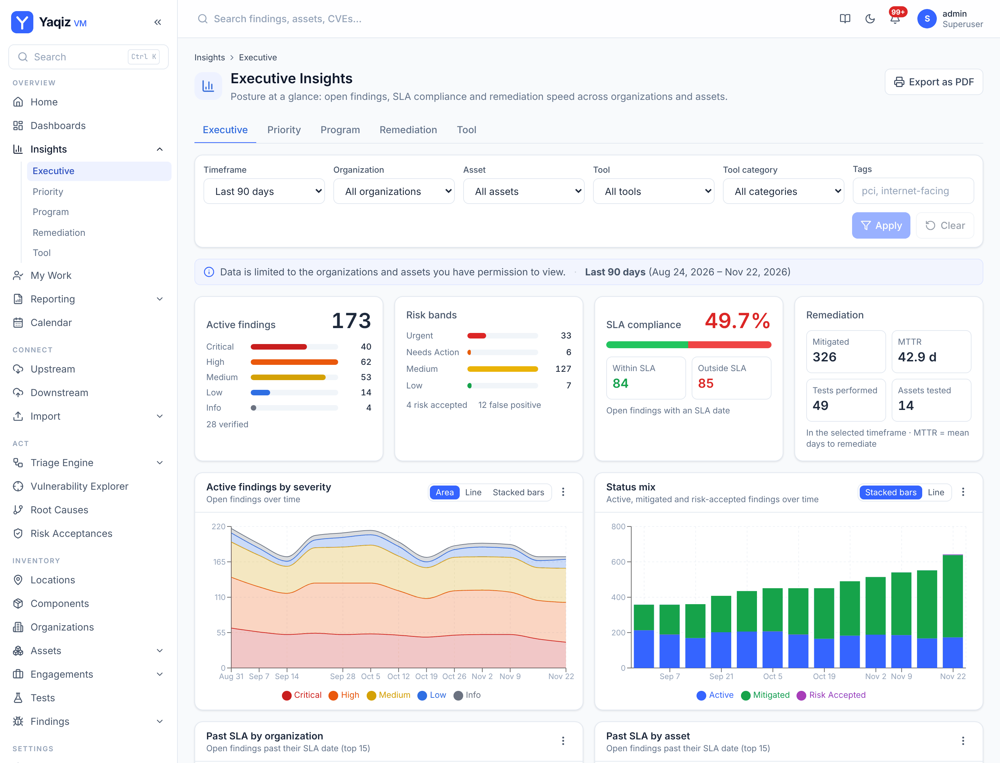
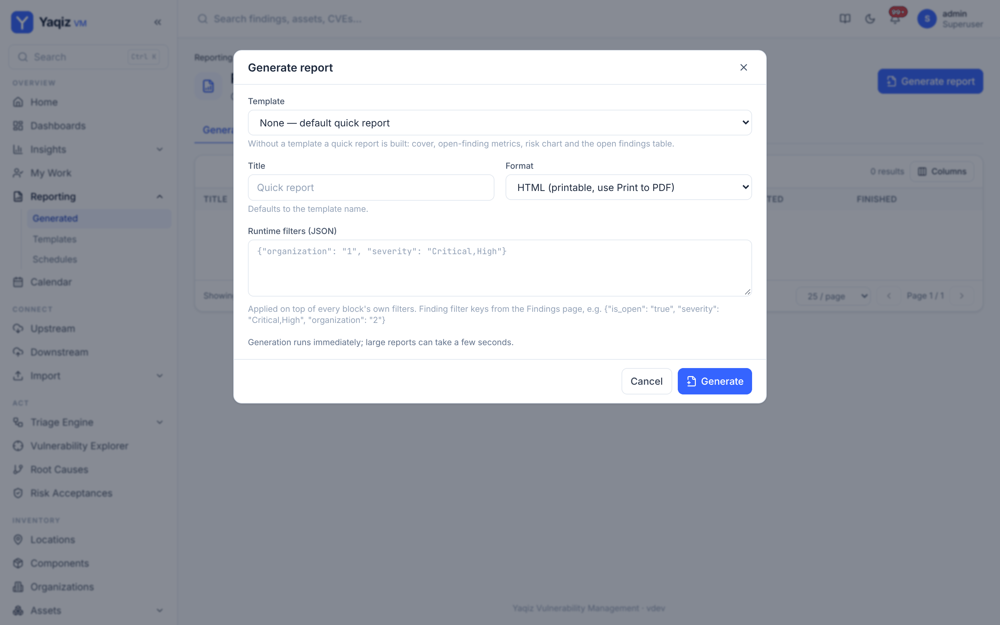
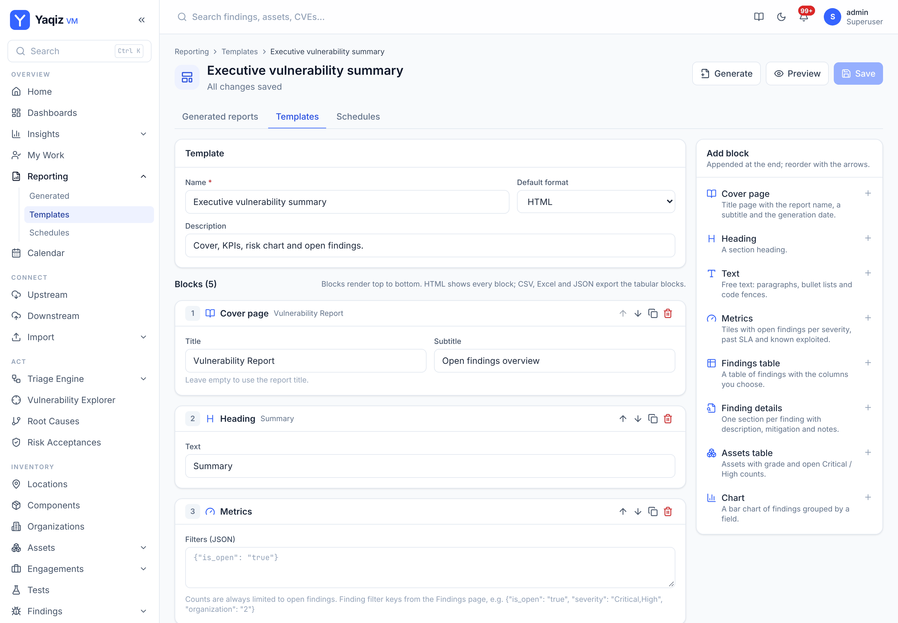

# 6. Dashboards and reports

Yaqiz gives you several views of your vulnerability program: the Command Center on the home page, dashboards that
you build from widgets, five Insights pages, and a personal work queue. When you need a document, Reporting turns
templates into HTML, CSV, Excel or JSON files, on demand or on a schedule. Every number you see is limited to the
organizations and assets that you may view.

In this chapter:

* [Home: the Command Center](#home-the-command-center)
* [Dashboards](#dashboards)
* [Insights](#insights)
* [My Work](#my-work)
* [Reporting](#reporting)
* [Calendar](#calendar)
* [Exporting lists and charts](#exporting-lists-and-charts)

## Home: the Command Center

**Overview › Home** shows how findings flow from your tools to remediation;
[chapter 1](01-first-steps.md#home-the-command-center) introduces the page. Choose the time window at the top right:
**7d**, **30d**, **90d** or **1y**. Most numbers and bars link to the matching filtered list.

* **Posture Score**: a score out of 1000. The bands are **Strong** (800 and above), **Needs attention** (600 to 799)
  and **At risk** (below 600). The score adds five parts: **Open severity burden** (up to 300 points), **SLA posture**
  (200), **Coverage confidence** (200, assets scanned in the last 90 days), **Exploit pressure** (150, open known
  exploited findings and EPSS) and **Automation health** (150, how much triage is done by rules rather than by hand).
  A part marked *(neutral)* has no data yet.
* **Flow**: **Processed** findings in the window, **Unique after dedupe**, **Ready to work** (open Urgent and Needs
  Action findings) and **Resolved**, with the median days to remediate. Below are **Top sources** (findings per tool)
  and **Open by risk**.
* Tiles: **Needs attention** (past-SLA Critical and High findings, or known exploited ones), **Active findings** by
  severity, **Vulnerable assets**, **In progress**, **Assets scanned**, **Accepted risk**, **Mitigated with controls**
  and **Weakest posture area**. The last tile names the part of the Posture Score whose improvement raises the score
  most.

When Yaqiz holds no findings yet, a **Get started** card suggests ways to bring in data.

## Dashboards

**Overview › Dashboards** shows one dashboard at a time. Pick another one from the drop-down list in the page title.
Yaqiz ships two starter dashboards, **Default Dashboard** and **Risk & Exploitability**, marked *(template)*. Everyone
sees them, but only superusers can change them. Dashboards that you create are yours: other users do not see them.

To build your own dashboard:

1. Open a starter dashboard and click **Customize a copy**, or open the menu (⋮) and choose **New dashboard**, enter a
   **Name** and click **Create**.
2. Click **Customize** if the dashboard is not already in edit mode, then click **Add widget**.
3. Enter a **Title** and choose the **Widget type**: **Count tile**, **Pie**, **Donut**, **Bar**, **Horizontal bar**,
   **Stacked bar**, **Line**, **Area**, **Radar**, **Top records** or **Text**.
4. Choose the **Data model** (`finding`, `asset`, `engagement` or `test`). For charts, choose **Group by** and
   optionally **Split series by**, **Time bucket** (for date groupings) and **Limit**. For **Top records**, choose
   **Rank by** and **Order**. For a **Count tile**, set a **Unit label** and **Color**.
5. In **Filters (JSON, same keys as the list pages)**, narrow the data, for example
   `{"is_open": "true", "severity": "Critical,High"}`.
6. Click **Save widget**. Drag widgets by their title and resize them from the corner, then click **Save**.

The widget menu (⋮) offers **Refresh** and **Download CSV**, and in edit mode **Configure** and **Remove**. Click a
bar or slice of a finding chart, or a count tile, to open the matching list. The dashboard menu also has
**Duplicate**, **Set as my default** (marked ★ in the list) and **Delete**. A dashboard holds at most 100 widgets.

## Insights

**Overview › Insights** has five pages that answer standard questions about your program. All pages share a filter
bar: **Timeframe** (last 7, 14, 30, 90 or 180 days, or the last 12 months; 90 days by default), **Organization**,
**Asset**, **Tool**, **Tool category** and **Tags**. Click **Apply** to use the filters and **Clear** to reset them.
The filters stay in place when you switch between the pages.

On every chart, the menu (⋮) offers **View as table** and **Download CSV**, and some charts let you switch the chart
type. Tables have a **CSV** button. Most bars and numbers open the matching findings when you click them. **Export as
PDF** opens your browser's print dialog with a print layout; choose to save as PDF there.

* **Executive**: *How is our posture overall?* A summary strip, active findings by severity over time, the status mix,
  past-SLA findings by organization and asset, mean time to remediate, and average age by severity and risk. The
  **Organizations** and **Assets** tables show open findings per severity, Urgent and Needs Action counts, **Past
  SLA**, **SLA %**, **Mitigated** and **MTTR (d)** for each organization and asset.
* **Priority**: *Where does risk concentrate, and what do we fix first?* Open findings by risk band, the priority
  distribution, risk over time, average age by risk and **Mitigated within SLA by risk**. The **Top assets**, **Top
  components** and **Top hosts** tables rank where the Urgent and Needs Action findings are.
* **Program**: *Is the program productive, and how much noise do we remove?* Findings fixed per period, noise by
  category, tests performed, assets tested, **Noise reduction & hours saved** from deduplication and false positives,
  and tests by type.
* **Remediation**: *Are we keeping up?* The open backlog over time and the part of it past SLA, **Velocity** (opened
  versus closed per period), mean time to remediate, risk accepted over time, past-SLA findings by organization and
  asset, and average age by severity.
* **Tool**: *What does each security tool contribute?* Severity by tool, false positives by tool, EPSS by tool, a
  **Tools** table, and **Severity by tool, monthly** with severity and risk counts per tool and month.

## My Work

**Overview › My Work** collects the findings assigned to you, the reviews you were asked for and the risk acceptances
that need your decision. [Chapter 1](01-first-steps.md#my-work) walks through the page. For team leads, three parts
matter most:

* **Waiting on others** (counter and section) lists the reviews that you requested and that are still open.
* **My team's queue** counts the open findings owned by your groups. Click **Open team queue** to see them in the
  findings list.
* **Shortcuts** include **Unassigned urgent findings**, the open Urgent findings that nobody owns yet.

## Reporting

**Overview › Reporting** has three pages: **Generated**, **Templates** and **Schedules**. A report shows only data
that the person who generates it may view.

### Generate a report

You need the **Generate reports** permission. The Writer, Maintainer and Owner roles include it, on any organization or
asset.

1. Open **Overview › Reporting › Generated** and click **Generate report**.
2. Choose a **Template**, or keep **None — default quick report**. The quick report has a cover, open-finding metrics,
   a risk chart and the table of open findings.
3. Optionally change the **Title**. It defaults to the template name.
4. Choose the **Format**: **HTML (printable, use Print to PDF)**, **CSV**, **Excel (XLSX)** or **JSON**.
5. Optionally enter **Runtime filters (JSON)**. They use the finding filter keys of the Findings page, for example
   `{"organization": "2", "severity": "Critical,High"}`, and apply on top of each block's own filters.
6. Click **Generate**. When the dialog says "Your report is ready", click **Open** (HTML) or **Download**.

The **Generated** list shows the reports that you requested, with their template, format, status and dates. Use
**Open** and **Download** again later, or **Delete** from the row menu. To get a PDF, open the HTML report and print it
to PDF from your browser.

### Templates

**Overview › Reporting › Templates** lists the templates, which are shared with everyone. Anyone can **View** a
template, and with the **Generate reports** permission you can click **Generate**. Creating and changing templates
needs the **Manage finding and report templates** (`config.templates`) permission.

1. Click **New template**. Enter a **Name**, a **Default format** and a **Description**.
2. Under **Add block**, click the blocks you need: **Cover page**, **Heading**, **Text**, **Metrics**, **Findings
   table**, **Finding details**, **Assets table** and **Chart**. Each block has its own settings, such as columns,
   maximum rows or filters. Reorder blocks with the arrows.
3. Click **Preview** to render the report, optionally with runtime filters. Then click **Save**.

HTML reports show every block. CSV, Excel and JSON reports contain the table blocks only. A template holds at most 100
blocks. Deleting a template also deletes its schedules; reports already generated are kept.

### Schedules

**Overview › Reporting › Schedules** generates a template at a fixed interval and emails it.

1. Click **New schedule** and choose the **Template**. **Name** is filled in for you.
2. Set **Run every (hours)**, or choose **Hourly**, **Daily**, **Weekly**, **Every 2 weeks** or **Every 30 days**.
3. Choose the **Format** and enter **Recipients**: up to 50 email addresses, separated by commas, for example
   `ciso@example.com, appsec@example.com`.
4. Optionally enter **Runtime filters (JSON)**, then click **Create schedule**.

Yaqiz checks for due schedules every 15 minutes, so the first report arrives shortly after you create the schedule.
The report is generated as you: you need the **Generate reports** permission, and the report shows what you may view.
Each report is attached to the email and also listed under **Generated** with the schedule name and date. If no mail
server is configured, recipients receive nothing; an administrator can check this under **Settings › System Status**.
Use the **Enabled** switch to pause a schedule; **Next run** shows when it runs again.

## Calendar

**Overview › Calendar** shows engagement schedules and test runs on the assets you can see, one month at a time.

* Move between months with the arrows, or click **Today** to return to the current month.
* Use the **Engagements** buttons (**Interactive**, **CI/CD**) to choose engagement types, and **Show tests** to show
  or hide tests. Colors show the status; the legend is below the calendar.
* Point at an entry to see its asset, status, dates and lead. Click a day number to list everything on that day, then
  click an entry to open it.

## Exporting lists and charts

| Where | How | What you get |
|---|---|---|
| **Inventory › Findings** (any list) | **Export** › **Export as CSV**, **Export as XLSX** or **Export as JSON** | All findings that match the current filters, up to 50,000. Only findings of assets that you may export (Writer role and above) |
| **Inventory › Assets › All** | **CSV (page)** | The assets on the current page |
| **Overview › Insights** | Chart menu › **Download CSV**; **CSV** on tables; **Export as PDF** | One chart or table; the whole page as PDF |
| **Overview › Dashboards** | Widget menu › **Download CSV** | The data of one chart widget |
| **Overview › Reporting** | **Format** when you generate a report | CSV, Excel, JSON or printable HTML |

Next: [7. Administration](07-administration.md)
