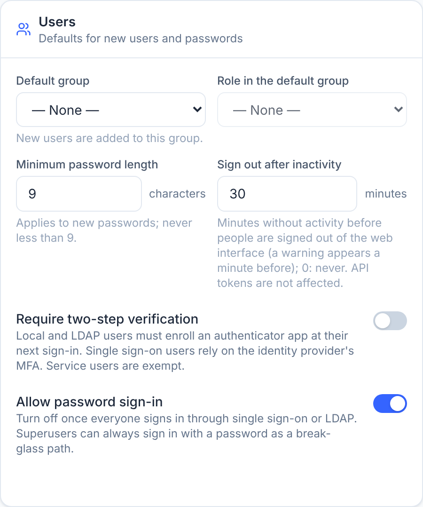
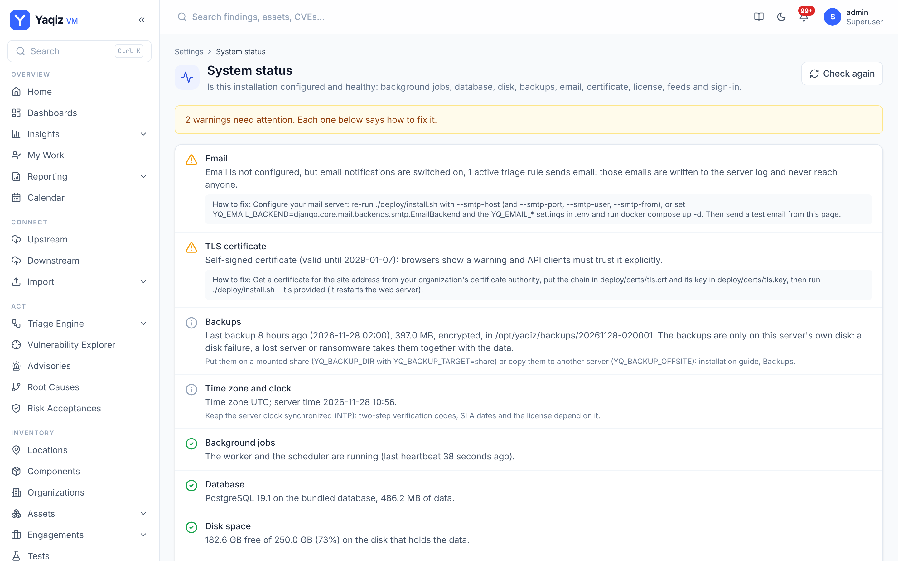
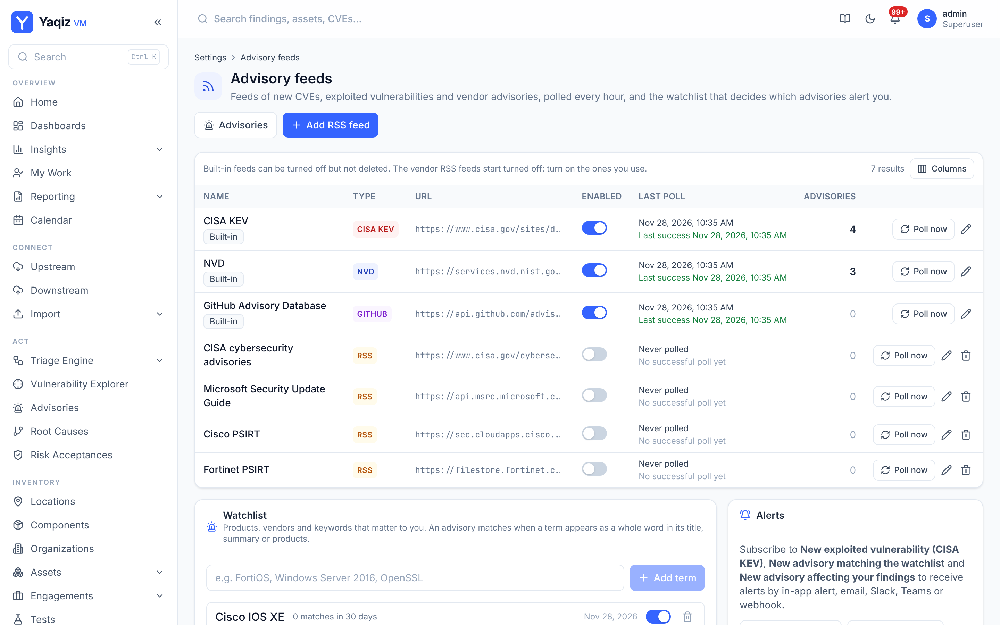

# 7. Administration

This chapter is for administrators. It starts with what to set up in the first week, then describes each page under
**Settings**, **Risk & Matching**, **Data Model**, **Notifications** and **Audit Logs**. Server tasks such as TLS, the
mail server (SMTP), the LDAP server, backups and upgrades are covered in the installation guide
(`docs/on-prem-installation.md` in the release package); [Command-line help](#command-line-help) shows where to find
the commands for operating the server.

In this chapter:

* [Your first week](#your-first-week)
* [Users, groups and roles](#users-groups-and-roles)
* [Sign-in methods](#sign-in-methods)
* [System Settings](#system-settings)
* [Feature Flags](#feature-flags)
* [License](#license)
* [System Status](#system-status)
* [Risk & Matching](#risk--matching)
* [Advisory Feeds](#advisory-feeds)
* [Data Model](#data-model)
* [Notifications](#notifications)
* [Audit Logs](#audit-logs)
* [Command-line help](#command-line-help)

The **Settings** part of the menu appears only for superusers and for users who hold at least one configuration
permission. Users who may configure assets (`asset.configure`) but hold no configuration permission see only
**Settings › Risk & Matching › Dedupe Pools**.

## Your first week

1. **Settings › System Status**: fix every red and amber check, then send a test email. Under **Backups**, check that
   the nightly backup ran and that it is not kept only on the server's own disk.
2. **Settings › License**: install the license file from your vendor (superusers only).
3. **Settings › System Settings**: set the **Team name**; under **Notifications** turn on **Email** and set the
   recipients and the Slack or Teams URLs; under **Users** choose the **Default group**, decide on **Require
   two-step verification** and set **Sign out after inactivity** (30 minutes by default); add a **Login banner** if
   your policy needs one. Click **Save settings**.
4. **Settings › Roles** and **Settings › Groups**: create one group per team and decide which roles they get.
5. **Settings › Users**: create accounts, or let LDAP and single sign-on users create theirs at first sign-in. Create a
   service user for each CI/CD pipeline.
6. Grant access where people work: on an organization or asset, open the **Members** tab and add users or groups.
7. **Settings › Risk & Matching**: choose the default **Service Level Agreements** configuration and
   **Prioritization Engine**, and check that **Finding Enrichment** loads EPSS and KEV data.
8. **Settings › Risk & Matching › Advisory Feeds**: turn on the vendor feeds you use, put the products and vendors you
   run on the watchlist, and check under **Last poll** that the enabled feeds poll without errors.
9. **Settings › Notifications › System**: choose which events go to Slack, Teams, email and webhooks, among them the
   advisory alerts. Users set their own alerts under **Settings › Notifications › Personal**.
10. **Settings › Feature Flags**: switch on or off the optional modules.

## Users, groups and roles

A **role** is a set of permissions. You grant a role in three ways:

* as the **Global role** of a user: it applies to every organization and asset;
* as the **Global role** of a group: every member gets it everywhere;
* as a **membership** on one organization or asset: open the organization or asset, go to the **Members** tab and
  click **Add member**. Organization roles are inherited by the organization's assets.

| Built-in role | What it allows |
|---|---|
| **Reader** | View everything in scope. |
| **API_Importer** | View, plus import and reimport scans (for CI/CD service users). |
| **Writer** | View, import, triage and edit findings, engagements and tests; generate reports and export. |
| **Maintainer** | Writer, plus edit assets, delete objects and manage members. As a global role, also creates organizations. |
| **Owner** | Full control, including deleting assets and managing owners. As a global role, also creates organizations. |

**Configuration permissions** control the administration pages. They apply only through a global role, and only
superusers can grant them.

| Permission | Code | Pages |
|---|---|---|
| Manage users, groups, roles | `config.users`, `config.groups`, `config.roles` | Settings › Users, Groups, Roles |
| Edit system settings | `config.settings` | System Settings, System Status, Matching Configuration, Dedupe Pools, Mitigation Policies, Finding Enrichment sources, Advisory Feeds, Custom Fields, Asset Attributes, Regulations, Note Types |
| Manage SLA configurations | `config.sla` | Service Level Agreements |
| Manage prioritization engines | `config.engines` | Prioritization Engines |
| Manage test types, environments | `config.test_types`, `config.environments` | Test Types, Environments |
| Manage upstream and downstream connectors | `config.connectors` | Connect › Upstream, Downstream |
| Manage triage rules | `config.rules` | Act › Triage Engine |
| Manage system notifications | `config.notifications` | Notifications › System, Webhooks |
| Manage universal parsers | `config.parsers` | Connect › Import › Universal Parser |
| View audit logs | `config.audit` | Audit Logs |
| Manage finding and report templates | `config.templates` | Finding templates, report templates |

**Custom roles.** Built-in roles are read-only. On **Settings › Roles**, select a role and click **Clone**, or click
**New custom role** and choose **Start from**. In **Object permissions**, click a cell to toggle view, add, edit or
delete for an object; click a row or column header to toggle all of it. Add **Special permissions** such as **Approve
or reject risk acceptances** or **Generate reports**, then click **Save**. **Owner role** marks roles whose holders can
manage owners (superusers only). A role that is still assigned cannot be deleted.

**Users.** On **Settings › Users**, click **New user** and fill in **Username**, **Email**, the names, an optional
**Password** and the **Global role**. **Active**, **Superuser** and **Service user** are checkboxes. Click **Create
user**. Only superusers can grant superuser status, and other administrators can only assign roles whose
permissions they hold themselves. A user's page shows **Effective permissions**, including access through groups and
memberships, and offers **Reset MFA**, **Deactivate** and **Delete**. Prefer **Deactivate**: it keeps the user's
history attributable.

**Reset two-step verification.** When someone has lost both their phone and their recovery codes, confirm who they are,
open their page under **Settings › Users** and click **Reset MFA** (shown while their two-step verification is on).
Their authenticator and recovery codes are removed. Until they set it up again, their password alone signs them in;
when **Require two-step verification** is on, they must set it up at their next sign-in. You cannot reset your own
account here, and only a superuser can reset an account that holds permissions you do not hold. Every reset is
recorded in the audit log.

If the only administrator is locked out this way, a server administrator runs
`docker compose exec api python manage.py reset_mfa <username>` on the server, in the installation folder (see
[Command-line help](#command-line-help)); this reset is recorded in the audit log too. The command uses the exact user
name. A name that differs only in letter case is accepted only when exactly one account matches it; when several do,
the command lists them and asks for the exact name.

**Groups.** On **Settings › Groups**, click **New group**, enter a **Name** and optionally a **Global role**, and click
**Create group**. On the group's page, choose a **User** and a **Role in group** and click **Add member**.

**Service users and API tokens.** A service user (checkbox **Service user**) is meant for CI/CD. It cannot sign in to
the web interface and does not need two-step verification. Give it the **API_Importer** role on the organizations it
imports into. To give a pipeline its token, open the service user under **Settings › Users** and click **Generate API
token**: the token is shown once, so copy it into the CI system's secrets; generating a new one replaces the old one at
once, and both actions are written to the audit log. The pipeline sends it as `Authorization: Token <token>`. People
find their own token in the user menu under **API token**, where they can **Reveal**, copy or **Rotate** it.

## Sign-in methods

LDAP / Active Directory and single sign-on (OpenID Connect) are configured on the server; see section 4a of the
installation guide. In the web interface you then see:

* With LDAP on, the sign-in page asks for the directory account. With single sign-on on, it shows a **Sign in with
  …** button.
* Directory and single sign-on accounts are created at their first sign-in, without permissions. They join the
  **Default group** with its role, if you set one under **System Settings** (section **Users**). Otherwise, grant
  roles by hand.
* The user's page shows the **Sign-in** source: **Local password**, **Directory (LDAP)** or **Single sign-on**.
* **Require two-step verification** (section **Users**) makes local and LDAP users enroll an authenticator app at
  their next sign-in. Single sign-on users rely on the identity provider's MFA.
* Once everyone uses single sign-on or LDAP, turn off **Allow password sign-in**. Superusers can always sign in with a
  password as a break-glass path.

## System Settings

**Settings › System Settings** holds instance-wide behavior in sections; use **Filter sections** to find one. Change
values, then click **Save settings**, or **Discard**. All sections need **Edit system settings**; the
**Notifications** section can also be changed with **Manage system notifications**.

| Section | Key options |
|---|---|
| **General** | **Team name**, **Read-only mode** (superusers only: blocks changes by everyone else) |
| **Deduplication** | **Deduplicate findings**, **Delete excess duplicates**, **Maximum duplicates**, **False positive history** |
| **SLA & grading** | **Finding SLAs**, **Notify on SLA breach**, **Asset grading**, grade thresholds A to D |
| **Risk acceptance** | **Default expiration**, **Notify before expiration**, **Block self-approval** |
| **Engagements** | **Auto-close engagements** and its **Grace period** |
| **Imports** | Background imports from the UI and the API, **Background threshold** |
| **Notifications** | **Email** and **Recipients for system emails**, **Slack** and its URL, **Microsoft Teams** and its URL, **Webhooks** and **Webhook timeout** |
| **Enrichment** | **EPSS scores**, **CISA KEV catalog** and their feed URLs |
| **Banners** | **Announcement** with style, **Login banner**, **Report disclaimer** |
| **Users** | **Default group**, **Role in the default group**, **Minimum password length**, **Sign out after inactivity**, **Require two-step verification**, **Allow password sign-in** |

### Sign out after inactivity

People are signed out of the web interface after a time without activity: clicks, typing, scrolling or changes, in
any Yaqiz tab of their browser. A page that only refreshes itself is not activity, so an unattended screen is signed
out. Set the time in **Sign out after inactivity** (section **Users**) and click **Save settings**: 30 minutes by
default, from 5 to 1440 minutes (24 hours); 0 turns it off. A minute before, the person sees **Still there?** with
**Stay signed in**. API tokens (scripts, CI/CD) are not affected.

Whatever the activity, a session also ends after its maximum length: 12 hours after sign-in by default. This maximum
is set on the server (`YQ_SESSION_AGE_SECONDS` in `.env`; installation guide, section 9). An open page notices within a
minute that its session ended, also when you deactivate the account, and shows the sign-in page with the reason.

## Feature Flags

**Settings › Feature Flags** turns optional modules on or off for every user at once. Only superusers can change
them. In 1.1.9 these flags have a visible effect:

* **Locations**, **Upstream Connectors**, **Triage Engine** and **Root Cause Correlation** show or hide the menu entries
  **Inventory › Locations**, **Connect › Upstream**, **Act › Triage Engine** and **Act › Root Causes**.
* **Risk Acceptance Approvals** (off by default, Beta) makes new risk acceptances wait for approval.

The page also lists other modules, for example **Custom Fields**, **Dedupe Pools** and **AI Assistant**.

## License

**Settings › License** shows who the installation is licensed to, the **Edition**, the expiry date, the **Grace period
after expiry** and the **Mode**, plus usage of **Assets** and **Users (active, excluding service users)** against the
license limits. To install or renew, a superuser pastes the license text or clicks **Choose file**, then **Install**.
A banner warns before expiry. After expiry and the grace period (14 days unless the license says otherwise), Yaqiz is
read-only: viewing, exporting and installing a license still work, and nothing is deleted. Limits only block creating
more assets or users than licensed.

## System Status

**Settings › System Status** answers one question: is this installation configured and healthy? Superusers and
holders of **Edit system settings** can open it. Each check shows a green (OK), grey (information), amber (warning) or
red (problem) icon, a one-line summary and, for warnings and problems, **How to fix**. A line at the top counts the
problems and warnings, for example "2 warnings need attention", and the checks follow in that order: problems,
warnings, information, then the checks that are OK. Click **Check again** after a fix. Most fixes happen on the
server; the installation guide explains them.

| Check | What it tells you |
|---|---|
| **Background jobs** | The worker and scheduler run. If not, background imports, rules, emails, syncs, reports and SLA checks stop. |
| **Database** | The database is reachable, its version and size. Amber when an external database server is newer than PostgreSQL 19, which the backup cannot dump. |
| **Disk space** | Free space on the data disk. Amber below 15% or 10 GB, red below 5% or 2 GB. |
| **Backups** | When the last backup ran and its size, whether it is encrypted, the folder or mounted share it is in, and whether it was copied to another server. Amber when no backup is recorded, after 36 hours without one, or when the copy to the other server failed; red after 7 days. Grey when the backups are only on the server's own disk, where a disk failure, a lost server or ransomware takes them together with the data. |
| **Stored credentials** | Tracker tokens, webhook secrets and similar are encrypted with a dedicated data key. |
| **Email** | A mail server is configured, the sender address is real, and the last rule email did not fail. Amber when email is not configured but notifications or rules use it. |
| **TLS certificate** | Validity, expiry within 30 days, host name match, self-signed. |
| **License** | Valid, in trial, expiring, in grace or expired. |
| **Vulnerability feeds (EPSS, KEV)** | When the feeds last loaded. Amber after 3 days without an update. |
| **Sign-in** | Which sign-in methods are active, and whether LDAP or single sign-on settings are incomplete. |
| **Site address and administrator email** | Links in emails work, and superusers have a real email address. |
| **Time zone and clock** | The server time zone and time. |

Backups are set up on the server: where they go, their encryption and the copy to another server are described in the
installation guide, section 6.

**Send a test email** sends a message to the address you enter (your own by default) and shows the mail server's
answer: accepted, or the reason it was refused. The button is off while email is not configured. You can send up to
10 test emails per hour.

**The admin banner.** When a check is amber or red, superusers and holders of **Edit system settings** see a colored
bar on every other page: "This installation needs attention: …". It is red for problems and amber for warnings. Click
**View system status**, or **Dismiss** to hide it until the counts change.

## Risk & Matching

These pages are under **Settings › Risk & Matching**.

* **Service Level Agreements** (`config.sla`): remediation deadlines. Yaqiz ships **Default**, **PCI DSS 6.3.3**,
  **FedRAMP Rev 5**, **FedRAMP VDR**, **Risk based** and **No SLA Enforced**. Click **New SLA configuration**, choose
  the **Basis** (severity or risk band), the days per severity or band and **SLA starts on** (**Detection date**,
  **Vulnerability publish date**, **Fix available date** or **Earliest known date**). Options: **Default
  configuration**, **Restart on reactivation**, **Cap by KEV due date** and **VDR tiering**. Saving recomputes the
  due dates. Assign a configuration to an asset in the asset's **SLA configuration** field (needs `asset.configure`).
* **Prioritization Engines** (`config.engines`): how severity, exploitability, exposure and business context become
  a priority. Yaqiz ships **Default** and **Exploit-driven**. **Multipliers** run from 0 (ignored) through 1.0 (default)
  to 2. **Risk bands** set the score thresholds (0 to 100) between Low, Medium, Needs Action and Urgent. **Actively
  exploited floor**, **Reachable floor** and **Unreachable ceiling** bound the band. Use **Try it** to score a
  hypothetical finding, **Save**, then **Recalculate** to rescore the findings of the engine's assets.
* **Matching Configuration** (`config.settings`): per tool, how findings count as the same: **Same tool**, **Cross
  tool** and **Reimport**. Set the **Algorithm** and the **Hash code fields**; **Rehash existing findings** applies new
  fields to old findings. **Changed from defaults only** shows your customizations; **Reset to default** undoes one.
* **Dedupe Pools**: groups of assets whose findings deduplicate against each other (**Kind**: **Same tool** or **Cross
  tool**). Adding or removing an asset needs `asset.configure` on it.
* **Mitigation Policies** (`config.settings`): standard remediation guidance with a **Title**, the **Policy** text and
  an optional **Default policy**. Attach a policy to findings by hand or with a rule's **Set Mitigation Policy** node.
* **Finding Enrichment**: shows **CVEs tracked**, **Known exploited (KEV)** and **Last enriched**. Under **Sources**,
  turn **EPSS lookup** and **CISA KEV lookup** on or off and optionally set an internal mirror in **EPSS feed URL**
  and **KEV feed URL**; an empty URL uses the public feed. Enrichment runs daily; superusers can click **Run
  enrichment now**. Without internet access, a server administrator loads feed files on the server (installation
  guide, section 4). KEV status raises risk through each engine's **Actively exploited floor** and can cap SLAs.
* **Advisory Feeds** (`config.settings`): the feeds and the watchlist of the **Advisories** page; see
  [Advisory Feeds](#advisory-feeds).

## Advisory Feeds

**Settings › Risk & Matching › Advisory Feeds** (page **Advisory feeds**) decides where the **Advisories** page
(**Act › Advisories**, [chapter 4](04-working-with-findings.md#advisories)) gets new CVEs, exploited vulnerabilities
and vendor advisories, and which of them alert people. Changing it needs **Edit system settings** (`config.settings`);
without it, the page shows the watchlist and the alerts but not the feeds.

**Feeds.** Yaqiz polls every enabled feed every hour. Three feeds are built in and turned on: **CISA KEV**
(vulnerabilities exploited in the wild), **NVD** (every new CVE) and the **GitHub Advisory Database**. They can be
turned off but not deleted. Four vendor RSS feeds are ready but start turned off: **CISA cybersecurity advisories**,
**Microsoft Security Update Guide**, **Cisco PSIRT** and **Fortinet PSIRT**; turn on the ones you use with the
**Enabled** switch.

* **Add RSS feed** adds any other RSS or Atom feed, for example of a vendor or a CERT: enter a **Name** and the **Feed
  URL**, then click **Add feed**.
* **Last poll** shows when each feed was polled, its last success and its last error; **Advisories** counts what it
  brought in. **Poll now** polls a feed at once.
* Click a feed to edit it: its **Feed URL**, an optional **NVD API key** or **GitHub token** for higher rate limits
  (stored write-only), and the **Minimum severity for watchlist alerts**.

**Watchlist.** List the products, vendors and keywords that matter to you, for example `FortiOS`, `Windows Server 2016`
or `Cisco IOS XE`, and click **Add term**. An advisory matches when a term appears as a whole word in its title,
summary or products. Each term shows its matches in the last 30 days; its switch pauses it. **Suggestions from your
assets** proposes terms from asset tags (`vendor:`, `os:`, `app:`, `model:`, `series:`) and the most common components
of open findings; one click adds a term.

**Alerts.** Advisories reach people through the notification rules, with three events in the **Advisories** group of
**Settings › Notifications**: **New exploited vulnerability (CISA KEV)**, **New advisory matching the watchlist** and
**New advisory affecting your findings**. Each user subscribes under **Personal**; **System** sends them to Slack,
Teams, email and webhooks ([Notifications](#notifications)). A personal alert about affected findings counts only the
findings that person can see, and comes only when they can see at least one; the **System** channels get the counts
over all findings. A feed's first successful poll fills the list without alerts, and more than 10 advisories for the
same event in one poll arrive as one summary.

A new **CISA KEV** entry also marks the matching findings as known exploited within the hour, without waiting for the
daily enrichment (when **CISA KEV lookup** is on under **Finding Enrichment**).

**Network.** The server needs to reach the feeds over HTTPS: `www.cisa.gov`, `services.nvd.nist.gov`,
`api.github.com`, and the host of every RSS feed you turn on. A feed that cannot be reached shows its error under
**Last poll**; when no feed can be reached, the **Advisories** page stays empty. On a server without internet access,
turn the feeds off, or point their **Feed URL** at an internal mirror. With an empty **Feed URL**, the **CISA KEV**
feed uses the **KEV feed URL** of **Finding Enrichment**, so one mirror serves both.

## Data Model

These pages are under **Settings › Data Model**.

| Page | Purpose and fields |
|---|---|
| **Custom Fields** | Typed fields on **Assets**, **Findings** or **Engagements**: **Type** (Text, Integer, Decimal, Boolean, Date, Single select, Multi select, URL), **Label**, **Key**, **Options**, **Help text**, **Order**, **Required**. |
| **Test Types** | The scanners and assessment types that imports record. **Category**, **Active**, **Static tool**, **Dynamic tool**. Needs `config.test_types`. |
| **Environments** | Where tested code runs, with a **Production mapping**. Needs `config.environments`. |
| **Asset Attributes** | Option lists for an asset's platform, lifecycle and origin: **Label**, **Value**, **Icon**, **Order**. |
| **Regulations** | Compliance frameworks for assets (PCI DSS, GDPR, ISO 27001, NIS2 and others are built in). |
| **Note Types** | Categories for finding notes. **Single** allows one note of the type per finding; **Mandatory** requires one. |

Pages without another permission named here need **Edit system settings**.

## Notifications

These pages are under **Settings › Notifications**.

* **Personal** (**My notifications**): every user chooses which events reach them as an **In-app alert** (the bell)
  and by **Email**, then clicks **Save**. Email needs an address in the user's profile and email enabled under
  **System Settings**. Users without the **Settings** menu open the page with **Search** (Ctrl K), entry
  **Notifications › Personal**.
* **System**: routes events instance-wide to **Slack**, **Teams**, **Email** and **Webhooks**. Chips at the top show
  which channels are enabled; a disabled channel delivers nothing. Configure the channels under **System Settings**
  (section **Notifications**). Needs **Manage system notifications**.
* **Webhooks**: click **New webhook** and enter a **Name**, a **URL** and optionally **Auth header name** and **Auth
  header value** (write-only). Events arrive as JSON POST requests with an `X-Yaqiz-Event` header. Use **Send test
  event** in the row menu. After failed deliveries a webhook can become **Temporarily inactive**; when errors go on
  for more than a day it becomes **Inactive**. Fix the receiver, then click **Activate** in the row menu.

Events include asset added, scan imported, finding added, closed or reopened, SLA breached or approaching, risk
acceptance requested, approved or expiring, review requested, user mentioned, connector failure, rule run failed,
report generated, and the advisory alerts **New exploited vulnerability (CISA KEV)**, **New advisory matching the
watchlist** and **New advisory affecting your findings** (see [Advisory Feeds](#advisory-feeds)).

## Audit Logs

**Settings › Audit Logs** records who changed what, and when; entries cannot be changed. The page needs **View audit
logs** (`config.audit`). Search by object or actor, and filter by **Action** (**Create**, **Update**, **Delete**,
**Login**, **Logout**, **Action**), **Type** and **Actor**. Click an entry to see its changes. Failed sign-ins are
recorded too.

## Command-line help

Some tasks are done on the server rather than in the web interface: installing, upgrading, backups and restores,
logs, and recovering access, for example with `reset_mfa`. Run the commands on the Yaqiz server, in the installation
folder (`/opt/yaqiz` by default), as `root` or with `sudo`.

* `./deploy/help.sh` prints every command for operating and troubleshooting the server. `./deploy/help.sh <topic>`
  prints one topic: `start`, `status`, `logs`, `services`, `sign-in`, `license`, `backup`, `restore`, `upgrade`,
  `database`, `queue`, `tls`, `config`, `support` or `commands`.
* `docs/cli-reference.md`, in the release package and in the installation folder, explains each deployment script and
  management command, what it changes, and the command that solves each common problem.
* Every script in `deploy/` shows its options with `--help` without changing anything.
* `./deploy/status.sh` shows the services, the checks of **Settings › System Status**, whether a nightly backup is
  scheduled and the errors of the last 30 minutes: start there when something does not work.

How to install, upgrade, back up and restore Yaqiz is described in the installation guide
(`docs/on-prem-installation.md` in the release package).

Back to the [guide index](README.md)
