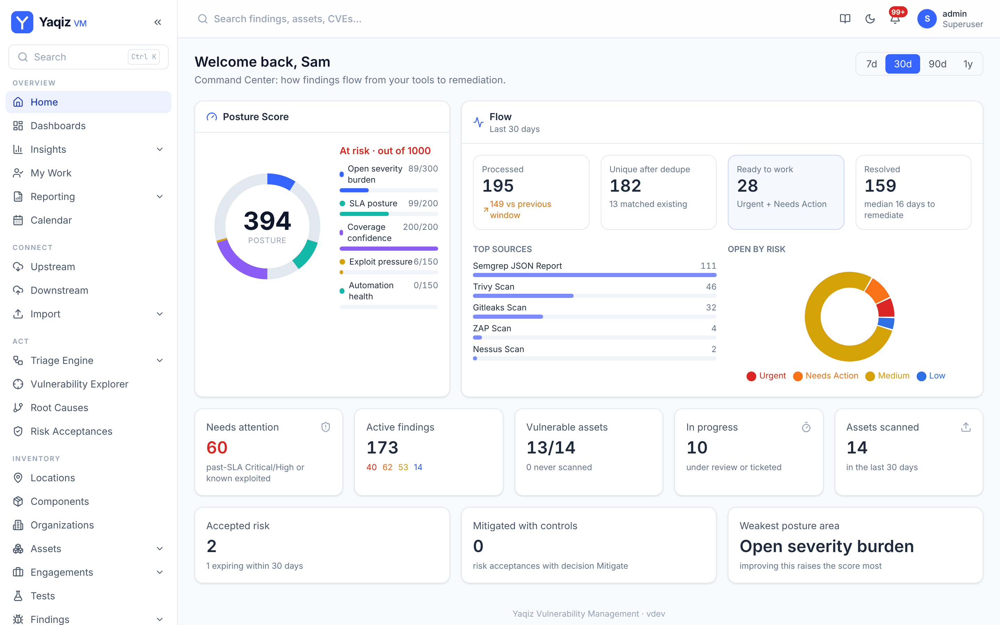

# Yaqiz user guide

A walkthrough of Yaqiz for the people who use it every day: security analysts, asset owners, team leads and
administrators. It follows the path a finding takes, from the scanner report to the fix, and shows each screen you
use along the way.

Written for **Yaqiz 1.1.7**. Installing, upgrading and operating the server (TLS, directory sign-in, single sign-on,
email, backups) is covered by the installation guide, `docs/on-prem-installation.md` in the release package, and
summarized in the [main README](../../README.md).



## How Yaqiz works

```
  Scanners and reports            Yaqiz                                             Your teams
 ──────────────────────  ┌──────────────────────────────────────────────────┐  ─────────────────────
  Nessus, ZAP, Trivy,  ──▶  Import      deduplicate, enrich (EPSS, KEV),   ──▶  My Work, findings lists
  Semgrep, … 97 types     │  Connectors  prioritize by business context,   │    Jira and other trackers
  Excel / Word / CSV   ──▶  CI/CD API   set SLA due dates                   ──▶  email, Slack, Teams
  pentest reports         │             Triage Engine rules act on them     │    dashboards and reports
                          └──────────────────────────────────────────────────┘
```

1. **Bring findings in** from scanner reports, spreadsheets and Word reports, API connectors and CI/CD pipelines.
2. Yaqiz **deduplicates** them, so a finding reported by several tools or scans is tracked once, and **enriches** them
   with exploit data (EPSS probability, CISA known exploited vulnerabilities).
3. Each finding gets a **priority** from its severity, exploitability and the business context of its asset, and an
   **SLA due date**.
4. Analysts **triage** the findings: confirm, assign, accept the risk or mark false positives. **Rules** in the Triage
   Engine do the routine part automatically: assign owners, open tickets, notify people.
5. **Dashboards, insights and scheduled reports** show the posture, the trends and who needs to act.

## Chapters

| Chapter | What you learn | For |
|---|---|---|
| [1. First steps](01-first-steps.md) | Sign in, two-step verification, the layout, Home and My Work, why menus differ between users | Everyone |
| [2. Inventory](02-inventory.md) | Organizations, assets, the hierarchy and change plans, engagements and tests, members and roles | Everyone; asset owners |
| [3. Bringing in findings](03-bringing-in-findings.md) | Importing scanner reports, Excel / Word / CSV findings, the Universal Parser, connectors, CI/CD | Analysts, DevOps |
| [4. Working with findings](04-working-with-findings.md) | Finding lists and filters, the finding page, statuses, risk acceptances, groups, the Vulnerability Explorer | Analysts, asset owners |
| [5. Automation and integrations](05-automation.md) | Triage Engine rules, runs and deliveries, webhook receivers, Jira and other integrations | Analysts, team leads |
| [6. Dashboards and reports](06-dashboards-and-reports.md) | Home, dashboards, insights, reports and schedules, the calendar | Team leads, managers |
| [7. Administration](07-administration.md) | Users, groups and roles, sign-in, SLAs and prioritization, notifications, license, System Status, audit log | Administrators |

New to Yaqiz? Read chapters 1 to 4 in order: after them you can import your first report and work through its
findings. Administrators setting up a new installation start with [chapter 7](07-administration.md), section
"Your first week".

## Conventions

* Menu paths use **›**: **Connect › Import › Add Findings** means the **Import** entry in the **Connect** section of the
  sidebar, then **Add Findings**. Button and field names are in **bold**, exactly as on screen.
* What you see depends on your role and on the modules your administrator enabled. When a page or button described
  here is missing, check **Profile › Your permissions** or ask your administrator (chapter 1 explains why).
* Screenshots show sample data; the organizations, people and findings in them are fictional.
